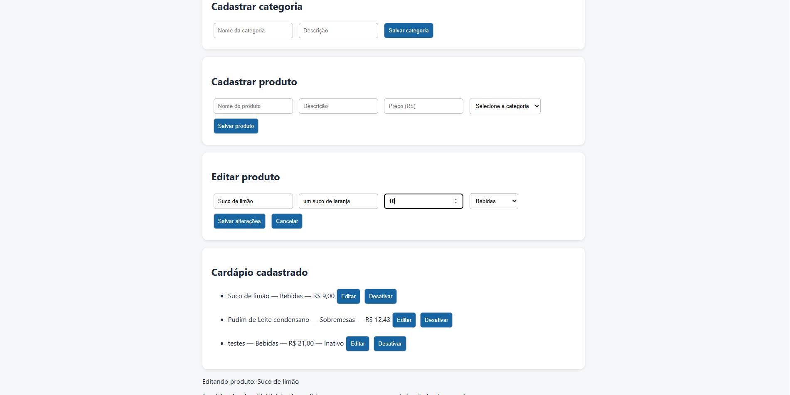
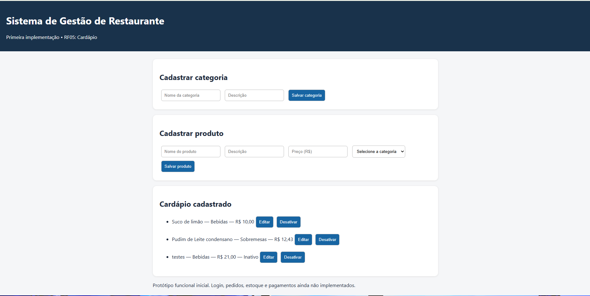
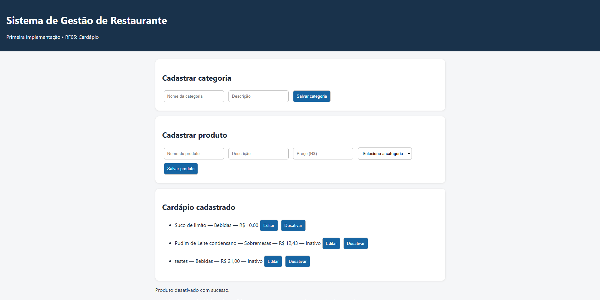
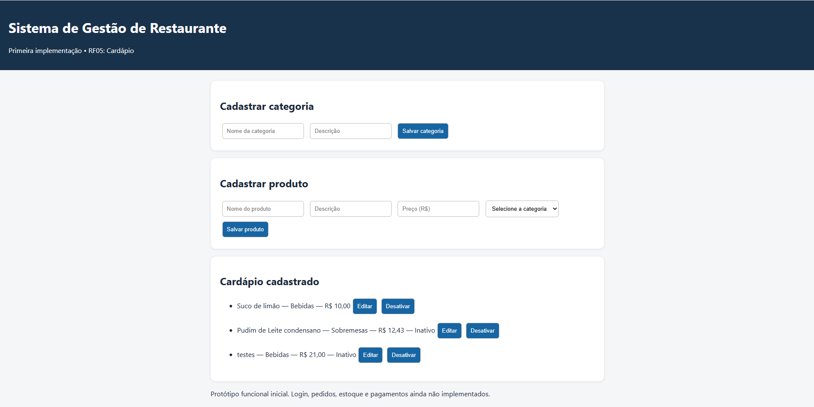

# Testes e Evidências — Segunda Entrega (06/11/2026)

## 1. Identificação

- **Projeto:** Sistema de Gestão de Restaurante
- **Entrega:** Segundo bimestre — 06/11/2026
- **Requisito avaliado:** RF05 — Gerenciamento do Cardápio
- **Branch:** `entrega-06-11-2026`
- **Commit de referência da implementação:** `c952fef`

## 2. Objetivo

Verificar as funcionalidades de edição e desativação lógica de produtos implementadas na segunda entrega, confirmando seu funcionamento pela interface web e a persistência das alterações no banco de dados.

## 3. Ambiente de testes

- Java 17
- Spring Boot 3.3.5
- Maven
- MySQL
- H2 para testes automatizados
- Navegador web
- Sistema executado localmente em `http://localhost:8080`

## 4. Testes executados

### CT06 — Edição de produto

**Objetivo:** verificar se um produto cadastrado pode ter suas informações atualizadas.

**Pré-condições:**
- Aplicação iniciada.
- Banco de dados disponível.
- Existência de pelo menos um produto ativo.

**Procedimento:**
1. Acessar o cardápio.
2. Selecionar um produto ativo.
3. Clicar em **Editar**.
4. Alterar o preço para um valor válido.
5. Salvar a alteração.
6. Atualizar a página utilizando `F5`.
7. Consultar novamente o produto.

**Resultado esperado:** o produto deve apresentar o novo preço, inclusive após a atualização da página.

**Resultado observado:** o preço foi atualizado e permaneceu com o novo valor após recarregar a página.

**Situação:** Aprovado no fluxo manual avaliado.

**Evidências:**





### CT07 — Desativação lógica de produto

**Objetivo:** verificar se um produto pode ser desativado sem que seu registro seja removido fisicamente.

**Pré-condições:**
- Aplicação iniciada.
- Banco de dados disponível.
- Existência de pelo menos um produto ativo destinado aos testes.

**Procedimento:**
1. Acessar o cardápio.
2. Selecionar um produto ativo.
3. Clicar em **Desativar**.
4. Confirmar a operação, caso solicitado.
5. Verificar se o produto continua listado como inativo.
6. Atualizar a página utilizando `F5`.
7. Verificar novamente a situação do produto.

**Resultado esperado:** o produto deve continuar listado como inativo, com as ações de edição e desativação indisponíveis.

**Resultado observado:** o produto permaneceu visível e identificado como inativo após a atualização da página.

**Situação:** Aprovado no fluxo manual de desativação lógica avaliado.

**Observação:** a operação utiliza o método HTTP `DELETE`, mas não exclui fisicamente o produto. O atributo `ativo` é alterado para `false`. Portanto, este teste não comprova uma exclusão física.

**Evidências:**





## 5. Testes automatizados

A aplicação foi compilada utilizando:

```powershell
mvn clean package
```

**Resultado registrado:**
- Testes executados: 2
- Falhas: 0
- Erros: 0
- Compilação: concluída com sucesso

Os dois testes automatizados existentes foram aprovados. Isso não significa que todas as funcionalidades do sistema estejam cobertas por testes automatizados.

## 6. Comparação com a entrega anterior

| Caso | Situação em 20/10/2026 | Situação em 06/11/2026 |
|---|---|---|
| CT06 — Edição | Bloqueado | Aprovado no teste manual |
| CT07 — Exclusão | Bloqueado | Fluxo de desativação lógica aprovado; exclusão física não implementada |

Os resultados da entrega anterior são preservados como registro histórico.

## 7. Conclusão

Os testes manuais realizados demonstraram o funcionamento da edição de produtos e da desativação lógica no RF05.

Também foi observada a persistência das alterações após o recarregamento da interface.

A implementação representa uma evolução em relação à entrega de 20/10/2026, mas não corresponde à conclusão integral do sistema ou de todos os requisitos funcionais previstos.