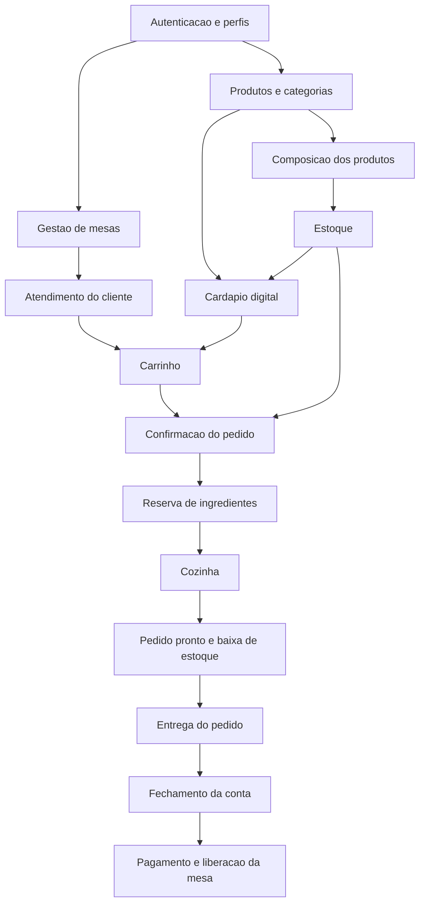

# Backlog e Planejamento — Sistema de Gestão de Restaurante

**Disciplina:** IMERSÃO PROFISSIONAL: PROJETO DE SOFTWARE — 2º bimestre de 2026\
**Professora:** Sabine Cassol\
**Entrega de referência:** 27/11/2026\
**Responsável pela organização do backlog:** Matheusborgges\
**Equipe:** guilhermemgb, Matheusborgges, MateusPresner e JoaoVitorPresner\
**Repositório:** https://github.com/JoaoVitorPresner/Sistema-de-Gestao-de-Restaurante\
**Branch:** `entrega-27-11-2026`\
**Versão:** consolidação final para revisão da equipe.

---

## 1. Objetivo e escopo

Este documento consolida o planejamento, as atividades executadas, os resultados obtidos e as pendências do Sistema de Gestão de Restaurante durante o segundo bimestre de 2026.

O planejamento considera a continuidade dos requisitos, modelos e protótipos elaborados no primeiro bimestre.

As entregas intermediárias priorizaram inicialmente o RF05 — Cardápio. A entrega final ampliou a implementação para os principais fluxos administrativos e operacionais do restaurante.

O backlog registra tanto as funcionalidades concluídas quanto as diferenças existentes entre os requisitos originais e a implementação final.

A conclusão das atividades de desenvolvimento não implica automaticamente a conclusão de todos os requisitos, da revisão acadêmica ou da publicação no GitHub.

## 2. Objetivos da entrega final

- Consolidar a implementação iniciada em 20/10.
- Ampliar as funcionalidades apresentadas em 06/11.
- Integrar os principais módulos do sistema.
- Implementar os fluxos de atendimento, pedidos, cozinha, estoque e pagamentos.
- Disponibilizar autenticação e controle de acesso.
- Validar as regras de negócio.
- Executar testes automatizados e manuais.
- Verificar os requisitos não funcionais.
- Preparar a documentação técnica.
- Organizar os relatórios e evidências.
- Preparar o repositório para a publicação final.
- Preparar a demonstração acadêmica.

## 3. Evolução do projeto

### 3.1 Primeiro bimestre

| Data | Marco | Escopo |
|---|---|---|
| 14/08/2026 | Visão e requisitos | Problema, objetivos, escopo e requisitos |
| 08/09/2026 | Modelagem | Diagramas, banco de dados e rastreabilidade |
| 25/09/2026 | Arquitetura e MVP | Tecnologias, protótipos e planejamento |

Os artefatos do primeiro bimestre permanecem como referência para a implementação.

### 3.2 Segundo bimestre

| Data | Marco | Resultado |
|---|---|---|
| 20/10/2026 | Primeira entrega | Implementação inicial do RF05, cadastro, consulta e persistência |
| 06/11/2026 | Segunda entrega | Edição e desativação lógica de produtos, testes e evidências |
| 27/11/2026 | Entrega final | Ampliação dos módulos, integração, testes finais e consolidação documental |

### 3.3 Histórico de versionamento

| Commit | Descrição |
|---|---|
| d45857a | Implementação inicial do RF05 |
| e5cfcaa | Documentação técnica da primeira entrega |
| c952fef | Edição e desativação lógica de produtos |
| e2f8c3f | Atualização do README e evidências de 06/11 |
| 760cea1 | Documentação técnica e backlog de 06/11 |

A branch `entrega-27-11-2026` foi criada a partir da evolução registrada na branch `entrega-06-11-2026`.

As alterações finais estão sendo preparadas localmente.

Os commits definitivos da entrega de 27/11 e a integração à branch principal ainda dependem da conclusão da revisão e da autorização para publicação.

## 4. Equipe e responsabilidades

| Integrante | Responsabilidade principal |
|---|---|
| guilhermemgb | Documentação técnica, requisitos, arquitetura e rastreabilidade |
| Matheusborgges | Backlog, planejamento, priorização e acompanhamento |
| MateusPresner | Testes, evidências e registro de defeitos |
| JoaoVitorPresner | README, GitHub, integração e implementação inicial do RF05 |

As responsabilidades representam as áreas de trabalho definidas pela equipe.

A atribuição de responsabilidade por uma área não significa que todas as atividades tenham sido executadas individualmente pelo integrante indicado.

A autoria individual das implementações posteriores ao RF05 deve ser confirmada pela equipe quando necessário.

## 5. Critérios de priorização e acompanhamento

### 5.1 Prioridades

| Prioridade | Definição |
|---|---|
| Alta | Funcionalidade ou atividade essencial para os fluxos principais, execução, segurança, testes ou entrega |
| Média | Funcionalidade complementar ou melhoria relevante |
| A definir | Atividade futura que depende de decisão, revisão de escopo ou distribuição pela equipe |

### 5.2 Estados das atividades

| Estado | Definição |
|---|---|
| Concluída | Atividade executada com resultado registrado |
| Concluída localmente | Implementação ou documento disponível no ambiente local, ainda sem publicação final |
| Parcialmente concluída | Parte dos critérios foi atendida |
| Em andamento | Atividade iniciada, mas ainda não encerrada |
| A fazer | Atividade sem execução confirmada |
| Pendente de validação | Necessita revisão ou aprovação complementar |
| Aguardando autorização | Execução depende de autorização explícita da equipe |
| Não implementada | Funcionalidade prevista que não integra a versão atual |

## 6. Histórico das tarefas anteriores

Os identificadores T01 a T16 foram preservados dos backlogs de 20/10 e 06/11.

| ID | Tarefa | Responsabilidade | Situação em 27/11 |
|---|---|---|---|
| T01 | Estrutura inicial de categorias e produtos | JoaoVitorPresner | Concluída |
| T02 | Cadastro, consulta e persistência | JoaoVitorPresner | Concluída |
| T03 | Testes automatizados iniciais | Execução e registro de testes | Concluída |
| T04 | Documentação técnica | Guilherme20028 | Documentação final criada; revisão pendente |
| T05 | Backlog e planejamento | Matheusborgges | Consolidação final em andamento |
| T06 | Testes manuais e evidências | MateusPresner | Resultados e evidências organizados; revisão pendente |
| T07 | Atualização do README | JoaoVitorPresner | Versões anteriores concluídas; atualização final pendente |
| T08 | Revisão do repositório e integração | JoaoVitorPresner | Publicação final pendente |
| T09 | Roteiro de demonstração | Equipe inteira | Ensaio conjunto não confirmado |
| T10 | Edição de categorias e produtos | Desenvolvimento e integração | Concluída localmente |
| T11 | Exclusão de categorias e produtos | Desenvolvimento e integração | Implementada como desativação lógica |
| T12 | Testes de entradas inválidas | Testes e desenvolvimento | Concluída para os cenários executados |
| T13 | Integração entre interface, API e banco | Testes e integração | Concluída para os fluxos verificados |
| T14 | Revisão e priorização dos requisitos restantes | Guilherme20028 / Matheusborgges | Requisitos revisados e rastreabilidade elaborada |
| T15 | Atualização dos documentos e README | Equipe conforme responsabilidades | Parcialmente concluída |
| T16 | Preparação da demonstração de 06/11 | Equipe inteira | Realização do ensaio não confirmada |

As situações históricas originais permanecem registradas nos documentos das respectivas entregas.

## 7. Backlog dos requisitos funcionais

A tabela mantém os identificadores e as prioridades definidos no primeiro bimestre.

| ID | Requisito resumido | Prioridade original | Situação final | Critério ou resultado |
|---|---|---|---|---|
| RF01 | Cadastro de usuários internos e perfis | Alta | Atendido | Cadastro e administração de funcionários |
| RF02 | Autenticação por login e senha | Alta | Atendido | Login de funcionários validado |
| RF03 | Controle de acesso por perfil | Alta | Atendido | Permissões aplicadas no backend e frontend |
| RF04 | Cadastro, consulta, alteração e exclusão de clientes | Média | Não atendido | A versão atual utiliza identificação pela mesa |
| RF05 | Gestão de produtos e categorias | Alta | Atendido com ressalva | Cadastro, consulta, edição, desativação e reativação |
| RF06 | Gestão de ingredientes e estoque | Alta | Atendido | Cadastro, edição e controle de ingredientes |
| RF07 | Associação de ingredientes aos produtos | Alta | Atendido | Composição com quantidades cadastradas |
| RF08 | Pedidos vinculados às mesas | Alta | Atendido | Pedidos associados ao atendimento |
| RF09 | Cardápio e pedidos do cliente | Alta | Atendido | Cardápio digital e confirmação pelo carrinho |
| RF10 | Acompanhamento e atualização dos pedidos | Alta | Atendido | Transições de status controladas |
| RF11 | Interface da cozinha | Alta | Atendido | Fila, início e conclusão do preparo |
| RF12 | Verificação da disponibilidade dos ingredientes | Alta | Atendido | Validação antes da confirmação |
| RF13 | Reserva e liberação de ingredientes | Alta | Atendido | Reservas e cancelamentos antes do preparo |
| RF14 | Baixa de ingredientes quando o pedido fica Pronto | Alta | Atendido | Consumo das reservas |
| RF15 | Registro e consulta de movimentações | Alta | Atendido | Entradas, saídas e histórico |
| RF16 | Identificação de estoque baixo | Média | Atendido | Indicadores de estoque mínimo |
| RF17 | Fechamento e cálculo de contas | Alta | Atendido | Cálculo automático e finalização |
| RF18 | Registro de pagamentos | Alta | Atendido | Múltiplas modalidades na mesma conta |
| RF19 | Descontos e estornos conforme permissões | Alta | Atendido | Validação de perfil e justificativas |
| RF20 | Comprovantes e relatórios de vendas | Média | Parcialmente atendido | Histórico e consultas por período; comprovantes não comprovados |
| RF21 | Auditoria de alterações relevantes | Média | Parcialmente atendido | Registros de estoque, cancelamentos e estornos |

### 7.1 Consolidação dos requisitos funcionais

| Classificação | Quantidade |
|---|---:|
| Atendidos sem ressalva específica de escopo | 17 |
| Atendidos com ressalva | 1 |
| Parcialmente atendidos | 2 |
| Não atendidos | 1 |
| Total | 21 |

A classificação considera as funcionalidades implementadas e os cenários verificados.

Não representa uma garantia de ausência de defeitos.

### 7.2 Requisitos com pendências de escopo

**RF04 — Clientes**

O cadastro individual de clientes não foi implementado.

O acesso pela identificação da mesa atende ao fluxo de pedidos do cliente, mas não substitui as operações de cadastro individual previstas no RF04.

**RF05 — Cardápio**

A exclusão de produtos e categorias foi implementada como desativação lógica.

A aceitação desse comportamento como atendimento integral ao requisito original deve ser confirmada academicamente.

**RF20 — Vendas e relatórios**

Existem consultas de vendas, indicadores e histórico de contas.

A emissão de comprovantes não fiscais não foi comprovada.

**RF21 — Auditoria**

Existem registros de movimentações de estoque, cancelamentos e estornos.

O histórico integral de todas as alterações relevantes e transições de status ainda não foi implementado.

## 8. Backlog dos requisitos não funcionais

| ID | Requisito | Situação | Resultado ou pendência |
|---|---|---|---|
| RNF01 | Armazenamento seguro de senhas | Validado nos cenários executados | BCrypt |
| RNF02 | Expiração após 15 minutos de inatividade | Validado | Teste manual de expiração aprovado |
| RNF03 | Restrição por perfil | Validado nos cenários executados | Testes de autenticação e autorização |
| RNF04 | Restrição de acesso aos dados dos clientes | Validado com ressalva | Isolamento por atendimento; identificação inicial pela mesa |
| RNF05 | Interfaces claras e intuitivas | Avaliado manualmente | Fluxos operacionais verificados |
| RNF06 | Mensagens claras | Avaliado manualmente | Mensagens de erro e confirmação verificadas |
| RNF07 | Resposta em até 3 segundos | Validado nas operações medidas | 55 medições locais aprovadas |
| RNF08 | Compatibilidade com navegadores | Parcialmente validado | Chrome e Edge; Firefox e Safari pendentes |
| RNF09 | Responsividade a partir de 360 pixels | Validado em dimensões simuladas | 12 interfaces verificadas |
| RNF10 | Backup periódico | Implementado e testado localmente | Geração, tarefa agendada e restauração |
| RNF11 | Interface da cozinha adequada a tablets e monitores | Validado em dimensões simuladas | Testes em diferentes resoluções |

### 8.1 Pendências de validação

- Testar Firefox e Safari.
- Ampliar testes em dispositivos físicos.
- Realizar testes de desempenho sob carga concorrente.
- Medir operações de escrita e condições de rede externa.
- Validar o backup no horário diário programado.
- Validar a política de retenção após o período configurado.
- Ampliar os testes de segurança e concorrência.

## 9. Backlog técnico da entrega final

Os identificadores T17 em diante foram definidos nesta consolidação para registrar as atividades desenvolvidas até 27/11.

Eles representam uma organização retrospectiva das atividades, não um cronograma intermediário previamente aprovado.

O marco de referência é 27/11/2026.

### 9.1 Implementação funcional

| ID | Atividade | Requisitos relacionados | Prioridade | Situação | Critério de conclusão |
|---|---|---|---|---|---|
| T17 | Estruturar autenticação de funcionários | RF02 | Alta | Concluída localmente | Login válido e rejeição de credenciais inválidas |
| T18 | Implementar autorização por perfil | RF03 | Alta | Concluída localmente | Recursos restritos aos perfis autorizados |
| T19 | Implementar dashboard | RF03 | Alta | Concluída localmente | Módulos apresentados conforme o perfil |
| T20 | Consolidar gestão de categorias e produtos | RF05 | Alta | Concluída com ressalva | Operações cadastrais e desativação lógica |
| T21 | Implementar gestão de mesas | RF08, RF09 | Alta | Concluída localmente | Cadastro, estados e atendimento |
| T22 | Implementar acesso do cliente | RF09 | Alta | Concluída localmente | Identificação e validação do atendimento |
| T23 | Implementar cardápio digital | RF09 | Alta | Concluída localmente | Produtos ativos e disponibilidade |
| T24 | Implementar carrinho | RF09 | Alta | Concluída localmente | Quantidades, subtotais e confirmação |
| T25 | Implementar registro de pedidos | RF08, RF09 | Alta | Concluída localmente | Pedido persistido e associado ao atendimento |
| T26 | Implementar acompanhamento de pedidos | RF10 | Alta | Concluída localmente | Consulta de estados e informações |
| T27 | Implementar interface da cozinha | RF11 | Alta | Concluída localmente | Início e conclusão do preparo |
| T28 | Implementar entrega de pedidos | RF10 | Alta | Concluída localmente | Transição válida de Pronto para Entregue |
| T29 | Implementar cancelamento de pedidos | RF10 | Alta | Concluída localmente | Permissão, justificativa e tratamento do estoque |
| T30 | Implementar cadastro de ingredientes | RF06 | Alta | Concluída localmente | Cadastro, edição e estados dos ingredientes |
| T31 | Implementar composição de produtos | RF07 | Alta | Concluída localmente | Ingredientes e quantidades por produto |
| T32 | Implementar verificação de disponibilidade | RF12 | Alta | Concluída localmente | Rejeição de pedidos sem saldo suficiente |
| T33 | Implementar reserva de ingredientes | RF13 | Alta | Concluída localmente | Reserva durante confirmação |
| T34 | Implementar liberação de reservas | RF13 | Alta | Concluída localmente | Cancelamento anterior ao preparo |
| T35 | Implementar consumo de reservas | RF14 | Alta | Concluída localmente | Baixa no estado Pronto |
| T36 | Implementar movimentações de estoque | RF15 | Alta | Concluída localmente | Entradas, saídas e histórico |
| T37 | Implementar indicadores de estoque baixo | RF16 | Média | Concluída localmente | Identificação do saldo mínimo |
| T38 | Implementar cálculo e fechamento de contas | RF17 | Alta | Concluída localmente | Total correto e liberação da mesa |
| T39 | Implementar múltiplos pagamentos | RF18 | Alta | Concluída localmente | Soma correspondente ao valor devido |
| T40 | Implementar descontos | RF19 | Alta | Concluída localmente | Validação percentual e de permissões |
| T41 | Implementar estornos | RF19 | Alta | Concluída localmente | Justificativa e preservação do histórico |
| T42 | Implementar histórico de vendas | RF20 | Média | Parcialmente concluída | Consultas e filtros disponíveis; comprovantes pendentes |
| T43 | Implementar registros de auditoria | RF21 | Média | Parcialmente concluída | Registros específicos disponíveis |
| T44 | Implementar administração de usuários | RF01 | Alta | Concluída localmente | Cadastro, edição, senha, ativação e bloqueio |

As atividades de implementação foram organizadas por funcionalidade.

A atribuição individual de autoria das novas implementações não é presumida neste documento.

### 9.2 Segurança e requisitos não funcionais

| ID | Atividade | Prioridade | Situação | Critério de conclusão |
|---|---|---|---|---|
| T45 | Armazenar senhas utilizando BCrypt | Alta | Concluída localmente | Senhas não armazenadas em texto puro |
| T46 | Implementar proteção CSRF | Alta | Concluída localmente | Operações protegidas por token |
| T47 | Implementar bloqueio por tentativas inválidas | Alta | Concluída localmente | Bloqueio após cinco falhas consecutivas |
| T48 | Configurar expiração das sessões | Alta | Concluída localmente | Expiração após 15 minutos de inatividade |
| T49 | Implementar invalidação de sessões | Alta | Concluída localmente | Sessões anteriores invalidadas após alterações relevantes |
| T50 | Isolar atendimentos das mesas | Alta | Concluída localmente | Validação do identificador de atendimento |
| T51 | Revisar responsividade | Alta | Concluída para dimensões testadas | Interfaces avaliadas a partir de 360 pixels |
| T52 | Avaliar compatibilidade | Alta | Parcialmente concluída | Chrome e Edge aprovados |
| T53 | Avaliar desempenho | Alta | Concluída para operações medidas | 55 medições inferiores a três segundos |
| T54 | Desenvolver script de backup | Alta | Concluída localmente | Geração de arquivo SQL válido |
| T55 | Configurar tarefa agendada | Alta | Concluída localmente | Tarefa registrada e execução manual aprovada |
| T56 | Testar restauração do banco | Alta | Concluída localmente | 12 tabelas restauradas com contagens correspondentes |

### 9.3 Qualidade, documentação e integração

| ID | Atividade | Responsabilidade | Prioridade | Situação |
|---|---|---|---|---|
| T57 | Executar testes automatizados Java | Testes e desenvolvimento | Alta | Concluída |
| T58 | Executar testes isolados JavaScript | Testes e desenvolvimento | Alta | Concluída |
| T59 | Executar verificações manuais | Testes e equipe | Alta | Concluída para os cenários executados |
| T60 | Revisar estrutura e sintaxe dos arquivos | Integração | Alta | Concluída para os padrões verificados |
| T61 | Executar compilação final | Integração | Alta | Concluída |
| T62 | Validar execução com MySQL | Testes e integração | Alta | Concluída |
| T63 | Criar estrutura da entrega final | Integração | Alta | Concluída localmente |
| T64 | Organizar capturas e relatórios | MateusPresner / integração | Alta | Concluída localmente |
| T65 | Elaborar documentação técnica final | guilhermemgb | Alta | Criado; revisão estrutural realizada |
| T66 | Consolidar backlog final | Matheusborgges | Alta | Criado; revisão estrutural realizada |
| T67 | Elaborar documento final de testes | MateusPresner | Alta | Criado; revisão estrutural realizada |
| T68 | Atualizar README final | JoaoVitorPresner | Alta | Atualizado e verificado |
| T69 | Revisar documentos e evidências | Equipe inteira | Alta | Revisão estrutural e conferência visual concluídas; revisão individual pendente |
| T70 | Revisar arquivos destinados ao GitHub | JoaoVitorPresner | Alta | Concluído; arquivos, credenciais de teste e capturas conferidos |
| T71 | Preparar comandos de versionamento | JoaoVitorPresner | Alta | Divisão validada; pacotes aprovados; branch sincronizada; comandos finais em preparação |
| T72 | Executar commits finais | guilhermemgb / MateusPresner | Alta | Aguardando autorização |
| T73 | Enviar alterações ao GitHub | guilhermemgb / MateusPresner | Alta | Aguardando autorização |
| T74 | Criar ou revisar Pull Request | JoaoVitorPresner | Alta | Aguardando autorização |
| T75 | Confirmar acesso ao material entregue | Equipe inteira | Alta | Pendente de validação |
| T76 | Preparar e ensaiar apresentação final | Equipe inteira | Alta | Ensaio não confirmado |

## 10. Dependências entre funcionalidades

A implementação dos módulos considera dependências operacionais e técnicas.

| Funcionalidade | Dependências principais |
|---|---|
| Autenticação | Usuários e configuração de segurança |
| Dashboard | Autenticação e perfis |
| Cardápio digital | Categorias, produtos e disponibilidade |
| Carrinho | Cardápio e atendimento ativo |
| Confirmação de pedidos | Mesa, produtos, composição e estoque |
| Cozinha | Pedidos confirmados |
| Cancelamento | Pedido ativo, permissões e reservas |
| Estoque | Ingredientes, composição e movimentações |
| Fechamento de contas | Atendimento, pedidos concluídos e pagamentos |
| Estorno | Conta finalizada e usuário autorizado |
| Backup | MySQL, utilitários de backup e configuração local |
| Publicação final | Compilação, testes, documentação e revisão |

### 10.1 Fluxo integrado

O fluxo representa o caminho principal de um atendimento bem-sucedido.

Cancelamentos, conflitos, estornos e demais situações excepcionais possuem tratamentos específicos.

## 11. Testes e validações

### 11.1 Resultados consolidados

| Categoria | Executadas | Aprovadas |
|---|---:|---:|
| Testes automatizados Java | 307 | 307 |
| Testes isolados JavaScript | 35 | 35 |
| Verificações manuais acumuladas | 639 | 639 |
| Medições de desempenho | 55 | 55 |
| Total | 1.036 | 1.036 |

O total reúne verificações de diferentes naturezas realizadas durante o desenvolvimento.

Não representa necessariamente cenários independentes ou cobertura integral do código.

### 11.2 Compilação final

| Indicador | Resultado |
|---|---|
| Comando | mvn clean package |
| Data | 27/11/2026 |
| Horário de conclusão | 14:42:21 |
| Testes Java | 307 |
| Falhas | 0 |
| Erros | 0 |
| Ignorados | 0 |
| Resultado | BUILD SUCCESS |
| Arquivo gerado | restaurante-0.1.0.jar |

### 11.3 Verificações complementares

| Atividade | Resultado |
|---|---|
| Sintaxe JavaScript | 14 arquivos aprovados |
| Referências locais HTML | 78 referências válidas |
| Identificadores HTML duplicados | Nenhum encontrado nas 12 páginas |
| Inicialização final com MySQL | Aprovada |
| Backup local | Dois arquivos gerados com sucesso |
| Restauração | 12 tabelas com contagens correspondentes |
| Compatibilidade | Dez verificações aprovadas em Chrome e Edge |
| Responsividade | 14 verificações aprovadas em dimensões simuladas |

As verificações estruturais e de restauração não foram adicionadas ao total de 1.036.

Os testes de compatibilidade e responsividade já integram as verificações manuais acumuladas.

### 11.4 Evidências organizadas

| Tipo | Quantidade |
|---|---:|
| Capturas PNG | 14 |
| Relatórios CSV | 3 |
| Total | 17 |

As evidências estão disponíveis em:

`2-Bimestre/Entrega-27-11/evidencias/`

Foram mantidas as capturas EV08 a EV21.

Os resultados dos testes automatizados e de desempenho estão registrados nos relatórios CSV.

As capturas técnicas complementares de testes e backup foram dispensadas na organização final das evidências.

## 12. Planejamento da entrega final

### 12.1 Etapas de preparação

| Etapa | Atividade | Situação |
|---|---|---|
| 135.1 | Planejamento da entrega | Concluída |
| 135.2 | Revisão e reforço da segurança | Concluída |
| 135.3 | Revisão dos requisitos não funcionais | Concluída com limitações documentadas |
| 135.4 | Revisão da integração e interfaces | Concluída |
| 135.5 | Compilação e testes finais | Concluída |
| 135.6 | Criação da estrutura de entrega | Concluída |
| 135.7 | Organização das evidências | Concluída |
| 135.8 | Documentação técnica | Arquivo criado e estrutura verificada |
| 135.9 | Backlog e planejamento | Documento elaborado |
| 135.10 | Documentação dos testes | A fazer |
| 135.11 | Atualização do README | A fazer |
| 135.12 | Revisão final dos arquivos | A fazer |
| 135.13 | Preparação dos comandos Git | A fazer |
| 135.14 | Commits e push | Aguardando autorização |
| 135.15 | Pull Request | Aguardando autorização |

### 12.2 Documentos da entrega final

| Documento | Responsabilidade | Situação |
|---|---|---|
| Documentacao-Tecnica-Entrega-27-11.md | guilhermemgb | Criado; revisão pendente |
| Backlog-e-Planejamento-27-11.md | Matheusborgges | Elaborado; revisão pendente |
| Testes-e-Evidencias-27-11.md | MateusPresner | A fazer |
| README.md | JoaoVitorPresner | Atualização final pendente |

### 12.3 Estratégia de publicação

A implementação permanece no diretório:

`2-Bimestre/Entrega-20-10/implementacao/`

Os documentos e evidências da entrega final permanecem em:

`2-Bimestre/Entrega-27-11/`

Não será criada uma cópia adicional do código-fonte para a entrega final.

Antes da publicação, deverão ser verificados:

- Código-fonte e configurações.
- Documentação e links internos.
- Relatórios e capturas.
- Ausência de credenciais reais.
- Ausência de backups contendo dados do banco.
- Ausência de arquivos gerados desnecessariamente.
- Branch de destino.
- Estado das alterações locais.

Os comandos de inclusão, commit e envio das alterações somente deverão ser executados após autorização.

## 13. Dependências e riscos

| Risco ou dependência | Consequência | Tratamento | Situação |
|---|---|---|---|
| Versão incompatível do Java | Falha na compilação ou execução | Padronização do Java 17 | Mitigado no ambiente testado |
| MySQL indisponível | Falha de conexão | Verificar serviço e configuração | Mitigado no ambiente testado |
| Credenciais expostas | Acesso indevido aos dados | Variáveis de ambiente e revisão de arquivos | Controles implementados; revisão final necessária |
| Exclusão lógica não aceita no RF05 | Atendimento parcial do requisito | Registrar decisão e confirmar aceitação | Pendente |
| Ausência do cadastro individual de clientes | RF04 não atendido | Registrar diferença de escopo | Documentado |
| Ausência de comprovantes | RF20 parcialmente atendido | Planejar emissão de comprovantes | Pendente |
| Auditoria incompleta | RF21 parcialmente atendido | Ampliar histórico de alterações | Pendente |
| Acesso inicial apenas pelo número da mesa | Identificação insuficiente do cliente | Evoluir para tokens ou QR Codes individuais | Pendente |
| Operações concorrentes | Possíveis inconsistências não identificadas | Ampliar testes em MySQL | Parcialmente mitigado |
| Compatibilidade limitada | Problemas em outros navegadores | Testar Firefox e Safari | Pendente |
| Backup dependente do ambiente local | Possível falha na execução agendada | Verificar disponibilidade e monitorar resultados | Parcialmente mitigado |
| Backup armazenado somente localmente | Perda simultânea dos dados e das cópias | Adotar armazenamento externo | Pendente |
| Documentos sem revisão coletiva | Divergências na entrega | Revisão pelos responsáveis | Pendente |
| Alterações finais não publicadas | Material indisponível no GitHub | Executar versionamento após autorização | Aguardando autorização |
| Demonstração não ensaiada | Dificuldades durante a apresentação | Executar roteiro com a equipe | Pendente de confirmação |

## 14. Backlog de melhorias futuras

As atividades abaixo representam propostas de evolução.

Os identificadores F01 em diante foram definidos para separar melhorias futuras das tarefas da entrega atual.

As prioridades são propostas para revisão da equipe e não representam novos prazos acadêmicos.

| ID | Melhoria | Requisito relacionado | Prioridade proposta | Critério de aceitação |
|---|---|---|---|---|
| F01 | Implementar cadastro individual de clientes | RF04 | Média | CRUD completo e integrado |
| F02 | Confirmar política de exclusão lógica | RF05 | Alta | Decisão acadêmica registrada |
| F03 | Implementar comprovantes não fiscais | RF20 | Média | Comprovante gerado a partir da conta finalizada |
| F04 | Ampliar relatórios de vendas | RF20 | Média | Consultas consolidadas e exportação |
| F05 | Implementar auditoria integral | RF21 | Média | Histórico de alterações com data e responsável |
| F06 | Implementar identificação por token ou QR Code | RNF04 | Alta | Acesso limitado ao atendimento autorizado |
| F07 | Ampliar testes de concorrência | RF12 a RF19 | Alta | Operações simultâneas sem inconsistências nos cenários testados |
| F08 | Realizar testes de carga | RNF07 | Média | Resultados sob carga documentados |
| F09 | Validar Firefox e Safari | RNF08 | Média | Fluxos principais aprovados |
| F10 | Testar dispositivos físicos | RNF09, RNF11 | Média | Interfaces verificadas em dispositivos reais |
| F11 | Validar execução diária do backup | RNF10 | Alta | Execução automática no horário configurado |
| F12 | Validar política de retenção | RNF10 | Média | Remoção controlada de arquivos expirados |
| F13 | Implementar armazenamento externo de backups | RNF10 | Média | Cópias recuperáveis fora do computador local |
| F14 | Ampliar validação de restauração | RNF10 | Média | Comparação de valores e integridade dos dados |
| F15 | Configurar HTTPS e ambiente de produção | Segurança | Alta antes de implantação pública | Comunicação protegida e ambiente configurado |
| F16 | Utilizar conta de banco específica da aplicação | Segurança | Alta antes de implantação pública | Permissões adequadas ao funcionamento |
| F17 | Implementar migrações versionadas | Banco de dados | Média | Evolução reproduzível do esquema |
| F18 | Ampliar métricas de cobertura | Qualidade | Média | Relatório de cobertura disponível |
| F19 | Implementar recuperação administrativa | RF01, RF02 | Alta | Procedimento seguro para recuperar o acesso |
| F20 | Prevenir confirmações duplicadas de pedidos | RF08, RF09 | Alta | Repetição de requisição não gera pedido duplicado |
| F21 | Integrar serviços financeiros reais | RF18, RF19 | A definir | Integração validada com provedor financeiro |
| F22 | Configurar hospedagem | Implantação | A definir | Aplicação disponível no ambiente definido |

Os responsáveis e prazos dessas melhorias deverão ser definidos posteriormente pela equipe.

## 15. Planejamento da apresentação final

### 15.1 Preparação do ambiente

Antes da demonstração, recomenda-se:

- Confirmar a instalação do Java 17.
- Confirmar a disponibilidade do MySQL.
- Verificar as variáveis de ambiente.
- Confirmar a existência dos usuários de demonstração.
- Preparar categorias, produtos e ingredientes fictícios.
- Verificar a disponibilidade das mesas.
- Inicializar a aplicação.
- Conferir os relatórios e documentos.

### 15.2 Roteiro proposto

| Ordem | Demonstração | Objetivo |
|---|---|---|
| 1 | Apresentar o projeto | Contextualizar o problema e a solução |
| 2 | Realizar login administrativo | Demonstrar autenticação |
| 3 | Apresentar o dashboard | Demonstrar os módulos |
| 4 | Consultar produtos e composição | Demonstrar integração com estoque |
| 5 | Acessar uma mesa como cliente | Demonstrar atendimento |
| 6 | Adicionar produtos ao carrinho | Demonstrar o cardápio digital |
| 7 | Confirmar pedido | Demonstrar persistência e reserva |
| 8 | Iniciar preparo na cozinha | Demonstrar fluxo operacional |
| 9 | Marcar pedido como Pronto | Demonstrar baixa de estoque |
| 10 | Registrar entrega | Demonstrar conclusão do pedido |
| 11 | Finalizar conta | Demonstrar cálculo e pagamentos |
| 12 | Conferir mesa liberada | Demonstrar integração do atendimento |
| 13 | Apresentar histórico de movimentações | Demonstrar rastreabilidade |
| 14 | Apresentar testes e evidências | Demonstrar qualidade |
| 15 | Apresentar limitações | Demonstrar conhecimento do escopo |

O roteiro é uma proposta para a apresentação.

A realização de um ensaio conjunto e a distribuição das falas ainda precisam ser confirmadas pela equipe.

## 16. Critérios de conclusão da entrega

### 16.1 Desenvolvimento e validação

- [x] Implementação inicial preservada.
- [x] Gestão de categorias e produtos ampliada.
- [x] Autenticação de funcionários implementada.
- [x] Controle de acesso por perfil implementado.
- [x] Gestão de mesas implementada.
- [x] Cardápio digital e carrinho implementados.
- [x] Registro e acompanhamento de pedidos implementados.
- [x] Interface da cozinha implementada.
- [x] Gestão de estoque implementada.
- [x] Composição e reservas de ingredientes implementadas.
- [x] Fechamento de contas e pagamentos implementados.
- [x] Descontos e estornos implementados.
- [x] Administração de usuários implementada.
- [x] Expiração e invalidação de sessões implementadas.
- [x] Backup local implementado.
- [x] Restauração do banco testada.
- [x] Testes automatizados Java executados.
- [x] Compilação final concluída.
- [x] Arquivo executável validado com MySQL.
- [x] Limitações dos requisitos registradas.

### 16.2 Documentação e evidências

- [x] Estrutura da entrega final criada.
- [x] 14 capturas de tela organizadas.
- [x] Três relatórios CSV organizados.
- [x] Documentação técnica elaborada.
- [x] Backlog final elaborado.
- [ ] Documento final de testes elaborado.
- [ ] README atualizado para a versão final.
- [ ] Documentação revisada pelos responsáveis.
- [ ] Evidências revisadas pelo responsável.
- [ ] Links internos verificados.

### 16.3 Versionamento e apresentação

- [x] Branch da entrega final criada.
- [ ] Alterações finais revisadas.
- [ ] Comandos de versionamento preparados.
- [ ] Commits finais realizados.
- [ ] Alterações finais enviadas ao GitHub.
- [ ] Sincronização da branch final confirmada.
- [ ] Pull Request criado ou revisado.
- [ ] Situação da integração à branch principal confirmada.
- [ ] Acesso da professora ao material confirmado.
- [ ] Demonstração ensaiada pela equipe.

A publicação e a integração permanecem pendentes até autorização e execução efetiva.

## 17. Rotina de acompanhamento

1. Cada integrante verifica as atividades relacionadas à sua responsabilidade.
2. Matheusborgges consolida as situações e prioridades do backlog.
3. guilhermemgb revisa a documentação técnica e a rastreabilidade.
4. MateusPresner confere os resultados dos testes e as evidências.
5. JoaoVitorPresner revisa o README, a estrutura do repositório e a integração.
6. Divergências identificadas devem ser registradas e corrigidas quando necessário.
7. A equipe confirma as limitações que permanecerão na versão entregue.
8. A publicação ocorre após revisão e autorização.
9. O roteiro de apresentação é revisado em conjunto.

## 18. Referências internas

- Documentos de requisitos e modelagem do primeiro bimestre.
- [Backlog de 20/10](../../Entrega-20-10/documentacao/Backlog-e-Planejamento-20-10.md).
- [Backlog de 06/11](../../Entrega-06-11/documentacao/Backlog-e-Planejamento-06-11.md).
- [Documentação técnica de 27/11](Documentacao-Tecnica-Entrega-27-11.md).
- [Código-fonte da implementação](../../Entrega-20-10/implementacao/).
- [Relatório de testes automatizados](../evidencias/relatorios/Testes-Automatizados-Resumo.csv).
- [Relatório detalhado de desempenho](../evidencias/relatorios/Desempenho-Detalhado.csv).
- [Resumo de desempenho](../evidencias/relatorios/Desempenho-Resumo.csv).
- [Capturas de tela](../evidencias/capturas/).
- [README principal](../../../README.md).

## 19. Conclusão

O desenvolvimento realizado durante o segundo bimestre permitiu ampliar o Sistema de Gestão de Restaurante de uma implementação inicial concentrada no cardápio para uma aplicação integrada com os principais módulos operacionais e administrativos.

A versão final contempla autenticação, controle de acesso, gestão de mesas, cardápio digital, pedidos, cozinha, estoque, pagamentos e administração de usuários.

A compilação final foi concluída com sucesso, acompanhada de 307 testes automatizados Java aprovados.

Também foram registradas verificações manuais, testes isolados JavaScript, medições de desempenho e procedimentos de backup e restauração.

O backlog mantém a rastreabilidade dos requisitos originais e registra as funcionalidades que permanecem parcialmente atendidas ou não implementadas.

A preparação técnica local encontra-se em estágio avançado.

A conclusão formal da entrega ainda depende da finalização documental, da revisão pelos responsáveis, da publicação no GitHub e da preparação da apresentação.

---

**Nota de controle:** este documento registra a situação conhecida durante a preparação da entrega de 27/11/2026. Matheusborgges deve validar a organização do backlog e as prioridades propostas. Os demais integrantes devem revisar os resultados de suas respectivas áreas. Nenhuma atividade de publicação ou aprovação coletiva deve ser considerada concluída sem confirmação.

---

[Voltar ao README principal](../../../README.md)
