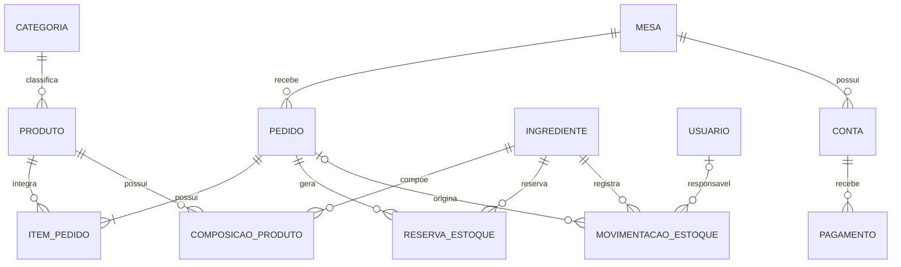
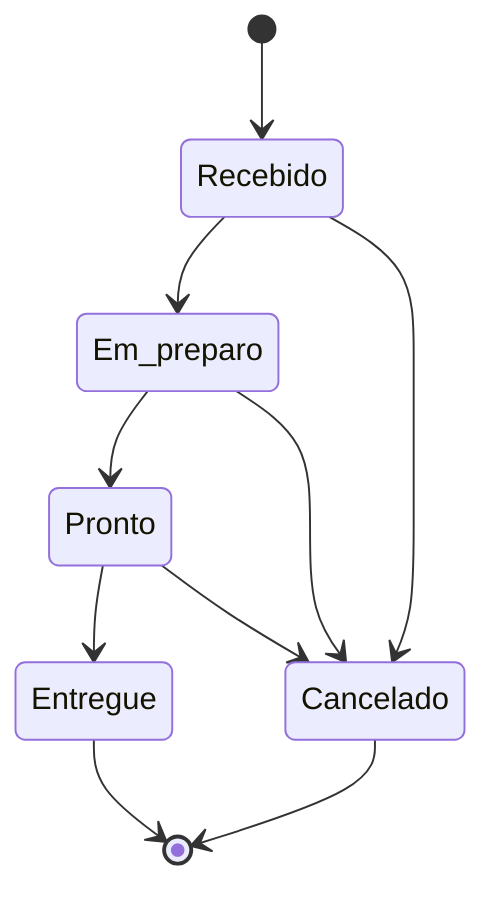

# Sistema de Gestão de Restaurante
## Documentação técnica — entrega final do 2º bimestre

**Disciplina:** IMERSÃO PROFISSIONAL: PROJETO DE SOFTWARE\
**Professora:** Sabine Cassol\
**Data de referência:** 27/11/2026\
**Responsável pela revisão técnica:** guilhermemgb\
**Equipe:** guilhermemgb, Matheusborgges, MateusPresner e JoaoVitorPresner\
**Repositório:** https://github.com/JoaoVitorPresner/Sistema-de-Gestao-de-Restaurante\
**Branch:** `entrega-27-11-2026`\
**Versão da aplicação:** 0.1.0\

> Este documento consolida a implementação desenvolvida até a entrega final do segundo bimestre, apresentando sua arquitetura, funcionalidades, requisitos, regras de negócio, procedimentos de execução, testes e limitações.

---

## 1. Introdução

O Sistema de Gestão de Restaurante é uma aplicação web desenvolvida para auxiliar restaurantes e lanchonetes na organização e integração de suas atividades operacionais e administrativas.

O projeto surgiu da necessidade de centralizar informações relacionadas ao atendimento, cardápio, pedidos, cozinha, estoque, vendas e pagamentos, reduzindo problemas decorrentes da fragmentação dos processos.

A aplicação disponibiliza interfaces específicas para diferentes perfis de acesso, permitindo que funcionários e clientes utilizem funcionalidades compatíveis com suas responsabilidades.

A entrega final representa a evolução da implementação inicial apresentada em 20/10/2026 e da atualização incremental realizada em 06/11/2026.

## 2. Objetivos

### 2.1 Objetivo geral

Desenvolver uma aplicação web integrada para apoiar a gestão das operações de um restaurante, permitindo organizar o atendimento, os pedidos, o estoque e o fechamento das vendas.

### 2.2 Objetivos específicos

- Centralizar as informações operacionais do estabelecimento.
- Disponibilizar um cardápio digital acessível aos clientes.
- Permitir o registro de pedidos vinculados às mesas.
- Facilitar a comunicação entre atendimento e cozinha.
- Controlar a disponibilidade e o consumo de ingredientes.
- Automatizar o cálculo dos valores das contas.
- Registrar pagamentos, descontos e estornos.
- Restringir funcionalidades conforme os perfis de acesso.
- Preservar os dados utilizando um banco de dados relacional.
- Disponibilizar mecanismos de backup e recuperação.
- Validar as funcionalidades por meio de testes automatizados e manuais.

## 3. Documentos de referência

Foram considerados os documentos produzidos durante o primeiro e o segundo bimestre.

### 3.1 Primeiro bimestre

- Visão geral do projeto.
- Definição do problema e dos objetivos.
- Requisitos funcionais.
- Requisitos não funcionais.
- Regras de negócio.
- Diagramas de casos de uso e atividades.
- Modelos conceitual e lógico do banco de dados.
- Dicionário de dados.
- Matriz de rastreabilidade.
- Arquitetura, protótipos e planejamento do MVP.

### 3.2 Segundo bimestre

- Documentação técnica da entrega de 20/10/2026.
- Documentação técnica da entrega de 06/11/2026.
- Backlogs e registros de planejamento anteriores.
- Documentos de testes e evidências.
- Código-fonte da implementação.

Os documentos anteriores permanecem como registros históricos da evolução do projeto.

Quando existem diferenças entre o planejamento original e a implementação final, estas são identificadas nas seções de rastreabilidade e limitações.

## 4. Escopo da entrega final

A versão final contempla os seguintes componentes:

| Componente | Situação |
|---|---|
| Autenticação de funcionários | Implementado |
| Identificação do cliente pela mesa | Implementado |
| Controle de acesso por perfil | Implementado |
| Dashboard administrativo | Implementado |
| Gestão de categorias e produtos | Implementado com exclusão lógica |
| Gestão de mesas | Implementado |
| Cardápio digital | Implementado |
| Carrinho de compras | Implementado |
| Registro e acompanhamento de pedidos | Implementado |
| Interface operacional da cozinha | Implementado |
| Cancelamento de pedidos | Implementado |
| Gestão de ingredientes | Implementado |
| Composição de produtos | Implementado |
| Reserva e consumo de estoque | Implementado |
| Histórico de movimentações | Implementado |
| Fechamento de contas | Implementado |
| Registro de pagamentos | Implementado |
| Descontos e estornos | Implementado |
| Administração de usuários | Implementado |
| Backup e recuperação | Implementado e testado localmente |
| Cadastro individual de clientes | Não implementado |
| Emissão de comprovantes não fiscais | Não comprovada |
| Relatórios de vendas | Consultas e histórico implementados |
| Auditoria integral de alterações | Parcialmente implementada |

A entrega contempla os principais fluxos operacionais do restaurante, mas não representa o atendimento integral de todos os requisitos originalmente planejados.

## 5. Tecnologias utilizadas

| Tecnologia | Aplicação no projeto |
|---|---|
| Java 17 | Linguagem de programação do backend |
| Spring Boot 3.3.5 | Estrutura principal da aplicação |
| Spring Web | Controllers e endpoints HTTP |
| Spring Data JPA | Acesso e persistência de dados |
| Hibernate | Mapeamento objeto-relacional |
| Spring Security | Autenticação e autorização |
| Jakarta Validation | Validação dos dados recebidos |
| BCrypt | Hash das senhas dos funcionários |
| MySQL 8.0 | Banco de dados da aplicação |
| H2 | Banco de dados utilizado nos testes automatizados |
| Maven | Gerenciamento de dependências, compilação e testes |
| JUnit | Execução de testes automatizados |
| Spring Boot Test | Testes da aplicação |
| MockMvc | Simulação de requisições HTTP nos testes |
| HTML5 | Estrutura das interfaces |
| CSS3 | Estilização e responsividade |
| JavaScript | Interatividade e comunicação com a API |
| Node.js | Verificação de sintaxe e testes isolados JavaScript |
| PowerShell | Automação de procedimentos e backup |
| Git | Controle de versão |
| GitHub | Hospedagem do repositório |
| Figma | Referência dos protótipos produzidos anteriormente |

A aplicação utiliza execução local, não possuindo hospedagem pública configurada nesta entrega.

## 6. Arquitetura da aplicação

A aplicação utiliza uma arquitetura web organizada em camadas, separando responsabilidades de apresentação, controle, regras de negócio e persistência.

### 6.1 Visão geral

```text
[Cliente / Funcionário]
          |
          v
[Navegador Web]
          |
          v
[HTML / CSS / JavaScript]
          |
          | HTTP / JSON
          v
[Spring Security]
          |
          v
[Controllers REST]
          |
          v
[Services / Regras de negócio]
          |
          v
[Repositories / Spring Data JPA]
          |
          v
[Hibernate]
          |
          v
[MySQL - banco restaurante]
```

Os DTOs auxiliam a comunicação entre as camadas e a representação dos dados recebidos e devolvidos pela API.

O tratamento centralizado de exceções permite devolver respostas HTTP adequadas para erros de validação, conflitos de negócio e recursos inexistentes.

As operações iniciais de categorias e produtos permanecem organizadas no `ApiController`, enquanto os módulos posteriores utilizam controllers e services específicos.

### 6.2 Camada de apresentação

Responsável pela interface utilizada pelos clientes e funcionários.

Suas responsabilidades incluem:

- Apresentação dos dados.
- Formulários de cadastro e edição.
- Filtros e indicadores.
- Comunicação com os endpoints REST.
- Exibição de mensagens de erro e confirmação.
- Atualização das informações apresentadas.
- Adaptação a diferentes tamanhos de tela.

### 6.3 Camada de controle

Os controllers recebem requisições HTTP, identificam os parâmetros enviados, aplicam validações e encaminham as operações para os componentes responsáveis.

### 6.4 Camada de serviço

Os services concentram as principais regras de negócio, incluindo:

- Validação de atendimentos.
- Transições de status dos pedidos.
- Reserva e consumo de ingredientes.
- Fechamento de contas.
- Aplicação de descontos.
- Estornos.
- Administração de usuários.
- Validação de permissões complementares.

### 6.5 Camada de persistência

Os repositories utilizam Spring Data JPA e Hibernate para consultar e modificar os registros do banco de dados.

Operações críticas utilizam transações e mecanismos de bloqueio para reduzir inconsistências durante alterações concorrentes.

A existência desses mecanismos não substitui testes específicos de concorrência em ambiente MySQL.

### 6.6 Fluxo de uma requisição

```text
Ação do usuário
       |
       v
Requisição HTTP
       |
       v
Autenticação e autorização
       |
       v
Controller
       |
       v
Validação dos dados
       |
       v
Service
       |
       v
Repository
       |
       v
Banco de dados
       |
       v
Resposta HTTP
       |
       v
Atualização da interface
```

## 7. Organização do projeto

O código-fonte permanece no diretório original da primeira entrega do segundo bimestre.

```text
Sistema-de-Gestao-de-Restaurante/
|
+-- README.md
|
+-- 1°Entrega/
|
+-- 2-Bimestre/
    |
    +-- Entrega-20-10/
    |   |
    |   +-- implementacao/
    |   |   |
    |   |   +-- pom.xml
    |   |   +-- scripts/
    |   |   |   +-- Backup-Restaurante.ps1
    |   |   |
    |   |   +-- src/
    |   |       +-- main/
    |   |       |   +-- java/br/com/restaurante/
    |   |       |   |   +-- config/
    |   |       |   |   +-- controller/
    |   |       |   |   +-- dto/
    |   |       |   |   +-- exception/
    |   |       |   |   +-- model/
    |   |       |   |   +-- repository/
    |   |       |   |   +-- security/
    |   |       |   |   +-- service/
    |   |       |   |
    |   |       |   +-- resources/
    |   |       |       +-- application.properties
    |   |       |       +-- static/
    |   |       |           +-- css/
    |   |       |           +-- js/
    |   |       |           +-- páginas HTML
    |   |       |
    |   |       +-- test/
    |   |
    |   +-- documentacao/
    |
    +-- Entrega-06-11/
    |   +-- documentacao/
    |   +-- evidencias/
    |
    +-- Entrega-27-11/
        +-- documentacao/
        +-- evidencias/
            +-- capturas/
            +-- relatorios/
```

A estrutura acima é uma representação resumida dos principais diretórios.

### 7.1 Quantidade de arquivos

| Categoria | Quantidade |
|---|---:|
| Java - backend | 92 |
| Java - testes | 17 |
| HTML | 12 |
| CSS | 12 |
| JavaScript | 14 |
| PowerShell | 1 |
| Total contabilizado | 148 |

O total não inclui todos os arquivos de configuração, documentação, evidências ou arquivos gerados pela compilação.

### 7.2 Principais interfaces

| Arquivo | Responsabilidade |
|---|---|
| index.html | Autenticação e identificação da mesa |
| dashboard.html | Painel de módulos dos funcionários |
| produtos.html | Gestão de categorias, produtos e composição |
| mesas.html | Gestão das mesas |
| cardapio.html | Cardápio digital |
| carrinho.html | Revisão e confirmação de pedidos |
| meus-pedidos.html | Acompanhamento dos pedidos do cliente |
| pedidos.html | Gestão operacional dos pedidos |
| cozinha.html | Fila de preparação |
| estoque.html | Gestão de ingredientes e movimentações |
| pagamentos.html | Gestão de contas e pagamentos |
| usuarios.html | Administração de funcionários |

## 8. Banco de dados

A aplicação utiliza o banco relacional MySQL, denominado `restaurante`.

O mapeamento das entidades é realizado por meio de JPA e Hibernate.

### 8.1 Tabelas implementadas

| Tabela | Finalidade |
|---|---|
| usuario | Funcionários, perfis e informações de autenticação |
| mesa | Identificação, capacidade e situação das mesas |
| categoria | Organização dos produtos do cardápio |
| produto | Produtos, preços e controle de disponibilidade |
| pedido | Registro dos pedidos vinculados ao atendimento |
| item_pedido | Produtos, quantidades e valores de cada pedido |
| ingrediente | Informações e saldos dos ingredientes |
| composicao_produto | Associação entre produtos e ingredientes |
| reserva_estoque | Controle das reservas de ingredientes por pedido |
| movimentacao_estoque | Histórico das alterações de estoque |
| conta | Registro das vendas finalizadas e estornadas |
| pagamento | Modalidades e valores dos pagamentos |

### 8.2 Principais relacionamentos

- Uma categoria pode possuir vários produtos.
- Uma mesa pode possuir vários pedidos ao longo de seus atendimentos.
- Um pedido possui um ou mais itens.
- Cada item de pedido está associado a um produto.
- Um produto pode possuir vários ingredientes em sua composição.
- Um ingrediente pode integrar a composição de vários produtos.
- Um pedido pode possuir várias reservas de estoque.
- Um ingrediente pode possuir várias movimentações.
- Uma mesa pode possuir várias contas ao longo do tempo.
- Uma conta pode possuir vários pagamentos.
- Usuários podem ser associados a operações administrativas registradas.

### 8.3 Representação simplificada



O diagrama apresenta os principais relacionamentos, não substituindo um modelo lógico completo com todos os atributos e restrições.

### 8.4 Integridade dos dados

A implementação utiliza mecanismos como:

- Chaves primárias.
- Chaves estrangeiras.
- Restrições de unicidade.
- Validação de campos obrigatórios.
- Validação de quantidades e valores.
- Transações.
- Controle de versão de entidades selecionadas.
- Bloqueios pessimistas em operações críticas.

A aplicação preserva informações históricas relevantes, incluindo o nome e o preço dos produtos no momento do pedido.

## 9. Perfis e permissões

O sistema possui cinco perfis de funcionários e um perfil de acesso destinado aos clientes.

### 9.1 Matriz de acesso aos módulos

| Módulo | Administrador | Gerente | Atendente | Cozinheiro | Estoquista | Cliente |
|---|---|---|---|---|---|---|
| Dashboard | Sim | Sim | Sim | Sim | Sim | Não |
| Produtos e categorias | Sim | Sim | Não | Não | Não | Não |
| Mesas | Sim | Sim | Sim | Não | Não | Não |
| Pedidos operacionais | Sim | Sim | Sim | Não | Não | Não |
| Cozinha | Sim | Sim | Não | Sim | Não | Não |
| Estoque | Sim | Sim | Não | Não | Sim | Não |
| Composição de produtos | Sim | Sim | Não | Não | Não | Não |
| Pagamentos | Sim | Sim | Sim | Não | Não | Não |
| Usuários | Sim | Não | Não | Não | Não | Não |
| Cardápio do cliente | Não | Não | Não | Não | Não | Sim |
| Carrinho do cliente | Não | Não | Não | Não | Não | Sim |
| Meus pedidos | Não | Não | Não | Não | Não | Sim |

O acesso a um módulo não implica autorização para todas as operações existentes nele.

Por exemplo, o atendente pode operar mesas e pagamentos, mas não possui as mesmas permissões administrativas do gerente.

### 9.2 Administrador

Possui acesso aos sete módulos administrativos e operacionais do dashboard.

É o único perfil autorizado a administrar os usuários internos.

### 9.3 Gerente

Possui acesso aos módulos de produtos, mesas, pedidos, cozinha, estoque e pagamentos.

Pode aplicar descontos superiores a 10% e realizar estornos conforme as regras de negócio.

### 9.4 Atendente

Possui acesso aos módulos de mesas, pedidos e pagamentos.

Pode registrar entregas, realizar cancelamentos excepcionais autorizados e finalizar contas.

Descontos superiores a 10% e estornos não são permitidos para esse perfil.

### 9.5 Cozinheiro

Possui acesso à interface da cozinha.

Pode consultar os pedidos da fila, iniciar o preparo e registrar a conclusão da preparação.

### 9.6 Estoquista

Possui acesso ao módulo de estoque, permitindo administrar ingredientes e registrar movimentações autorizadas.

A configuração da composição dos produtos permanece restrita ao administrador e ao gerente.

### 9.7 Cliente

Acessa o sistema utilizando a identificação da mesa.

Pode consultar o cardápio, montar o carrinho, realizar pedidos e acompanhar os pedidos associados ao atendimento ativo.

O cliente não possui cadastro individual ou acesso aos módulos administrativos.

## 10. Módulos implementados

### 10.1 Autenticação

Os funcionários utilizam login e senha.

As senhas são armazenadas utilizando hash BCrypt.

O sistema verifica o estado do usuário, suas permissões e a existência de bloqueios administrativos ou automáticos.

Após cinco tentativas consecutivas de autenticação inválida, a conta é bloqueada.

O acesso dos clientes utiliza a identificação da mesa e um código interno associado ao atendimento.

### 10.2 Dashboard

O dashboard apresenta os módulos disponíveis conforme o perfil autenticado.

A distribuição implementada é:

| Perfil | Módulos disponíveis |
|---|---:|
| Administrador | 7 |
| Gerente | 6 |
| Atendente | 3 |
| Cozinheiro | 1 |
| Estoquista | 1 |

As restrições também são aplicadas no backend, não dependendo exclusivamente da ocultação dos elementos da interface.

### 10.3 Gestão de categorias e produtos

Permite:

- Cadastro e consulta.
- Alteração dos registros.
- Desativação lógica.
- Reativação.
- Organização por categoria.
- Controle de preços.
- Configuração da composição de produtos.

A exclusão lógica preserva os registros existentes e suas relações históricas.

Categorias com produtos ativos não podem ser desativadas enquanto essa condição permanecer.

### 10.4 Gestão de mesas

As mesas possuem os seguintes estados:

| Estado | Descrição |
|---|---|
| LIVRE | Disponível para iniciar atendimento |
| OCUPADA | Possui atendimento ativo |
| AGUARDANDO_PAGAMENTO | Atendimento em processo de fechamento |
| INATIVA | Indisponível para atendimento |

O sistema permite cadastrar, editar, ocupar, desativar e reativar mesas conforme as permissões e o estado atual.

Cada atendimento possui um identificador próprio, permitindo separar pedidos realizados em momentos diferentes na mesma mesa.

A mesa é liberada após o fechamento válido da conta.

### 10.5 Cardápio digital

Apresenta categorias e produtos ativos.

Produtos controlados pelo estoque têm sua disponibilidade avaliada conforme a composição cadastrada e o saldo disponível dos ingredientes.

Produtos indisponíveis não podem ser adicionados normalmente ao carrinho.

A disponibilidade é novamente verificada no backend durante a confirmação do pedido.

### 10.6 Carrinho

O carrinho permite:

- Adicionar produtos.
- Alterar quantidades.
- Remover produtos.
- Visualizar subtotais.
- Visualizar o valor total.
- Informar observações.
- Confirmar o pedido.

O carrinho utiliza armazenamento de sessão do navegador.

Os valores definitivos são calculados pelo backend, evitando depender exclusivamente dos preços informados pelo frontend.

### 10.7 Gestão de pedidos

Os pedidos são associados à mesa e ao atendimento ativo.

O fluxo principal utiliza os seguintes estados:



As transições são controladas pelo backend.

Pedidos entregues ou cancelados não podem ser cancelados novamente.

### 10.8 Cancelamento de pedidos

O cancelamento é permitido para administrador, gerente e atendente, dentro das condições estabelecidas pelo sistema.

A operação exige uma justificativa e registra o responsável e a data.

O cliente não possui autorização para cancelar diretamente seus pedidos.

O tratamento do estoque depende do estágio do pedido:

| Estado anterior | Tratamento do estoque |
|---|---|
| Recebido | Liberação dos ingredientes reservados |
| Em preparo | Registro dos ingredientes como perda |
| Pronto | Sem devolução automática dos ingredientes consumidos |
| Entregue | Cancelamento não permitido |
| Cancelado | Novo cancelamento não permitido |

O tratamento de perdas durante o preparo constitui uma decisão complementar de implementação.

### 10.9 Interface da cozinha

A interface apresenta os pedidos distribuídos em três grupos:

- Recebidos.
- Em preparo.
- Prontos.

O cozinheiro pode iniciar a preparação e registrar sua conclusão.

A mudança para o estado Pronto realiza a baixa dos ingredientes reservados.

A entrega ao cliente é registrada posteriormente pelos funcionários autorizados no módulo operacional de pedidos.

### 10.10 Gestão de estoque

O módulo permite:

- Cadastrar ingredientes.
- Alterar informações cadastrais.
- Definir unidades de medida.
- Definir limites mínimos.
- Registrar entradas.
- Registrar saídas manuais.
- Consultar movimentações.
- Identificar ingredientes com estoque baixo.
- Ativar e desativar ingredientes conforme as restrições existentes.

São controlados três valores principais:

- Estoque físico.
- Estoque reservado.
- Estoque disponível.

O estoque disponível corresponde ao estoque físico menos o estoque reservado.

### 10.11 Composição de produtos

A composição define os ingredientes e as quantidades necessárias para preparar uma unidade de determinado produto.

O sistema permite cadastrar, editar e remover associações entre produtos e ingredientes.

Produtos configurados para controle de estoque, mas sem composição válida, não podem ser confirmados normalmente em novos pedidos.

Produtos que não necessitam de controle de ingredientes podem permanecer disponíveis sem composição.

### 10.12 Reserva e consumo de estoque

Durante a confirmação do pedido, o sistema calcula a quantidade total necessária de cada ingrediente.

Caso o saldo disponível seja insuficiente, a operação é rejeitada.

Quando o pedido é confirmado:

- O estoque físico permanece inalterado.
- A quantidade reservada aumenta.
- A quantidade disponível diminui.

Quando o pedido fica Pronto:

- O estoque físico diminui.
- A quantidade reservada correspondente é consumida.
- A movimentação é registrada.

Quando o pedido é cancelado antes do preparo, a reserva é liberada sem reduzir o estoque físico.

### 10.13 Pagamentos e fechamento de contas

O módulo permite consultar contas abertas, calcular valores, aplicar descontos autorizados e registrar pagamentos.

As modalidades disponíveis são:

- Dinheiro.
- Pix.
- Cartão de crédito.
- Cartão de débito.
- Vale-refeição.

Uma conta pode possuir várias modalidades de pagamento.

A soma dos pagamentos deve corresponder ao valor final devido.

O fechamento somente é permitido quando os pedidos do atendimento estão entregues ou cancelados.

Pedidos cancelados não integram o valor devido.

Após a finalização, a conta e seus pagamentos permanecem registrados, e a mesa é liberada.

### 10.14 Descontos

O sistema permite aplicar descontos percentuais de acordo com as permissões.

Descontos superiores a 10% são restritos ao administrador e ao gerente.

Descontos positivos exigem justificativa.

Os valores são calculados utilizando representação decimal apropriada para operações monetárias.

### 10.15 Estornos

O estorno de uma conta finalizada é permitido somente ao administrador ou gerente.

A operação exige justificativa e registra o responsável e a data.

O histórico original da venda é preservado.

O estorno não reabre automaticamente a mesa e não devolve ingredientes ao estoque.

O sistema registra o estorno administrativamente, sem executar uma devolução financeira real por meio de instituições bancárias.

### 10.16 Administração de usuários

O administrador pode:

- Cadastrar funcionários.
- Consultar usuários.
- Alterar nome, login e perfil.
- Redefinir senhas.
- Desativar usuários.
- Reativar usuários.
- Desbloquear contas.
- Consultar indicadores administrativos.

Existem restrições para impedir alterações administrativas que eliminem o último administrador disponível.

O bloqueio automático por tentativas inválidas continua sendo aplicado e pode exigir um procedimento de recuperação administrativa.

## 11. API REST

A comunicação entre frontend e backend utiliza requisições HTTP e respostas JSON nos endpoints da aplicação.

A autenticação utiliza sessões HTTP.

### 11.1 Autenticação

| Método | Endpoint | Finalidade |
|---|---|---|
| POST | /login | Autenticar funcionário |
| POST | /logout | Encerrar sessão |
| GET | /api/auth/me | Consultar funcionário autenticado |
| GET | /api/auth/csrf | Obter token CSRF |
| POST | /api/cliente/login | Identificar atendimento do cliente |
| GET | /api/cliente/me | Consultar atendimento ativo |

### 11.2 Categorias e produtos

| Método | Endpoint | Finalidade |
|---|---|---|
| GET | /api/categorias | Listar categorias |
| GET | /api/categorias/{id} | Consultar categoria |
| POST | /api/categorias | Cadastrar categoria |
| PUT | /api/categorias/{id} | Atualizar categoria |
| DELETE | /api/categorias/{id} | Desativar categoria |
| PATCH | /api/categorias/{id}/ativar | Reativar categoria |
| GET | /api/produtos | Listar produtos |
| GET | /api/produtos/{id} | Consultar produto |
| POST | /api/produtos | Cadastrar produto |
| PUT | /api/produtos/{id} | Atualizar produto |
| DELETE | /api/produtos/{id} | Desativar produto |
| PATCH | /api/produtos/{id}/ativar | Reativar produto |

As operações DELETE realizam desativação lógica.

### 11.3 Mesas

| Método | Endpoint | Finalidade |
|---|---|---|
| GET | /api/mesas | Listar mesas |
| GET | /api/mesas/{id} | Consultar mesa |
| POST | /api/mesas | Cadastrar mesa |
| PUT | /api/mesas/{id} | Editar mesa |
| PATCH | /api/mesas/{id}/ocupar | Iniciar atendimento |
| PATCH | /api/mesas/{id}/solicitar-pagamento | Solicitar fechamento |
| PATCH | /api/mesas/{id}/desativar | Desativar mesa |
| PATCH | /api/mesas/{id}/ativar | Reativar mesa |

### 11.4 Cliente e pedidos

| Método | Endpoint | Finalidade |
|---|---|---|
| GET | /api/cliente/cardapio | Consultar cardápio |
| POST | /api/cliente/pedidos | Confirmar pedido |
| GET | /api/cliente/pedidos | Consultar pedidos do atendimento |
| GET | /api/cliente/pedidos/{id} | Consultar pedido específico |
| GET | /api/pedidos | Consultar pedidos operacionais |
| PATCH | /api/pedidos/{id}/entregar | Registrar entrega |
| PATCH | /api/pedidos/{id}/cancelar | Cancelar pedido |

### 11.5 Cozinha

| Método | Endpoint | Finalidade |
|---|---|---|
| GET | /api/cozinha/pedidos | Consultar fila |
| PATCH | /api/cozinha/pedidos/{id}/iniciar | Iniciar preparo |
| PATCH | /api/cozinha/pedidos/{id}/pronto | Concluir preparo |

### 11.6 Estoque

| Método | Endpoint | Finalidade |
|---|---|---|
| GET | /api/estoque/resumo | Consultar indicadores |
| GET | /api/estoque/ingredientes | Listar ingredientes |
| GET | /api/estoque/ingredientes/{id} | Consultar ingrediente |
| POST | /api/estoque/ingredientes | Cadastrar ingrediente |
| PUT | /api/estoque/ingredientes/{id} | Editar ingrediente |
| PATCH | /api/estoque/ingredientes/{id}/ativar | Ativar ingrediente |
| PATCH | /api/estoque/ingredientes/{id}/desativar | Desativar ingrediente |
| GET | /api/estoque/movimentacoes | Consultar movimentações |
| GET | /api/estoque/movimentacoes/ingrediente/{id} | Filtrar por ingrediente |
| GET | /api/estoque/movimentacoes/tipo/{tipo} | Filtrar por tipo |
| POST | /api/estoque/movimentacoes | Registrar movimentação manual |

### 11.7 Composição de produtos

| Método | Endpoint | Finalidade |
|---|---|---|
| GET | /api/estoque/composicoes/{produtoId} | Consultar composição |
| POST | /api/estoque/composicoes/{produtoId} | Adicionar ingrediente |
| PUT | /api/estoque/composicoes/{produtoId}/{ingredienteId} | Editar composição |
| DELETE | /api/estoque/composicoes/{produtoId}/{ingredienteId} | Remover associação |
| PATCH | /api/estoque/composicoes/{produtoId}/controle | Configurar controle de estoque |

### 11.8 Pagamentos

| Método | Endpoint | Finalidade |
|---|---|---|
| GET | /api/pagamentos/resumo | Consultar indicadores |
| GET | /api/pagamentos/abertas | Listar contas abertas |
| GET | /api/pagamentos/abertas/{mesaId} | Consultar conta aberta |
| POST | /api/pagamentos/abertas/{mesaId}/finalizar | Finalizar conta |
| GET | /api/pagamentos/contas | Consultar histórico |
| GET | /api/pagamentos/contas/{id} | Consultar conta |
| GET | /api/pagamentos/contas/status/{status} | Filtrar por situação |
| GET | /api/pagamentos/contas/mesa/{mesaId} | Filtrar por mesa |
| GET | /api/pagamentos/contas/periodo | Consultar vendas por período |
| PATCH | /api/pagamentos/contas/{id}/estornar | Registrar estorno |

A consulta por período utiliza os parâmetros `inicio` e `fim`.

### 11.9 Usuários

| Método | Endpoint | Finalidade |
|---|---|---|
| GET | /api/usuarios | Listar funcionários |
| GET | /api/usuarios/resumo | Consultar indicadores |
| GET | /api/usuarios/{id} | Consultar funcionário |
| POST | /api/usuarios | Cadastrar funcionário |
| PUT | /api/usuarios/{id} | Atualizar funcionário |
| PATCH | /api/usuarios/{id}/senha | Redefinir senha |
| PATCH | /api/usuarios/{id}/desativar | Desativar funcionário |
| PATCH | /api/usuarios/{id}/ativar | Reativar funcionário |
| PATCH | /api/usuarios/{id}/desbloquear | Desbloquear funcionário |

### 11.10 Respostas HTTP

| Código | Significado |
|---|---|
| 200 | Operação realizada com sucesso |
| 201 | Recurso criado |
| 204 | Operação concluída sem conteúdo |
| 302 | Redirecionamento utilizado em fluxos de autenticação |
| 400 | Dados inválidos |
| 401 | Autenticação ou atendimento inválido |
| 403 | Acesso não autorizado |
| 404 | Recurso inexistente |
| 409 | Conflito com o estado atual ou regra de negócio |

O comportamento específico pode variar conforme o endpoint e o fluxo de autenticação.

## 12. Rastreabilidade dos requisitos funcionais

A tabela considera os 21 requisitos funcionais definidos originalmente.

| Código | Requisito resumido | Situação | Implementação |
|---|---|---|---|
| RF01 | Cadastro de usuários e perfis | Atendido | Administração de funcionários |
| RF02 | Autenticação por login e senha | Atendido | Spring Security e BCrypt |
| RF03 | Controle de acesso por perfil | Atendido | Autorizações no frontend e backend |
| RF04 | CRUD de clientes | Não atendido | Atendimento identificado pela mesa, sem cadastro individual |
| RF05 | CRUD de produtos e categorias | Atendido com ressalva | Exclusão implementada como desativação lógica |
| RF06 | Gestão de ingredientes e estoque | Atendido | Módulo de estoque |
| RF07 | Composição de produtos | Atendido | Associação entre produtos e ingredientes |
| RF08 | Pedidos vinculados às mesas | Atendido | Gestão de pedidos e atendimentos |
| RF09 | Cardápio e pedidos do cliente | Atendido | Cardápio digital e carrinho |
| RF10 | Acompanhamento e atualização de status | Atendido | Fluxo de estados dos pedidos |
| RF11 | Interface da cozinha | Atendido | Painel de preparação |
| RF12 | Verificação de ingredientes | Atendido | Validação durante confirmação |
| RF13 | Reserva e liberação de ingredientes | Atendido | Controle de reservas |
| RF14 | Baixa de estoque no estado Pronto | Atendido | Consumo das reservas |
| RF15 | Movimentações de estoque | Atendido | Entradas, saídas e histórico |
| RF16 | Identificação de estoque baixo | Atendido | Indicadores e limites mínimos |
| RF17 | Fechamento e cálculo de contas | Atendido | Módulo de pagamentos |
| RF18 | Pagamentos com múltiplas modalidades | Atendido | Registro de pagamentos |
| RF19 | Descontos e estornos autorizados | Atendido | Validação de permissões |
| RF20 | Comprovantes e relatórios de vendas | Parcialmente atendido | Histórico e consultas por período; emissão de comprovantes não comprovada |
| RF21 | Auditoria de alterações relevantes | Parcialmente atendido | Movimentações, cancelamentos e estornos registrados; auditoria integral não implementada |

### 12.1 Consolidação

| Classificação | Quantidade |
|---|---:|
| Atendidos sem ressalva específica de escopo | 17 |
| Atendidos com ressalva | 1 |
| Parcialmente atendidos | 2 |
| Não atendidos | 1 |
| Total | 21 |

A aceitação definitiva da exclusão lógica como atendimento integral ao RF05 depende da interpretação acadêmica do requisito original.

O RF04 permanece registrado como não atendido, pois o acesso pela mesa não equivale a um cadastro individual de clientes.

## 13. Rastreabilidade das regras de negócio

| Código | Regra resumida | Aplicação |
|---|---|---|
| RN01 | Um perfil ativo por funcionário | Campo de perfil único por usuário |
| RN02 | Descontos superiores a 10% restritos | Validação de administrador ou gerente |
| RN03 | Estorno autorizado e justificado | Permissão, justificativa e registro do responsável |
| RN04 | Cancelamento excepcional de pedidos | Permissões, estados permitidos e justificativa obrigatória |
| RN05 | Mesa não pode receber novo atendimento enquanto ocupada | Controle de estado e identificador do atendimento |
| RN06 | Fechamento somente com pedidos concluídos e pagamento integral | Validação dos pedidos e valores |
| RN07 | Múltiplas modalidades de pagamento | Validação da soma dos pagamentos |
| RN08 | Estoque físico não negativo | Validação dos saldos e movimentações |
| RN09 | Verificação prévia dos ingredientes | Validação na confirmação do pedido |
| RN10 | Reserva após confirmação | Registro de reservas por pedido |
| RN11 | Baixa quando o pedido fica Pronto | Consumo das reservas |
| RN12 | Liberação antes do preparo | Cancelamento com liberação de reservas |
| RN13 | Composição obrigatória para produtos controlados | Bloqueio de pedidos sem composição válida |
| RN14 | Cliente restrito ao atendimento ativo | Validação da mesa e do identificador de atendimento |

As regras possuem mecanismos correspondentes na implementação.

### 13.1 Decisões complementares

- Cancelamentos excepcionais são permitidos para administrador, gerente e atendente, mediante justificativa.
- Cancelamentos durante o preparo registram os ingredientes reservados como perda.
- Cancelamentos após a preparação não devolvem ingredientes automaticamente.
- O acesso de outro cliente a uma mesa ocupada utiliza o atendimento existente, não criando um novo atendimento.
- A composição de um produto controlado pode permanecer temporariamente incompleta durante sua configuração, mas o produto não poderá ser confirmado em pedidos enquanto estiver nessa condição.
- O estorno não reabre a mesa e não realiza devolução automática de estoque.
- Não foi implementada transferência de itens entre mesas.
- Registros históricos relevantes são preservados por desativação lógica.

Essas decisões complementam as regras originais e devem ser consideradas na avaliação do comportamento do sistema.

## 14. Requisitos não funcionais

Foram considerados os 11 requisitos não funcionais definidos no primeiro bimestre.

| Código | Requisito | Situação da validação |
|---|---|---|
| RNF01 | Armazenamento seguro de senhas | Atendido nos cenários verificados |
| RNF02 | Sessão encerrada após 15 minutos de inatividade | Atendido nos cenários verificados |
| RNF03 | Restrição por perfil | Atendido nos cenários verificados |
| RNF04 | Restrição de acesso aos dados dos clientes | Atendido no isolamento dos atendimentos, com ressalva sobre identificação pela mesa |
| RNF05 | Interfaces claras e intuitivas | Avaliado por testes manuais |
| RNF06 | Mensagens claras de erro e confirmação | Avaliado por testes manuais |
| RNF07 | Resposta em até 3 segundos | Atendido nas operações locais medidas |
| RNF08 | Compatibilidade com navegadores modernos | Parcialmente validado |
| RNF09 | Responsividade a partir de 360 pixels | Atendido nas dimensões simuladas |
| RNF10 | Backup periódico | Implementado e testado localmente |
| RNF11 | Interface da cozinha adequada para tablets e monitores | Atendido nas dimensões simuladas |

### 14.1 Desempenho

Foram realizadas cinco medições para cada uma de 11 operações de consulta.

| Indicador | Resultado |
|---|---:|
| Operações avaliadas | 11 |
| Medições realizadas | 55 |
| Medições aprovadas | 55 |
| Menor tempo | 17,44 ms |
| Tempo médio geral | 22,47 ms |
| Maior tempo | 41,24 ms |
| Limite definido | 3.000 ms |

Todas as operações medidas apresentaram resposta inferior ao limite de três segundos.

As medições foram realizadas localmente, utilizando requisições HTTP sequenciais e uma sessão administrativa autenticada.

Os resultados não comprovam o desempenho sob carga concorrente, em redes externas ou durante todas as operações de escrita.

### 14.2 Compatibilidade

Foram realizados testes manuais no Google Chrome e Microsoft Edge.

Os dez procedimentos executados foram aprovados.

O Firefox e o Safari não foram testados nesta entrega.

Como Chrome e Edge utilizam o mesmo motor de renderização, os resultados não comprovam compatibilidade integral entre diferentes motores de navegador.

### 14.3 Responsividade

As 12 interfaces foram avaliadas na dimensão simulada de 360 x 800 pixels.

A interface da cozinha também foi avaliada nas dimensões:

- 1024 x 768 pixels.
- 1920 x 1080 pixels.

As 14 verificações foram aprovadas.

Os resultados correspondem à simulação de dimensões no navegador, não a testes em todos os dispositivos físicos disponíveis no mercado.

## 15. Segurança

### 15.1 Armazenamento de senhas

As senhas dos funcionários são armazenadas utilizando BCrypt.

As respostas da API de usuários não devem disponibilizar os hashes das senhas.

As credenciais do banco de dados são fornecidas por variáveis de ambiente.

### 15.2 Autenticação e autorização

O Spring Security é utilizado para controlar a autenticação e o acesso aos recursos.

As permissões são aplicadas no backend e complementadas por restrições nas interfaces.

As operações administrativas críticas também possuem validações de negócio.

### 15.3 Proteção CSRF

A aplicação utiliza tokens CSRF nas operações que modificam dados.

O frontend obtém o token necessário e o encaminha nas requisições correspondentes.

### 15.4 Bloqueio de usuários

Após cinco tentativas consecutivas inválidas, o usuário é bloqueado.

O administrador pode desbloquear contas ou redefinir senhas.

A proteção contra desativação administrativa do último administrador não impede necessariamente seu bloqueio automático por tentativas inválidas.

### 15.5 Expiração de sessão

As sessões HTTP são configuradas para expirar após 15 minutos de inatividade.

A atualização automática das mesas por requisições periódicas foi removida para evitar a manutenção involuntária de sessões inativas.

### 15.6 Invalidação de sessões

Foi implementado um mecanismo de versão de segurança associado aos usuários.

Alterações relevantes, como mudança de perfil, mudança de login, redefinição de senha, desativação e bloqueio, invalidam sessões anteriores.

Alterações exclusivamente cadastrais de nome preservam a sessão.

A invalidação é verificada na próxima requisição protegida, não representando necessariamente a interrupção imediata de operações já iniciadas.

### 15.7 Isolamento dos atendimentos

O cliente é associado a uma mesa e a um identificador de atendimento.

O backend verifica essas informações antes de permitir operações relacionadas aos pedidos.

O encerramento do atendimento invalida o identificador anterior.

A identificação inicial apenas pelo número da mesa não comprova a presença física do cliente no estabelecimento. A utilização futura de tokens ou QR Codes individuais poderá reforçar esse mecanismo.

### 15.8 Limites da validação de segurança

Foram realizados testes funcionais de autenticação, autorização, bloqueio e invalidação de sessões.

Também foram realizadas verificações preliminares de possíveis credenciais explícitas no código.

Esses procedimentos não equivalem a uma auditoria profissional de segurança ou a um teste de invasão completo.

## 16. Backup e recuperação

### 16.1 Mecanismo implementado

Foi desenvolvido o script:

`2-Bimestre/Entrega-20-10/implementacao/scripts/Backup-Restaurante.ps1`

O script utiliza o utilitário `mysqldump` para gerar cópias do banco de dados.

Suas responsabilidades incluem:

- Criação da pasta de backups.
- Geração de arquivos SQL com identificação temporal.
- Verificação do resultado da execução.
- Verificação da existência de conteúdo no arquivo gerado.
- Registro de informações em log.
- Remoção de arquivos temporários.
- Aplicação de uma política de retenção.

### 16.2 Configuração local

| Configuração | Valor |
|---|---|
| Tarefa agendada | Restaurante-Backup-Diario |
| Frequência | Diária |
| Horário | 03:00 |
| Retenção configurada | 7 dias |
| Diretório | Documents/Backups-Restaurante |
| Banco | restaurante |
| Ferramenta | mysqldump |
| Perfil de conexão | restaurante-backup |

A frequência, o horário e a retenção foram definidos como decisões operacionais desta implementação.

Foi utilizada uma conta de banco de dados destinada ao backup, com permissões de leitura necessárias à geração das cópias.

As credenciais não são armazenadas diretamente no script.

O perfil de conexão do MySQL deve ser configurado localmente e protegido pelas permissões do sistema operacional.

### 16.3 Resultado da execução

Foram gerados dois arquivos de backup durante os procedimentos de validação:

| Arquivo | Tamanho |
|---|---:|
| restaurante-20261127-142515-211.sql | 19.655 bytes |
| restaurante-20261127-142716-111.sql | 19.655 bytes |

A tarefa agendada foi acionada manualmente para validar sua execução.

O código de retorno registrado foi 0, indicando sucesso.

A execução automática no horário diário configurado ainda não havia ocorrido no momento da entrega.

### 16.4 Teste de restauração

Foi criado um banco temporário denominado `restaurante_teste_restauracao`.

O backup foi importado nesse banco sem substituir os dados da aplicação original.

Foram verificadas as 12 tabelas restauradas e comparadas suas quantidades de registros com as tabelas do banco original.

| Indicador | Resultado |
|---|---:|
| Tabelas verificadas | 12 |
| Tabelas com contagem correspondente | 12 |
| Registros contabilizados | 52 |
| Divergências de contagem | 0 |

Após a validação, o banco temporário foi removido.

A comparação confirmou a estrutura restaurada e as quantidades de registros, não uma comparação individual de todos os valores armazenados.

### 16.5 Limitações do backup

- A tarefa agendada precisa ser configurada em cada ambiente de instalação.
- A configuração atual depende da disponibilidade do computador, do serviço MySQL e da sessão do usuário do Windows.
- A execução automática no horário previsto ainda não foi comprovada.
- A política de retenção foi implementada, mas sua execução após o período configurado não foi validada.
- Os arquivos permanecem armazenados localmente.
- Não existe replicação automática para armazenamento externo.
- Os backups reais e arquivos de credenciais não devem ser enviados ao GitHub.

## 17. Instalação e execução

### 17.1 Pré-requisitos

- Java JDK 17.
- Maven.
- MySQL 8.0 instalado e em funcionamento.
- Git.
- Navegador moderno.
- PowerShell para os procedimentos apresentados.
- Node.js, opcional para verificações JavaScript.

### 17.2 Obtenção do código-fonte

Após a publicação da versão final no repositório remoto:

```powershell
git clone -b entrega-27-11-2026 https://github.com/JoaoVitorPresner/Sistema-de-Gestao-de-Restaurante.git
```

Acessar o diretório da implementação:

```powershell
cd Sistema-de-Gestao-de-Restaurante
cd 2-Bimestre/Entrega-20-10/implementacao
```

A publicação das alterações finais deve ser realizada posteriormente pela equipe responsável pela integração.

### 17.3 Verificação do ambiente

```powershell
java -version
mvn -version
Get-Service MySQL80
```

O nome do serviço MySQL pode variar conforme a instalação.

### 17.4 Compilação e testes

```powershell
mvn clean package
```

Esse comando realiza a limpeza, compilação, execução dos testes e empacotamento.

### 17.5 Configuração do banco

```powershell
$env:DB_USER = "root"

$env:DB_URL = "jdbc:mysql://localhost:3306/restaurante?createDatabaseIfNotExist=true"

$env:DB_PASSWORD = [System.Net.NetworkCredential]::new(
    "",
    (Read-Host "Digite a senha do MySQL" -AsSecureString)
).Password
```

O usuário root foi utilizado no ambiente acadêmico local.

Em uma implantação de produção, recomenda-se utilizar uma conta específica para a aplicação, com permissões adequadas.

A configuração utiliza atualização do esquema pelo Hibernate.

### 17.6 Inicialização dos funcionários

Em uma instalação nova, as senhas iniciais dos funcionários podem ser fornecidas pelas seguintes variáveis de ambiente:

- ADMIN_PASSWORD
- GERENTE_PASSWORD
- ATENDENTE_PASSWORD
- COZINHEIRO_PASSWORD
- ESTOQUISTA_PASSWORD

Exemplo para o administrador:

```powershell
$env:ADMIN_PASSWORD = [System.Net.NetworkCredential]::new(
    "",
    (Read-Host "Defina a senha inicial do administrador" -AsSecureString)
).Password
```

As senhas devem respeitar as validações da aplicação.

Os usuários existentes não são substituídos automaticamente pelo inicializador.

A configuração das senhas iniciais é necessária somente quando os respectivos usuários ainda não existem no banco.

### 17.7 Execução

```powershell
java -jar "target\restaurante-0.1.0.jar"
```

Endereço padrão:

http://localhost:8080

Para encerrar a aplicação:

```text
Ctrl + C
```

### 17.8 Execução do backup

Após configurar o perfil de conexão local `restaurante-backup`:

```powershell
powershell.exe -NoProfile -ExecutionPolicy Bypass -File ".\scripts\Backup-Restaurante.ps1"
```

O agendamento automático deve ser configurado separadamente no Agendador de Tarefas do Windows.

## 18. Testes e qualidade

### 18.1 Testes automatizados Java

A execução final ocorreu em 27/11/2026, às 14:42:21.

Comando utilizado:

```powershell
mvn clean package
```

Resultado:

```text
Tests run: 307, Failures: 0, Errors: 0, Skipped: 0

BUILD SUCCESS

Total time: 50.208 s
```

### 18.2 Distribuição por classe

| Classe | Testes | Resultado |
|---|---:|---|
| ApiControllerTest | 5 | Aprovado |
| AutenticacaoControllerTest | 4 | Aprovado |
| AutenticacaoTest | 6 | Aprovado |
| CancelamentoPedidoControllerTest | 26 | Aprovado |
| CardapioAdministrativoTest | 16 | Aprovado |
| CardapioControllerTest | 12 | Aprovado |
| ClienteControllerTest | 10 | Aprovado |
| ComposicaoProdutoControllerTest | 27 | Aprovado |
| EstoqueControllerTest | 29 | Aprovado |
| IntegracaoEstoquePedidoTest | 19 | Aprovado |
| IntegracaoPagamentoPedidoTest | 14 | Aprovado |
| MesaControllerTest | 10 | Aprovado |
| PagamentoControllerTest | 51 | Aprovado |
| PedidoClienteControllerTest | 20 | Aprovado |
| PedidoOperacionalControllerTest | 12 | Aprovado |
| UsuarioControllerTest | 35 | Aprovado |
| ValidacaoSessaoTest | 11 | Aprovado |
| Total | 307 | Aprovado |

Os testes automatizados utilizam H2 e componentes de teste do Spring.

Os resultados não representam a execução dos 307 testes diretamente em um servidor MySQL.

### 18.3 Consolidação das verificações

| Categoria | Quantidade | Aprovadas |
|---|---:|---:|
| Verificações manuais acumuladas | 639 | 639 |
| Testes automatizados Java | 307 | 307 |
| Testes isolados JavaScript | 35 | 35 |
| Medições de desempenho | 55 | 55 |
| Total | 1.036 | 1.036 |

O total reúne procedimentos de naturezas diferentes realizados ao longo do desenvolvimento.

Não corresponde necessariamente a 1.036 cenários independentes, nem representa uma medida percentual de cobertura de código.

A execução final dos testes Java substitui as execuções anteriores na contabilização, evitando sua duplicação.

### 18.4 Verificações estruturais

| Verificação | Resultado |
|---|---|
| Arquivos JavaScript com sintaxe válida | 14/14 |
| Referências locais HTML verificadas | 78/78 |
| Páginas sem identificadores duplicados | 12/12 |
| Identificadores HTML contabilizados | 397 |
| Referências literais getElementById verificadas | 26/26 |
| Possíveis credenciais encontradas pelos padrões pesquisados | 0 |
| Arquivos indevidos encontrados pelos padrões pesquisados | 0 |

Essas verificações foram contabilizadas separadamente dos testes funcionais.

A análise de identificadores JavaScript não abrange todas as funções auxiliares, seletores ou elementos gerados dinamicamente.

As verificações de credenciais e arquivos indevidos são preliminares e limitadas aos padrões pesquisados.

### 18.5 Validação do arquivo executável

O empacotamento final gerou:

| Característica | Resultado |
|---|---|
| Arquivo | restaurante-0.1.0.jar |
| Tamanho | 52.496.817 bytes |
| Empacotamento Spring Boot | Concluído |
| Inicialização com MySQL | Aprovada |
| Login administrativo | Aprovado |
| Carregamento do dashboard e produtos | Aprovado |
| Encerramento da sessão | Aprovado |

O arquivo executável foi validado em ambiente local.

### 18.6 Limites dos resultados

A aprovação dos testes realizados não garante a ausência absoluta de defeitos.

Não foram estabelecidas métricas completas de cobertura de código, testes extensivos de carga concorrente, auditoria profissional de segurança ou validação em todos os ambientes de produção.

## 19. Evidências da entrega

A entrega final possui 14 capturas de tela e três relatórios CSV.

### 19.1 Evidências visuais

| Código | Arquivo | Conteúdo |
|---|---|---|
| EV08 | [EV08-Login.png](../evidencias/capturas/EV08-Login.png) | Tela de autenticação |
| EV09 | [EV09-Dashboard.png](../evidencias/capturas/EV09-Dashboard.png) | Dashboard administrativo |
| EV10 | [EV10-Produtos.png](../evidencias/capturas/EV10-Produtos.png) | Gestão de produtos |
| EV11 | [EV11-Mesas.png](../evidencias/capturas/EV11-Mesas.png) | Gestão de mesas |
| EV12 | [EV12-Cardapio.png](../evidencias/capturas/EV12-Cardapio.png) | Cardápio digital |
| EV13 | [EV13-Carrinho.png](../evidencias/capturas/EV13-Carrinho.png) | Carrinho do cliente |
| EV14 | [EV14-Meus-Pedidos.png](../evidencias/capturas/EV14-Meus-Pedidos.png) | Acompanhamento dos pedidos |
| EV15 | [EV15-Pedidos.png](../evidencias/capturas/EV15-Pedidos.png) | Gestão operacional |
| EV16 | [EV16-Cozinha.png](../evidencias/capturas/EV16-Cozinha.png) | Interface da cozinha |
| EV17 | [EV17-Estoque.png](../evidencias/capturas/EV17-Estoque.png) | Gestão de estoque |
| EV18 | [EV18-Composicao.png](../evidencias/capturas/EV18-Composicao.png) | Composição de produtos |
| EV19 | [EV19-Pagamentos.png](../evidencias/capturas/EV19-Pagamentos.png) | Pagamentos |
| EV20 | [EV20-Usuarios.png](../evidencias/capturas/EV20-Usuarios.png) | Administração de usuários |
| EV21 | [EV21-Responsividade.png](../evidencias/capturas/EV21-Responsividade.png) | Responsividade |

### 19.2 Relatórios

| Arquivo | Conteúdo |
|---|---|
| [Testes-Automatizados-Resumo.csv](../evidencias/relatorios/Testes-Automatizados-Resumo.csv) | Resultados das 17 classes de testes |
| [Desempenho-Detalhado.csv](../evidencias/relatorios/Desempenho-Detalhado.csv) | 55 medições individuais |
| [Desempenho-Resumo.csv](../evidencias/relatorios/Desempenho-Resumo.csv) | Resultados consolidados por operação |

As capturas apresentam exemplos representativos das interfaces.

Os resultados dos testes automatizados e de desempenho são registrados nos relatórios CSV.

Os procedimentos de backup e restauração são descritos nesta documentação, sem inclusão dos arquivos SQL contendo dados do banco.

## 20. Limitações e melhorias futuras

Apesar da implementação dos principais fluxos operacionais, existem funcionalidades e validações que podem ser ampliadas.

| Item | Limitação ou melhoria |
|---|---|
| Cadastro de clientes | Implementar cadastro individual caso o RF04 seja mantido |
| Exclusão de registros | Confirmar a aceitação da desativação lógica no RF05 |
| Comprovantes | Implementar emissão de comprovantes não fiscais |
| Relatórios | Ampliar consultas, consolidações e exportações de vendas |
| Auditoria | Registrar histórico completo das transições de status e demais alterações relevantes |
| Pagamentos | Integrar serviços financeiros reais, caso necessário |
| Identificação da mesa | Adotar QR Codes ou tokens individuais de atendimento |
| Concorrência | Ampliar testes simultâneos em MySQL |
| Desempenho | Realizar testes de carga e operações de escrita |
| Navegadores | Validar Firefox e Safari |
| Responsividade | Ampliar testes em dispositivos físicos |
| Backup | Validar execução automática e retenção |
| Recuperação | Ampliar a comparação dos dados restaurados |
| Armazenamento externo | Disponibilizar cópias de segurança fora do computador local |
| Segurança | Realizar auditoria especializada e configurar HTTPS em produção |
| Banco de dados | Adotar conta específica da aplicação e migrações versionadas |
| Hospedagem | Configurar ambiente de implantação |
| Cobertura | Estabelecer métricas completas de cobertura de código |
| Administração | Definir procedimento de recuperação do último administrador bloqueado |
| Pedidos | Implementar proteção adicional contra confirmações duplicadas em falhas de comunicação |

Essas melhorias não anulam os resultados obtidos, mas delimitam o alcance da implementação e da validação acadêmica realizada.

## 21. Conclusão

A entrega final do Sistema de Gestão de Restaurante apresenta uma aplicação web integrada, capaz de executar os principais processos de atendimento, cardápio, pedidos, cozinha, estoque, pagamentos e administração de usuários.

A implementação evoluiu significativamente em relação às entregas de 20/10 e 06/11, incorporando novos módulos, regras de negócio, mecanismos de segurança e procedimentos de recuperação de dados.

A compilação final foi concluída com sucesso, com 307 testes automatizados Java aprovados.

Também foram registradas 639 verificações manuais, 35 testes isolados JavaScript e 55 medições de desempenho aprovadas.

O arquivo executável foi validado com o banco de dados MySQL, e os procedimentos locais de backup e restauração foram realizados com sucesso.

Os principais fluxos operacionais previstos encontram-se implementados, respeitando as decisões de negócio adotadas durante o desenvolvimento.

Entretanto, permanecem diferenças de escopo em relação a determinados requisitos originais, especialmente o cadastro individual de clientes, a emissão de comprovantes e a auditoria integral.

A aplicação representa uma versão acadêmica funcional, com limitações documentadas e possibilidades de evolução futura.

---

## Revisão e responsabilidades

| Integrante | Responsabilidade |
|---|---|
| guilhermemgb | Revisão da documentação técnica |
| Matheusborgges | Backlog e planejamento |
| MateusPresner | Testes e evidências |
| JoaoVitorPresner | README, integração e organização do repositório |

A revisão pelos responsáveis e a publicação das alterações finais devem ocorrer antes da conclusão do processo de entrega.

---

[Voltar ao README principal](../../../README.md)
