# Testes e Evidências — Entrega Final (27/11/2026)

## 1. Identificação

- **Projeto:** Sistema de Gestão de Restaurante.
- **Disciplina:** IMERSÃO PROFISSIONAL: PROJETO DE SOFTWARE.
- **Professora:** Sabine Cassol.
- **Entrega:** Entrega final do segundo bimestre de 2026.
- **Data de referência:** 27/11/2026.
- **Branch:** `entrega-27-11-2026`.
- **Responsável pela organização dos testes e evidências:** MateusPresner.
- **Equipe:** guilhermemgb, Matheusborgges, MateusPresner e JoaoVitorPresner.
- **Repositório:** https://github.com/JoaoVitorPresner/Sistema-de-Gestao-de-Restaurante
- **Situação:** consolidação dos resultados para revisão da equipe.

Este documento consolida os testes realizados durante o desenvolvimento do Sistema de Gestão de Restaurante.

Os documentos das entregas anteriores permanecem preservados como registros históricos.

Os resultados apresentados correspondem às verificações efetivamente executadas e registradas durante o desenvolvimento.

A responsabilidade pela organização dos testes não implica autoria individual de todas as verificações realizadas.

---

## 2. Objetivos dos testes

Os testes tiveram como objetivos:

- Verificar o funcionamento dos requisitos implementados.
- Validar as regras de negócio.
- Verificar a integração entre frontend, backend e banco de dados.
- Validar a autenticação e as permissões dos usuários.
- Verificar a persistência das informações.
- Avaliar o tratamento de entradas inválidas.
- Verificar as transições de estado dos pedidos.
- Validar as operações de estoque.
- Verificar o cálculo e fechamento das contas.
- Validar descontos e estornos.
- Avaliar o desempenho das principais consultas.
- Verificar a responsividade das interfaces.
- Avaliar a compatibilidade com navegadores.
- Validar os procedimentos de backup e restauração.
- Identificar limitações e oportunidades de melhoria.
- Organizar evidências para a entrega acadêmica.

---

## 3. Ambiente de testes

### 3.1 Tecnologias e ferramentas

| Componente | Tecnologia ou ferramenta |
|---|---|
| Sistema operacional | Windows |
| Linguagem backend | Java 17 |
| Framework backend | Spring Boot 3.3.5 |
| Segurança | Spring Security |
| Persistência | Spring Data JPA e Hibernate |
| Banco de execução | MySQL 8.0 |
| Banco dos testes automatizados | H2 |
| Gerenciamento do projeto | Maven 3.10.0 |
| Testes Java | JUnit e Spring Boot Test |
| Testes HTTP automatizados | MockMvc |
| Frontend | HTML, CSS e JavaScript |
| Verificação JavaScript | Node.js |
| Navegadores avaliados | Google Chrome e Microsoft Edge |
| Terminal | Windows PowerShell |
| Backup | mysqldump |
| Agendamento | Agendador de Tarefas do Windows |
| Versionamento | Git e GitHub |

### 3.2 Ambiente de execução

A aplicação foi executada localmente no endereço:

`http://localhost:8080`

Os testes manuais utilizaram a aplicação integrada ao banco MySQL.

Os testes automatizados Java utilizaram o banco H2, configurado para o ambiente de testes.

Essa separação permite executar testes automatizados sem modificar diretamente os dados do banco utilizado na demonstração.

O H2 não reproduz integralmente todos os comportamentos do MySQL, especialmente em operações concorrentes, bloqueios e particularidades do mecanismo de persistência.

### 3.3 Perfis avaliados

| Perfil | Área principal avaliada |
|---|---|
| Administrador | Administração geral e usuários |
| Gerente | Gestão operacional e administrativa |
| Atendente | Mesas, pedidos e pagamentos |
| Cozinheiro | Fila e preparação dos pedidos |
| Estoquista | Ingredientes e movimentações |
| Cliente | Cardápio, carrinho e acompanhamento |

O acesso do cliente ocorre por meio da identificação da mesa e da sessão de atendimento, sem cadastro individual.

---

## 4. Metodologia de testes

### 4.1 Testes automatizados Java

Foram utilizados testes automatizados para verificar:

- Controllers.
- Autenticação.
- Autorização.
- Validação de requisições.
- Persistência.
- Regras de negócio.
- Integração entre serviços.
- Transições de estado.
- Tratamento de erros.
- Invalidação de sessões.

Os testes foram executados durante o desenvolvimento e novamente na compilação final.

### 4.2 Testes isolados JavaScript

Foram executadas verificações isoladas de funções e comportamentos JavaScript relacionados ao dashboard e aos pagamentos.

Essas verificações não substituem testes completos de interface executados em um navegador.

### 4.3 Testes manuais

Os testes manuais foram realizados utilizando a interface web e o banco MySQL.

Foram avaliados fluxos válidos, entradas inválidas, restrições de acesso, persistência e integração entre módulos.

Os resultados foram registrados progressivamente durante o desenvolvimento.

A quantidade consolidada representa verificações acumuladas, podendo incluir diferentes etapas de um mesmo cenário.

### 4.4 Testes de desempenho

As medições foram realizadas por meio de requisições HTTP autenticadas executadas pelo PowerShell.

Cada operação selecionada foi executada cinco vezes.

Foram registrados:

- Código de resposta HTTP.
- Tempo de resposta.
- Resultado da operação.
- Tempo mínimo.
- Tempo médio.
- Tempo máximo.

### 4.5 Verificações complementares

Também foram realizadas verificações de:

- Sintaxe JavaScript.
- Referências locais entre arquivos HTML, CSS e JavaScript.
- Identificadores HTML duplicados.
- Organização dos arquivos.
- Configurações de segurança.
- Geração de backups.
- Restauração do banco de dados.
- Compilação e execução do arquivo JAR.

### 4.6 Critérios de classificação

| Classificação | Significado |
|---|---|
| Aprovado | Resultado observado correspondente ao esperado |
| Reprovado | Resultado observado diferente do esperado |
| Parcialmente validado | Apenas parte dos critérios foi verificada |
| Não avaliado | Não existe execução confirmada |
| Não implementado | Funcionalidade ausente na versão atual |

Uma verificação aprovada não garante ausência de defeitos em situações diferentes das avaliadas.

---

## 5. Histórico dos testes

### 5.1 Primeira entrega — 20/10/2026

A primeira entrega concentrou-se na implementação inicial do RF05 — Gerenciamento do Cardápio.

Foram avaliadas as funcionalidades disponíveis de cadastro, consulta e persistência.

Os resultados detalhados permanecem no documento:

[Consultar testes e evidências de 20/10](../../Entrega-20-10/documentacao/Testes-e-Evidencias-20-10.md).

### 5.2 Segunda entrega — 06/11/2026

A segunda entrega ampliou o RF05 com edição e desativação lógica de produtos.

| Caso histórico | Funcionalidade | Resultado registrado |
|---|---|---|
| CT06 | Edição de produto | Aprovado |
| CT07 | Desativação lógica de produto | Aprovado |

O CT07 verificou a desativação lógica, não a exclusão física do registro.

Também foram registrados dois testes automatizados aprovados, sem falhas ou erros.

[Consultar testes e evidências de 06/11](../../Entrega-06-11/documentacao/Testes-e-Evidencias-06-11.md).

### 5.3 Entrega final — 27/11/2026

A entrega final ampliou os testes para os módulos administrativos e operacionais.

Foram incluídos cenários relacionados a:

- Autenticação e autorização.
- Administração de usuários.
- Produtos e categorias.
- Mesas e atendimento.
- Cardápio digital.
- Carrinho.
- Pedidos.
- Cozinha.
- Estoque.
- Pagamentos.
- Segurança das sessões.
- Desempenho.
- Backup e restauração.

Os resultados históricos não foram somados novamente aos totais finais.

---

## 6. Testes automatizados Java

### 6.1 Comandos utilizados

Para executar os testes automatizados:

```powershell
mvn clean test
```

Para executar os testes e gerar o arquivo executável:

```powershell
mvn clean package
```

Os comandos devem ser executados no diretório:

`2-Bimestre/Entrega-20-10/implementacao/`

### 6.2 Resultado final por classe

| Classe | Testes | Falhas | Erros | Ignorados |
|---|---:|---:|---:|---:|
| ApiControllerTest | 5 | 0 | 0 | 0 |
| AutenticacaoControllerTest | 4 | 0 | 0 | 0 |
| AutenticacaoTest | 6 | 0 | 0 | 0 |
| CancelamentoPedidoControllerTest | 26 | 0 | 0 | 0 |
| CardapioAdministrativoTest | 16 | 0 | 0 | 0 |
| CardapioControllerTest | 12 | 0 | 0 | 0 |
| ClienteControllerTest | 10 | 0 | 0 | 0 |
| ComposicaoProdutoControllerTest | 27 | 0 | 0 | 0 |
| EstoqueControllerTest | 29 | 0 | 0 | 0 |
| IntegracaoEstoquePedidoTest | 19 | 0 | 0 | 0 |
| IntegracaoPagamentoPedidoTest | 14 | 0 | 0 | 0 |
| MesaControllerTest | 10 | 0 | 0 | 0 |
| PagamentoControllerTest | 51 | 0 | 0 | 0 |
| PedidoClienteControllerTest | 20 | 0 | 0 | 0 |
| PedidoOperacionalControllerTest | 12 | 0 | 0 | 0 |
| UsuarioControllerTest | 35 | 0 | 0 | 0 |
| ValidacaoSessaoTest | 11 | 0 | 0 | 0 |
| **Total** | **307** | **0** | **0** | **0** |

### 6.3 Distribuição por área

| Área | Testes aprovados |
|---|---:|
| Produtos e categorias | 21 |
| Autenticação e sessões | 21 |
| Cardápio digital e acesso do cliente | 22 |
| Mesas | 10 |
| Pedidos e cancelamentos | 58 |
| Estoque e composição | 75 |
| Pagamentos e integração | 65 |
| Administração de usuários | 35 |
| **Total** | **307** |

A distribuição agrupa as classes de acordo com sua finalidade principal.

Algumas classes verificam funcionalidades relacionadas a mais de uma área.

### 6.4 Evolução da suíte automatizada

| Marco de desenvolvimento | Testes acumulados aprovados |
|---|---:|
| Entrega de 06/11 | 2 |
| Implementação de estoque concluída | 196 |
| Implementação de pagamentos concluída | 261 |
| Administração de usuários concluída | 296 |
| Invalidação de sessões concluída | 307 |
| Compilação final | 307 |

Os valores representam o tamanho da suíte nos respectivos marcos.

Não devem ser somados entre si.

### 6.5 Evidência

Os resultados foram extraídos dos relatórios gerados pelo Maven Surefire.

[Relatório consolidado dos testes automatizados](../evidencias/relatorios/Testes-Automatizados-Resumo.csv).

Os arquivos Java de teste permanecem disponíveis em:

[Diretório de testes automatizados](../../Entrega-20-10/implementacao/src/test/java/).

### 6.6 Resultado

- Classes executadas: 17.
- Testes executados: 307.
- Testes aprovados: 307.
- Falhas: 0.
- Erros: 0.
- Ignorados: 0.
- Taxa de aprovação da execução final: 100%.

A taxa de aprovação não corresponde a uma medição de cobertura de código.

---

## 7. Testes isolados JavaScript

Foram realizadas verificações isoladas durante a implementação do frontend.

| Área | Executados | Aprovados |
|---|---:|---:|
| Dashboard | 12 | 12 |
| Pagamentos | 23 | 23 |
| **Total** | **35** | **35** |

As verificações complementaram os testes manuais realizados no navegador.

Os resultados são provenientes dos registros de execução durante o desenvolvimento.

Não existe um relatório CSV específico para esses 35 testes na pasta de evidências finais.

A aprovação dessas verificações não representa cobertura integral dos arquivos JavaScript.

---

## 8. Testes manuais

### 8.1 Consolidação por etapa

| Grupo de verificações | Executadas | Aprovadas |
|---|---:|---:|
| Funcionalidades iniciais até cancelamento de pedidos | 214 | 214 |
| Estoque e composição de produtos | 272 | 272 |
| Pagamentos e fechamento de contas | 102 | 102 |
| Administração de usuários | 15 | 15 |
| Revisão de segurança e sessões | 8 | 8 |
| Responsividade | 14 | 14 |
| Compatibilidade com navegadores | 10 | 10 |
| Verificação da execução final | 4 | 4 |
| **Total** | **639** | **639** |

Os valores representam verificações acumuladas confirmadas durante o desenvolvimento.

Uma verificação pode corresponder a uma etapa de um cenário maior.

Não existe uma planilha individual consolidando os 639 registros.

### 8.2 Autenticação e dashboard

| Cenário avaliado | Resultado |
|---|---|
| Login com credenciais válidas | Aprovado |
| Rejeição de credenciais inválidas | Aprovado |
| Identificação do perfil autenticado | Aprovado |
| Exibição dos módulos autorizados | Aprovado |
| Restrição de funcionalidades não autorizadas | Aprovado |
| Encerramento da sessão | Aprovado |

### 8.3 Produtos e categorias

| Cenário avaliado | Resultado |
|---|---|
| Cadastro de categorias | Aprovado |
| Cadastro de produtos | Aprovado |
| Consulta dos registros | Aprovado |
| Edição de informações | Aprovado |
| Desativação lógica | Aprovado |
| Reativação | Aprovado |
| Persistência das alterações | Aprovado |
| Tratamento de entradas inválidas | Aprovado |

A exclusão física não integra a política de gerenciamento adotada.

### 8.4 Mesas e atendimento

| Cenário avaliado | Resultado |
|---|---|
| Cadastro e consulta de mesas | Aprovado |
| Alteração de mesas disponíveis | Aprovado |
| Ocupação de mesa | Aprovado |
| Solicitação de pagamento | Aprovado |
| Restrição de alterações incompatíveis com o estado | Aprovado |
| Liberação após fechamento da conta | Aprovado |
| Atualização manual das informações | Aprovado |

### 8.5 Cardápio digital e carrinho

| Cenário avaliado | Resultado |
|---|---|
| Acesso do cliente pela mesa | Aprovado |
| Consulta de produtos disponíveis | Aprovado |
| Adição de produtos ao carrinho | Aprovado |
| Alteração de quantidades | Aprovado |
| Remoção de produtos | Aprovado |
| Cálculo dos subtotais | Aprovado |
| Confirmação de pedido | Aprovado |
| Acompanhamento de pedidos | Aprovado |

### 8.6 Pedidos e cozinha

| Cenário avaliado | Resultado |
|---|---|
| Registro de pedido | Aprovado |
| Exibição na fila da cozinha | Aprovado |
| Início do preparo | Aprovado |
| Marcação do pedido como Pronto | Aprovado |
| Registro da entrega | Aprovado |
| Cancelamento autorizado | Aprovado |
| Exigência de justificativa | Aprovado |
| Restrição de transições inválidas | Aprovado |
| Consulta do histórico | Aprovado |

### 8.7 Estoque

| Cenário avaliado | Resultado |
|---|---|
| Cadastro e edição de ingredientes | Aprovado |
| Entrada de estoque | Aprovado |
| Saída manual de estoque | Aprovado |
| Rejeição de saldo insuficiente | Aprovado |
| Identificação de estoque baixo | Aprovado |
| Cadastro de composição de produtos | Aprovado |
| Reserva de ingredientes | Aprovado |
| Liberação de reservas | Aprovado |
| Consumo de reservas | Aprovado |
| Registro de perdas | Aprovado |
| Histórico de movimentações | Aprovado |
| Persistência após reinicialização | Aprovado |

### 8.8 Pagamentos

| Cenário avaliado | Resultado |
|---|---|
| Consulta de contas abertas | Aprovado |
| Cálculo dos valores devidos | Aprovado |
| Aplicação de descontos autorizados | Aprovado |
| Restrição de descontos superiores a 10% | Aprovado |
| Registro de múltiplos pagamentos | Aprovado |
| Rejeição de valores incompatíveis | Aprovado |
| Restrição de fechamento com pedidos pendentes | Aprovado |
| Finalização da conta | Aprovado |
| Liberação da mesa | Aprovado |
| Estorno autorizado | Aprovado |
| Preservação do histórico | Aprovado |
| Isolamento de novos atendimentos | Aprovado |

Os pagamentos e estornos representam registros internos do sistema.

Não foram realizadas transações financeiras reais.

### 8.9 Administração de usuários

| Cenário avaliado | Resultado |
|---|---|
| Acesso administrativo ao módulo | Aprovado |
| Restrição de acesso para outros perfis | Aprovado |
| Cadastro de funcionário | Aprovado |
| Edição de informações | Aprovado |
| Redefinição de senha | Aprovado |
| Desativação e reativação | Aprovado |
| Bloqueio por tentativas inválidas | Aprovado |
| Desbloqueio administrativo | Aprovado |
| Proteções administrativas avaliadas | Aprovado |

As tabelas de cenários desta seção apresentam exemplos consolidados das verificações.

Não constituem uma nova contagem de testes.

---

## 9. Testes de integração

### 9.1 Integração entre frontend, backend e banco

O fluxo geral avaliado foi:

```text
Interface web
      |
      v
Requisição HTTP
      |
      v
Controller
      |
      v
Service
      |
      v
Repository
      |
      v
Banco de dados
```

As informações registradas pela interface foram consultadas novamente após atualizações das páginas e reinicializações da aplicação nos cenários avaliados.

### 9.2 Integração entre pedidos e estoque

| Operação | Comportamento esperado | Resultado |
|---|---|---|
| Confirmar pedido | Reservar ingredientes necessários | Aprovado |
| Confirmar pedido sem estoque suficiente | Rejeitar a operação | Aprovado |
| Cancelar antes do preparo | Liberar reservas | Aprovado |
| Iniciar preparo | Manter reservas | Aprovado |
| Marcar como Pronto | Consumir reservas e baixar estoque físico | Aprovado |
| Cancelar durante preparo | Registrar consumo como perda | Aprovado |
| Cancelar pedido Pronto | Não devolver ingredientes consumidos | Aprovado |

A política de registrar perdas durante o preparo foi adotada como decisão de implementação.

### 9.3 Cenário integrado de estoque

Durante os testes foi utilizado um produto fictício denominado Hambúrguer - Teste Estoque.

Sua composição inicial de teste incluía:

| Ingrediente | Quantidade por produto |
|---|---:|
| Carne bovina | 150 g |
| Pão | 1 unidade |
| Queijo | 30 g |

Foram avaliados pedidos entregues e pedidos cancelados em diferentes estados.

Os saldos físicos e reservados foram conferidos após as operações.

O cenário demonstrou o funcionamento da reserva, liberação, consumo e registro de perdas.

### 9.4 Integração entre pedidos e pagamentos

| Operação | Comportamento esperado | Resultado |
|---|---|---|
| Consultar conta | Considerar pedidos do atendimento atual | Aprovado |
| Cancelar pedido | Excluir seu valor da cobrança | Aprovado |
| Finalizar com pedido pendente | Rejeitar fechamento | Aprovado |
| Registrar pagamento insuficiente | Rejeitar fechamento | Aprovado |
| Registrar pagamentos válidos | Finalizar conta | Aprovado |
| Finalizar atendimento | Liberar mesa | Aprovado |
| Estornar conta | Preservar histórico original | Aprovado |
| Iniciar novo atendimento | Não reutilizar pedidos anteriores | Aprovado |

### 9.5 Testes automatizados específicos de integração

| Classe | Testes aprovados |
|---|---:|
| IntegracaoEstoquePedidoTest | 19 |
| IntegracaoPagamentoPedidoTest | 14 |
| **Total** | **33** |

Esses testes já estão incluídos nos 307 testes automatizados Java.

---

## 10. Testes de segurança

### 10.1 Autenticação

Foram avaliados:

- Login válido.
- Login inválido.
- Identificação do usuário autenticado.
- Bloqueio após cinco tentativas inválidas consecutivas.
- Desbloqueio administrativo.
- Redefinição de senha.
- Restrição de acesso para usuários inativos.
- Encerramento de sessão.

### 10.2 Controle de acesso

As permissões foram verificadas de acordo com os perfis internos.

O dashboard apresenta os módulos autorizados para cada perfil.

As restrições também são aplicadas no backend, independentemente da exibição dos módulos na interface.

### 10.3 Revisão manual final de segurança

| Identificador | Verificação | Resultado |
|---|---|---|
| SEG01 | Login normal do funcionário | Aprovado |
| SEG02 | Alteração do nome preserva a sessão | Aprovado |
| SEG03 | Alteração do perfil invalida a sessão | Aprovado |
| SEG04 | Redefinição da senha invalida a sessão | Aprovado |
| SEG05 | Desativação invalida a sessão | Aprovado |
| SEG06 | Bloqueio automático invalida a sessão | Aprovado |
| SEG07 | Atualização manual das mesas | Aprovado |
| SEG08 | Expiração após 15 minutos de inatividade | Aprovado |

Os identificadores SEG01 a SEG08 foram organizados nesta consolidação.

### 10.4 Testes automatizados de sessão

A classe ValidacaoSessaoTest contém 11 testes.

| Verificação | Resultado |
|---|---|
| Sessão de funcionário válido | Aprovado |
| Alteração apenas do nome | Aprovado |
| Alteração do login | Aprovado |
| Alteração do perfil | Aprovado |
| Redefinição de senha | Aprovado |
| Desativação de usuário | Aprovado |
| Desativação e reativação | Aprovado |
| Bloqueio automático | Aprovado |
| Desbloqueio de usuário | Aprovado |
| Autenticação após redefinição de senha | Aprovado |
| Sessão válida de cliente | Aprovado |

### 10.5 Armazenamento de senhas

As senhas dos funcionários são armazenadas utilizando BCrypt.

Os testes verificaram o funcionamento da autenticação e da redefinição de senhas.

Não são incluídas senhas reais ou hashes de usuários nas evidências finais.

### 10.6 Proteção de sessões

A aplicação utiliza uma versão de segurança associada ao usuário.

Alterações relevantes invalidam sessões anteriores quando ocorre uma nova requisição protegida.

A invalidação não significa interrupção instantânea de uma página já carregada ou de uma operação em andamento.

### 10.7 Limitações da avaliação

Os testes realizados não constituem uma auditoria profissional de segurança.

O acesso inicial do cliente utiliza o número da mesa, sem comprovação individual de identidade ou presença física.

A configuração HTTPS e outras medidas específicas de implantação pública permanecem como melhorias futuras.

---

## 11. Testes de desempenho

### 11.1 Objetivo

Verificar o RNF07, que estabelece tempo de resposta de até três segundos para as principais operações em condições normais de rede.

### 11.2 Procedimento

1. Inicializar a aplicação integrada ao MySQL.
2. Obter o token CSRF.
3. Realizar autenticação administrativa.
4. Selecionar as operações de consulta.
5. Executar cinco requisições por operação.
6. Registrar os tempos de resposta.
7. Verificar o código HTTP.
8. Verificar o retorno esperado em JSON.
9. Comparar os tempos com o limite de 3.000 ms.
10. Exportar os resultados para arquivos CSV.

### 11.3 Operações avaliadas

| Operação | Endpoint |
|---|---|
| Identificação do funcionário | /api/auth/me |
| Listagem de categorias | /api/categorias |
| Listagem de produtos | /api/produtos |
| Listagem de mesas | /api/mesas |
| Listagem de pedidos | /api/pedidos |
| Fila da cozinha | /api/cozinha/pedidos |
| Resumo do estoque | /api/estoque/resumo |
| Listagem de ingredientes | /api/estoque/ingredientes |
| Resumo dos pagamentos | /api/pagamentos/resumo |
| Listagem de contas | /api/pagamentos/contas |
| Listagem de usuários | /api/usuarios |

### 11.4 Resultados

Todos os tempos estão expressos em milissegundos.

| Operação | Medições | Mínimo | Média | Máximo | Aprovadas |
|---|---:|---:|---:|---:|---:|
| Identificação do funcionário | 5 | 18,90 | 21,91 | 29,14 | 5 |
| Listagem de categorias | 5 | 18,39 | 21,37 | 24,84 | 5 |
| Listagem de produtos | 5 | 21,16 | 24,27 | 29,60 | 5 |
| Listagem de mesas | 5 | 22,25 | 23,50 | 24,42 | 5 |
| Listagem de pedidos | 5 | 24,03 | 28,01 | 41,24 | 5 |
| Fila da cozinha | 5 | 19,22 | 21,04 | 23,49 | 5 |
| Resumo do estoque | 5 | 21,33 | 22,42 | 24,55 | 5 |
| Listagem de ingredientes | 5 | 19,88 | 21,14 | 22,82 | 5 |
| Resumo dos pagamentos | 5 | 20,92 | 22,09 | 24,68 | 5 |
| Listagem de contas | 5 | 17,44 | 19,20 | 20,79 | 5 |
| Listagem de usuários | 5 | 21,33 | 22,18 | 24,11 | 5 |

### 11.5 Consolidação

| Indicador | Resultado |
|---|---:|
| Operações avaliadas | 11 |
| Medições por operação | 5 |
| Total de medições | 55 |
| Medições aprovadas | 55 |
| Medições reprovadas | 0 |
| Menor tempo | 17,44 ms |
| Tempo médio geral | 22,47 ms |
| Maior tempo | 41,24 ms |
| Limite estabelecido | 3.000 ms |

O maior tempo registrado corresponde a aproximadamente 1,37% do limite estabelecido.

### 11.6 Evidências

- [Relatório detalhado de desempenho](../evidencias/relatorios/Desempenho-Detalhado.csv).
- [Resumo de desempenho](../evidencias/relatorios/Desempenho-Resumo.csv).

### 11.7 Limitações

As medições foram realizadas localmente, com requisições GET sequenciais e uma sessão administrativa autenticada.

Não foram realizados testes específicos de:

- Carga concorrente.
- Grande volume de dados.
- Redes externas.
- Operações de escrita sob carga.
- Tempo completo de renderização das páginas.
- Capacidade máxima de usuários simultâneos.

O RNF07 foi validado para as operações e condições medidas.

---

## 12. Compatibilidade e responsividade

### 12.1 Compatibilidade com navegadores

| Navegador | Versão registrada | Situação |
|---|---|---|
| Google Chrome | 158.0.8127.37 | Avaliado |
| Microsoft Edge | 158.0.4370.45 | Avaliado |
| Mozilla Firefox | Não avaliado | Pendente |
| Safari | Não avaliado | Pendente |

### 12.2 Cenários de compatibilidade

| Cenário | Chrome | Edge |
|---|---|---|
| Exibição da tela de login | Aprovado | Aprovado |
| Login administrativo | Aprovado | Aprovado |
| Dashboard com os módulos administrativos | Aprovado | Aprovado |
| Acesso do cliente, cardápio e carrinho | Aprovado | Aprovado |
| Encerramento da sessão | Aprovado | Aprovado |

Total de verificações: 10.

Total aprovado: 10.

Chrome e Edge utilizam mecanismos de renderização da mesma família.

Por isso, o RNF08 permanece parcialmente validado.

### 12.3 Responsividade em dispositivos móveis

As seguintes interfaces foram avaliadas na resolução simulada de 360 x 800 pixels.

| Interface | Resultado |
|---|---|
| Login | Aprovado |
| Dashboard | Aprovado |
| Produtos | Aprovado |
| Mesas | Aprovado |
| Cardápio digital | Aprovado |
| Carrinho | Aprovado |
| Meus pedidos | Aprovado |
| Pedidos administrativos | Aprovado |
| Cozinha | Aprovado |
| Estoque | Aprovado |
| Pagamentos | Aprovado |
| Usuários | Aprovado |

### 12.4 Interface da cozinha

| Dimensão simulada | Resultado |
|---|---|
| 1024 x 768 pixels | Aprovado |
| 1920 x 1080 pixels | Aprovado |

Total de verificações de responsividade: 14.

Total aprovado: 14.

### 12.5 Evidência

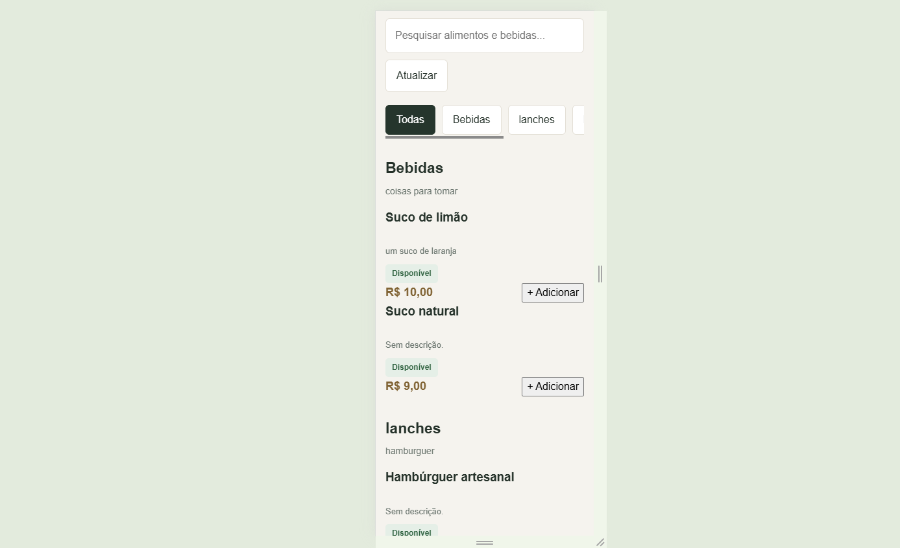

### 12.6 Limitações

As dimensões foram simuladas por meio das ferramentas do navegador.

Não foi confirmada a execução em dispositivos físicos correspondentes a todas as resoluções avaliadas.

---

## 13. Backup e restauração

### 13.1 Objetivo

Validar o mecanismo de backup periódico previsto no RNF10.

### 13.2 Configuração adotada

| Item | Configuração |
|---|---|
| Banco de dados | restaurante |
| Ferramenta | mysqldump |
| Script | Backup-Restaurante.ps1 |
| Frequência configurada | Diária |
| Horário configurado | 03:00 |
| Retenção configurada | 7 dias |
| Tarefa agendada | Restaurante-Backup-Diario |
| Armazenamento | Diretório local externo ao repositório |
| Credenciais | Login path do MySQL |

A frequência, o horário e o período de retenção representam decisões de implementação.

O requisito original não estabelece valores específicos para esses parâmetros.

### 13.3 Script de backup

O script implementa:

- Criação do diretório de armazenamento.
- Geração de arquivo SQL.
- Identificação por data e horário.
- Verificação do código de saída.
- Verificação da existência e tamanho do arquivo.
- Registro de execução.
- Tratamento de arquivos temporários.
- Política de retenção.

[Consultar script de backup](../../Entrega-20-10/implementacao/scripts/Backup-Restaurante.ps1).

### 13.4 Arquivos gerados

| Arquivo | Tamanho | Horário registrado |
|---|---:|---|
| restaurante-20261127-142515-211.sql | 19.655 bytes | 27/11/2026 14:25:15 |
| restaurante-20261127-142716-111.sql | 19.655 bytes | 27/11/2026 14:27:16 |

Os arquivos SQL não integram as evidências publicáveis do repositório.

Eles permanecem armazenados localmente.

### 13.5 Resultado da tarefa agendada

| Indicador | Resultado |
|---|---|
| Nome | Restaurante-Backup-Diario |
| Estado observado | Ready |
| Última execução | 27/11/2026 14:27:27 |
| Código de resultado | 0 |
| Próxima execução prevista no momento da consulta | 28/11/2026 03:00:00 |
| Execuções perdidas | 0 |

A tarefa foi acionada manualmente para verificar sua execução.

O código de resultado zero e a geração do arquivo confirmaram o funcionamento no cenário avaliado.

### 13.6 Teste de restauração

Foi criado um banco temporário denominado:

`restaurante_teste_restauracao`

O backup mais recente foi importado nesse banco.

Durante a primeira tentativa, ocorreu um erro de abertura do arquivo SQL.

A importação foi repetida utilizando uma cópia temporária em um caminho sem caracteres acentuados.

A segunda tentativa foi concluída com sucesso.

O banco original não foi substituído.

### 13.7 Comparação das tabelas

| Tabela | Banco original | Banco restaurado | Resultado |
|---|---:|---:|---|
| categoria | 4 | 4 | Aprovado |
| composicao_produto | 2 | 2 | Aprovado |
| conta | 0 | 0 | Aprovado |
| ingrediente | 3 | 3 | Aprovado |
| item_pedido | 3 | 3 | Aprovado |
| mesa | 14 | 14 | Aprovado |
| movimentacao_estoque | 8 | 8 | Aprovado |
| pagamento | 0 | 0 | Aprovado |
| pedido | 2 | 2 | Aprovado |
| produto | 11 | 11 | Aprovado |
| reserva_estoque | 0 | 0 | Aprovado |
| usuario | 5 | 5 | Aprovado |
| **Total** | **52** | **52** | **Aprovado** |

As 12 tabelas foram restauradas e apresentaram contagens correspondentes.

As tabelas vazias tiveram sua existência estrutural verificada.

Após a validação, o banco temporário foi removido.

### 13.8 Limitações

- A execução automática no horário programado ainda não foi observada.
- A política de retenção ainda não foi testada após sete dias.
- O armazenamento permanece local.
- A execução depende das condições do computador e do serviço MySQL.
- A tarefa utiliza a sessão interativa do usuário configurado.
- A comparação da restauração verificou as tabelas e quantidades de registros, não todos os valores individualmente.
- A configuração deve ser realizada separadamente em outros computadores.

### 13.9 Evidências

Os resultados foram registrados durante a execução dos comandos de backup, agendamento e restauração.

Não foi incluída uma captura PNG específica do backup na pasta de evidências finais.

Os arquivos de backup também não foram incluídos para evitar a publicação desnecessária dos dados do banco.

---

## 14. Verificações estruturais

### 14.1 Quantidade de arquivos avaliados

| Tipo | Quantidade |
|---|---:|
| Java de implementação | 92 |
| Java de testes | 17 |
| HTML | 12 |
| CSS | 12 |
| JavaScript | 14 |
| PowerShell | 1 |
| **Total** | **148** |

A contagem não inclui todos os arquivos de configuração, documentação ou arquivos gerados.

### 14.2 Sintaxe JavaScript

Os 14 arquivos JavaScript foram verificados utilizando o comando:

```powershell
node --check
```

| Indicador | Resultado |
|---|---:|
| Arquivos verificados | 14 |
| Arquivos aprovados | 14 |
| Erros de sintaxe encontrados | 0 |

A aprovação sintática não garante ausência de erros durante a execução.

### 14.3 Referências locais

Foram verificadas referências locais de arquivos HTML para recursos CSS, JavaScript e outras páginas.

| Indicador | Resultado |
|---|---:|
| Referências verificadas | 78 |
| Referências válidas | 78 |
| Referências ausentes | 0 |

### 14.4 Identificadores HTML

| Indicador | Resultado |
|---|---:|
| Páginas avaliadas | 12 |
| Identificadores encontrados | 397 |
| Identificadores duplicados | 0 |

Também foram verificadas 26 referências literais por getElementById, sem referências ausentes encontradas.

Essa verificação não cobre todas as formas de seleção dinâmica de elementos.

### 14.5 Revisão de arquivos e credenciais

Foram realizadas verificações preliminares para identificar:

- Arquivos de compilação.
- Arquivos temporários.
- Backups.
- Arquivos de configuração local.
- Credenciais explícitas.
- Arquivos desnecessários para publicação.

Nenhuma ocorrência foi encontrada nos padrões específicos utilizados na revisão preliminar.

A revisão não representa uma garantia absoluta de ausência de informações sensíveis.

Uma nova conferência deverá ocorrer antes da publicação.

---

## 15. Compilação e execução final

### 15.1 Compilação

Comando executado:

```powershell
mvn clean package
```

| Indicador | Resultado |
|---|---|
| Data | 27/11/2026 |
| Horário de conclusão | 14:42:21 |
| Tempo total | 50,208 segundos |
| Testes executados | 307 |
| Falhas | 0 |
| Erros | 0 |
| Ignorados | 0 |
| Resultado | BUILD SUCCESS |

### 15.2 Arquivo gerado

| Item | Resultado |
|---|---|
| Arquivo | restaurante-0.1.0.jar |
| Diretório | target |
| Tamanho | 52.496.817 bytes |

O arquivo JAR é gerado pelo Maven e não precisa ser incluído no código-fonte versionado.

### 15.3 Execução

A aplicação foi iniciada utilizando:

```powershell
java -jar "target\restaurante-0.1.0.jar"
```

As configurações de conexão com o MySQL foram fornecidas por variáveis de ambiente.

### 15.4 Verificação manual final

| Identificador | Verificação | Resultado |
|---|---|---|
| FINAL01 | Inicialização da aplicação com MySQL | Aprovado |
| FINAL02 | Login administrativo | Aprovado |
| FINAL03 | Dashboard e consulta de produtos existentes | Aprovado |
| FINAL04 | Encerramento da sessão | Aprovado |

As quatro verificações já integram o total acumulado de 639 verificações manuais.

---

## 16. Rastreabilidade dos requisitos

### 16.1 Requisitos funcionais

| ID | Área avaliada | Situação |
|---|---|---|
| RF01 | Cadastro e administração de usuários | Validado nos cenários executados |
| RF02 | Autenticação | Validado nos cenários executados |
| RF03 | Controle de acesso | Validado nos cenários executados |
| RF04 | Cadastro individual de clientes | Não implementado |
| RF05 | Produtos e categorias | Validado com ressalva sobre exclusão lógica |
| RF06 | Ingredientes e estoque | Validado nos cenários executados |
| RF07 | Composição de produtos | Validado nos cenários executados |
| RF08 | Pedidos vinculados às mesas | Validado nos cenários executados |
| RF09 | Cardápio e pedidos do cliente | Validado nos cenários executados |
| RF10 | Acompanhamento e estados dos pedidos | Validado nos cenários executados |
| RF11 | Interface da cozinha | Validado nos cenários executados |
| RF12 | Disponibilidade de ingredientes | Validado nos cenários executados |
| RF13 | Reserva e liberação de ingredientes | Validado nos cenários executados |
| RF14 | Baixa de ingredientes | Validado nos cenários executados |
| RF15 | Movimentações de estoque | Validado nos cenários executados |
| RF16 | Identificação de estoque baixo | Validado nos cenários executados |
| RF17 | Cálculo e fechamento de contas | Validado nos cenários executados |
| RF18 | Registro de pagamentos | Validado nos cenários executados |
| RF19 | Descontos e estornos | Validado nos cenários executados |
| RF20 | Comprovantes e relatórios | Parcialmente validado |
| RF21 | Auditoria | Parcialmente validado |

A classificação considera o escopo efetivamente implementado.

### 16.2 Regras de negócio

| ID | Regra avaliada | Resultado |
|---|---|---|
| RN01 | Um perfil ativo por usuário interno | Validado |
| RN02 | Descontos superiores a 10% restritos | Validado |
| RN03 | Estorno autorizado com justificativa | Validado |
| RN04 | Cancelamento sujeito a permissões | Validado |
| RN05 | Restrição de novo atendimento inicial em mesa ocupada | Validado com ressalva |
| RN06 | Fechamento condicionado aos pedidos e pagamento | Validado |
| RN07 | Múltiplos pagamentos com soma correspondente | Validado |
| RN08 | Estoque físico não negativo | Validado |
| RN09 | Verificação de ingredientes suficientes | Validado |
| RN10 | Reserva na confirmação do pedido | Validado |
| RN11 | Baixa quando o pedido fica Pronto | Validado |
| RN12 | Liberação antes do início do preparo | Validado |
| RN13 | Composição dos produtos controlados | Validado |
| RN14 | Acesso limitado ao atendimento ativo | Validado com ressalva |

A RN05 permite o acesso ao atendimento já existente de uma mesa ocupada, sem criar um novo atendimento inicial.

A RN14 utiliza a sessão e o identificador do atendimento, mas a identificação inicial apenas pelo número da mesa permanece uma limitação.

### 16.3 Requisitos não funcionais

| ID | Validação | Situação |
|---|---|---|
| RNF01 | Hash BCrypt | Validado nos cenários executados |
| RNF02 | Expiração após 15 minutos | Validado |
| RNF03 | Permissões por perfil | Validado nos cenários executados |
| RNF04 | Restrição dos dados dos clientes | Validado com ressalva |
| RNF05 | Clareza das interfaces | Avaliado manualmente |
| RNF06 | Mensagens de erro e confirmação | Avaliado manualmente |
| RNF07 | Resposta em até três segundos | Validado nas operações medidas |
| RNF08 | Compatibilidade com navegadores | Parcialmente validado |
| RNF09 | Responsividade a partir de 360 pixels | Validado em dimensões simuladas |
| RNF10 | Backup periódico | Implementado e testado localmente |
| RNF11 | Interface da cozinha | Validado em dimensões simuladas |

A rastreabilidade detalhada dos requisitos também está disponível na documentação técnica e no backlog final.

---

## 17. Evidências da entrega final

### 17.1 Organização

```text
Entrega-27-11/
├── documentacao/
└── evidencias/
    ├── capturas/
    └── relatorios/
```

### 17.2 Índice de capturas

| ID | Arquivo | Conteúdo |
|---|---|---|
| EV08 | [EV08-Login.png](../evidencias/capturas/EV08-Login.png) | Tela de autenticação |
| EV09 | [EV09-Dashboard.png](../evidencias/capturas/EV09-Dashboard.png) | Painel administrativo |
| EV10 | [EV10-Produtos.png](../evidencias/capturas/EV10-Produtos.png) | Gestão de produtos |
| EV11 | [EV11-Mesas.png](../evidencias/capturas/EV11-Mesas.png) | Gestão de mesas |
| EV12 | [EV12-Cardapio.png](../evidencias/capturas/EV12-Cardapio.png) | Cardápio digital |
| EV13 | [EV13-Carrinho.png](../evidencias/capturas/EV13-Carrinho.png) | Carrinho do cliente |
| EV14 | [EV14-Meus-Pedidos.png](../evidencias/capturas/EV14-Meus-Pedidos.png) | Acompanhamento de pedidos |
| EV15 | [EV15-Pedidos.png](../evidencias/capturas/EV15-Pedidos.png) | Gestão de pedidos |
| EV16 | [EV16-Cozinha.png](../evidencias/capturas/EV16-Cozinha.png) | Interface da cozinha |
| EV17 | [EV17-Estoque.png](../evidencias/capturas/EV17-Estoque.png) | Gestão de estoque |
| EV18 | [EV18-Composicao.png](../evidencias/capturas/EV18-Composicao.png) | Composição de produtos |
| EV19 | [EV19-Pagamentos.png](../evidencias/capturas/EV19-Pagamentos.png) | Gestão de pagamentos |
| EV20 | [EV20-Usuarios.png](../evidencias/capturas/EV20-Usuarios.png) | Administração de usuários |
| EV21 | [EV21-Responsividade.png](../evidencias/capturas/EV21-Responsividade.png) | Responsividade |

### 17.3 EV08 — Login

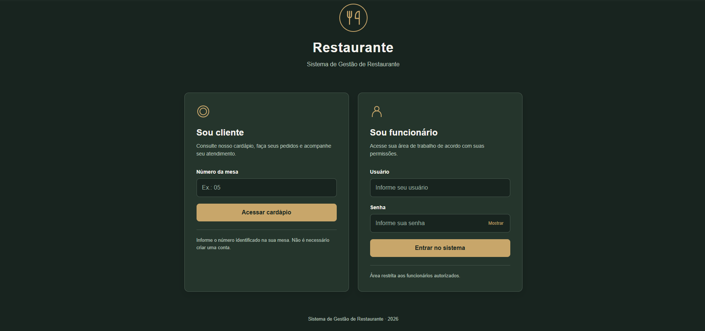

### 17.4 EV09 — Dashboard

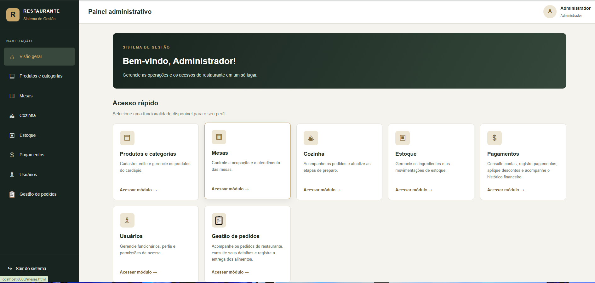

### 17.5 EV10 — Produtos

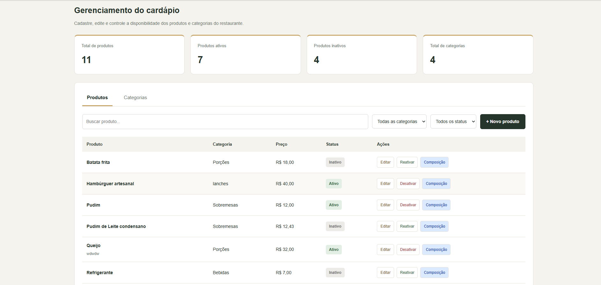

### 17.6 EV11 — Mesas

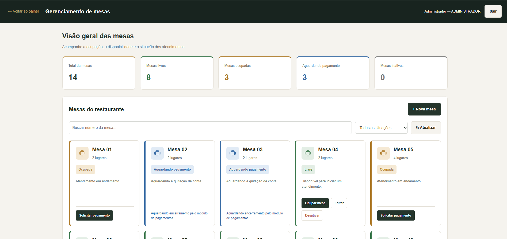

### 17.7 EV12 — Cardápio

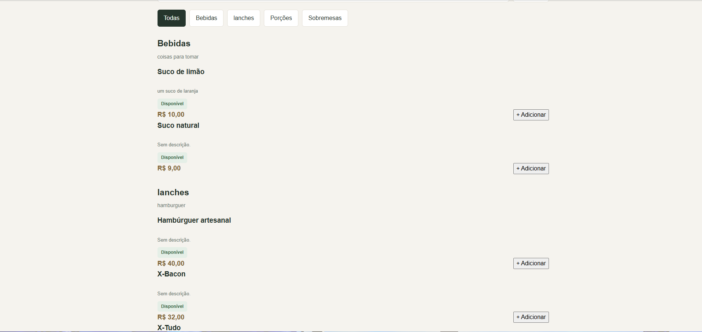

### 17.8 EV13 — Carrinho

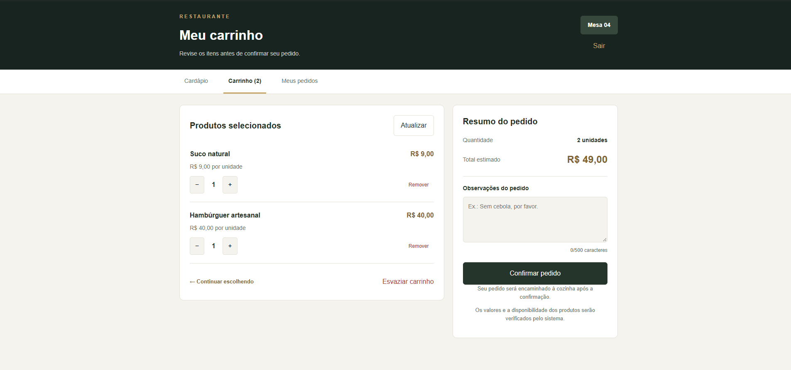

### 17.9 EV14 — Meus pedidos

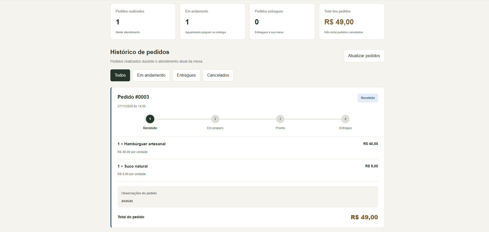

### 17.10 EV15 — Pedidos

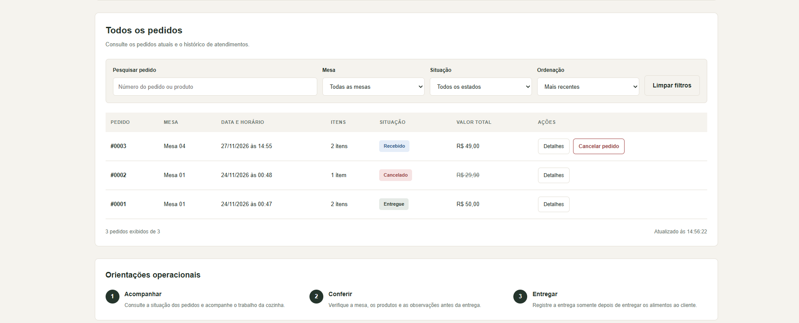

### 17.11 EV16 — Cozinha

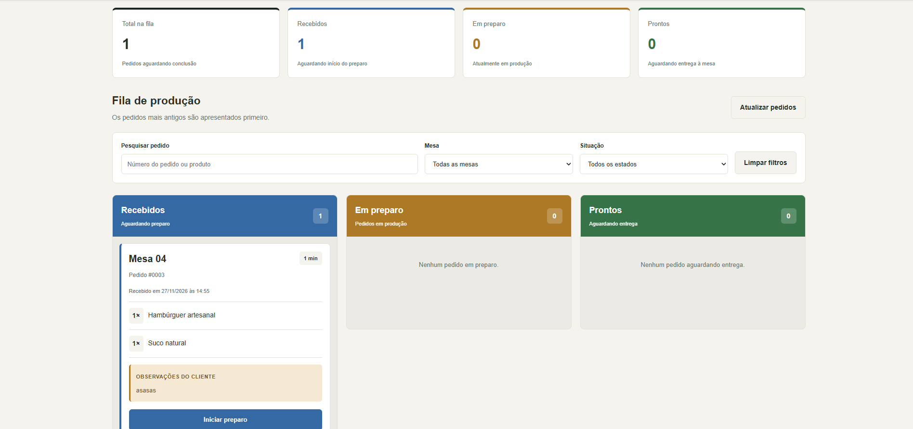

### 17.12 EV17 — Estoque

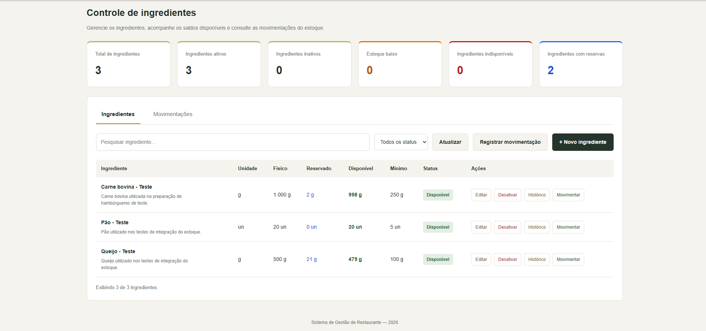

### 17.13 EV18 — Composição

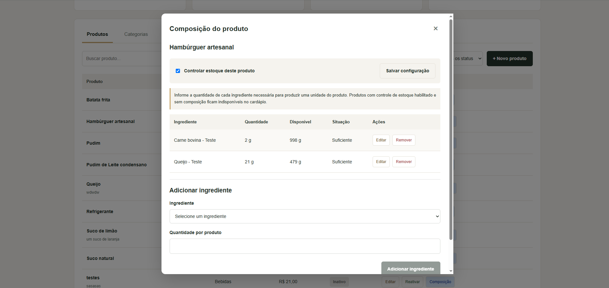

### 17.14 EV19 — Pagamentos

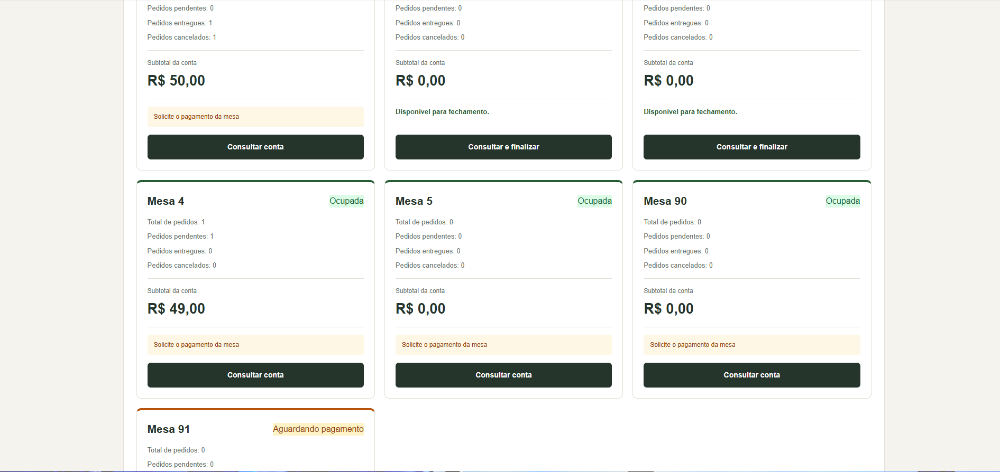

### 17.15 EV20 — Usuários

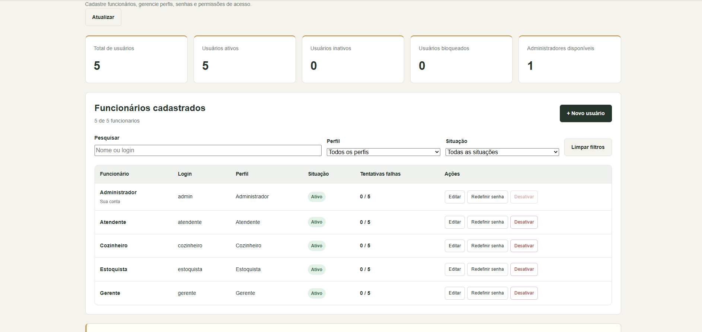

### 17.16 EV21 — Responsividade


### 17.17 Relatórios CSV

| Arquivo | Conteúdo |
|---|---|
| [Testes-Automatizados-Resumo.csv](../evidencias/relatorios/Testes-Automatizados-Resumo.csv) | Resultados das 17 classes Java |
| [Desempenho-Detalhado.csv](../evidencias/relatorios/Desempenho-Detalhado.csv) | Resultados individuais das 55 medições |
| [Desempenho-Resumo.csv](../evidencias/relatorios/Desempenho-Resumo.csv) | Estatísticas das 11 operações |

### 17.18 Quantidade de evidências

| Tipo | Quantidade |
|---|---:|
| Capturas PNG | 14 |
| Relatórios CSV | 3 |
| **Total** | **17** |

As capturas demonstram as interfaces correspondentes.

Uma captura de tela isolada não comprova todas as regras de negócio ou todos os testes associados ao módulo.

A conferência visual final das imagens permanece sob responsabilidade da equipe.

---

## 18. Limitações dos testes

### 18.1 Cobertura funcional

A aprovação dos testes não significa que todos os requisitos originais foram integralmente implementados.

Permanecem diferenças de escopo relacionadas a:

- Cadastro individual de clientes.
- Exclusão física de registros.
- Emissão de comprovantes.
- Auditoria integral.

### 18.2 Cobertura automatizada

Não foi produzida uma medição percentual consolidada de cobertura de código.

Os testes Java utilizam H2, que não substitui integralmente o comportamento do MySQL.

Alguns testes utilizam autenticação simulada ou execução direta de serviços.

### 18.3 Concorrência

A aplicação utiliza mecanismos transacionais e bloqueios em operações relevantes.

Entretanto, não foi realizada uma campanha abrangente de testes concorrentes no MySQL.

### 18.4 Desempenho

As medições foram locais e sequenciais.

Não foi determinada a capacidade máxima de usuários simultâneos.

### 18.5 Compatibilidade

Firefox e Safari não foram avaliados.

### 18.6 Responsividade

As resoluções foram simuladas no navegador.

### 18.7 Segurança

Os testes não constituem certificação ou auditoria profissional de segurança.

A identificação inicial do cliente pela mesa permanece uma limitação.

### 18.8 Backup

O funcionamento da tarefa foi confirmado por acionamento manual.

A execução no horário programado e a retenção após sete dias ainda precisam ser observadas.

### 18.9 Evidências

Foram mantidas 17 evidências na entrega final.

Não existem capturas individuais para todas as verificações realizadas.

Os resultados acumulados dos testes manuais e JavaScript foram registrados durante o desenvolvimento, sem um relatório individual completo na pasta final.

---

## 19. Consolidação dos resultados

### 19.1 Resultado quantitativo

| Categoria | Executadas | Aprovadas | Reprovadas na consolidação |
|---|---:|---:|---:|
| Testes automatizados Java | 307 | 307 | 0 |
| Testes isolados JavaScript | 35 | 35 | 0 |
| Verificações manuais acumuladas | 639 | 639 | 0 |
| Medições de desempenho | 55 | 55 | 0 |
| **Total** | **1.036** | **1.036** | **0** |

Os valores representam resultados finais aprovados.

Falhas intermediárias corrigidas durante o desenvolvimento não são apresentadas como falhas da execução final.

O total reúne verificações de naturezas diferentes e não representa necessariamente 1.036 casos independentes.

### 19.2 Verificações complementares

| Verificação | Resultado |
|---|---|
| Compilação final | BUILD SUCCESS |
| Inicialização com MySQL | Aprovada |
| Sintaxe JavaScript | 14 arquivos aprovados |
| Referências locais | 78 referências válidas |
| Identificadores HTML duplicados | Nenhum encontrado |
| Geração de backup | Aprovada |
| Execução da tarefa de backup | Aprovada por acionamento manual |
| Restauração | 12 tabelas com contagens correspondentes |
| Evidências organizadas | 17 arquivos |

As verificações complementares não foram adicionadas novamente ao total de 1.036.

### 19.3 Situação dos requisitos

| Classificação dos requisitos funcionais | Quantidade |
|---|---:|
| Atendidos sem ressalva específica de escopo | 17 |
| Atendidos com ressalva | 1 |
| Parcialmente atendidos | 2 |
| Não atendidos | 1 |
| **Total** | **21** |

Os requisitos não funcionais foram avaliados conforme os cenários disponíveis, com limitações registradas especialmente em compatibilidade, segurança, desempenho e backup.

### 19.4 Situação da entrega

| Atividade | Situação |
|---|---|
| Desenvolvimento dos módulos principais | Concluído localmente |
| Testes automatizados finais | Concluídos |
| Testes manuais previstos na preparação | Concluídos |
| Compilação final | Concluída |
| Organização das evidências | Concluída |
| Documentação dos resultados | Elaborada |
| Revisão coletiva | Pendente de confirmação |
| Publicação final | Aguardando autorização |

---

## 20. Conclusão

Os testes realizados demonstraram o funcionamento dos principais módulos implementados no Sistema de Gestão de Restaurante.

A aplicação evoluiu de uma implementação inicial concentrada no gerenciamento do cardápio para um sistema integrado de atendimento, pedidos, cozinha, estoque, pagamentos e administração de usuários.

A compilação final foi concluída com sucesso, com 307 testes automatizados Java aprovados e nenhuma falha, erro ou teste ignorado.

Também foram registradas 639 verificações manuais aprovadas, 35 testes isolados JavaScript aprovados e 55 medições de desempenho aprovadas.

As operações avaliadas quanto ao desempenho apresentaram tempos inferiores ao limite de três segundos.

O mecanismo de backup foi executado com sucesso, e a restauração foi validada em um banco temporário.

As limitações identificadas foram registradas para preservar a correspondência entre os resultados observados e o escopo efetivamente implementado.

A versão encontra-se preparada para revisão documental e demonstração acadêmica no ambiente local avaliado.

A conclusão formal da entrega depende da revisão pelos responsáveis e da publicação autorizada no GitHub.

---

## Referências internas

- [Testes e evidências de 20/10](../../Entrega-20-10/documentacao/Testes-e-Evidencias-20-10.md).
- [Testes e evidências de 06/11](../../Entrega-06-11/documentacao/Testes-e-Evidencias-06-11.md).
- [Documentação técnica final](Documentacao-Tecnica-Entrega-27-11.md).
- [Backlog e planejamento final](Backlog-e-Planejamento-27-11.md).
- [Implementação](../../Entrega-20-10/implementacao/).
- [Capturas de tela](../evidencias/capturas/).
- [Relatórios de testes](../evidencias/relatorios/).
- [README principal](../../../README.md).

---

**Nota de revisão:** MateusPresner deverá conferir os resultados consolidados e as evidências disponíveis. A equipe deverá validar a rastreabilidade, as limitações registradas e a correspondência entre os documentos. A elaboração deste documento não representa aprovação coletiva ou publicação definitiva.

---

[Voltar ao README principal](../../../README.md)
