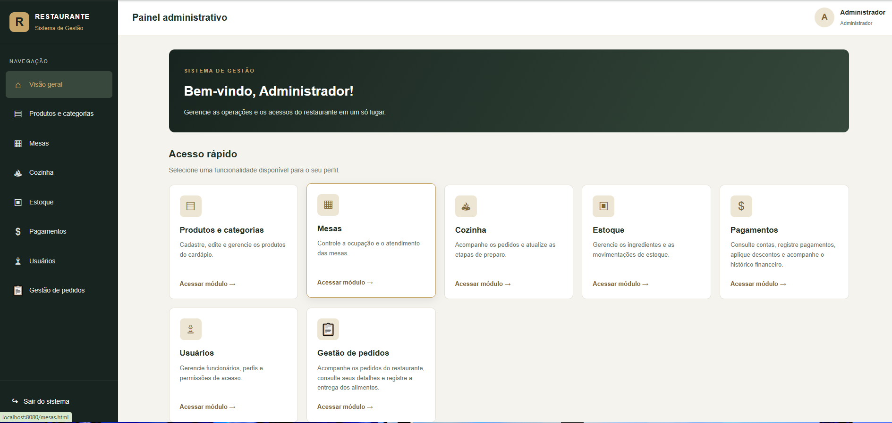
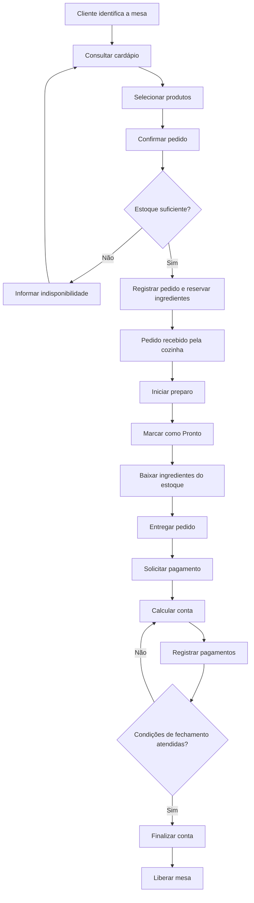
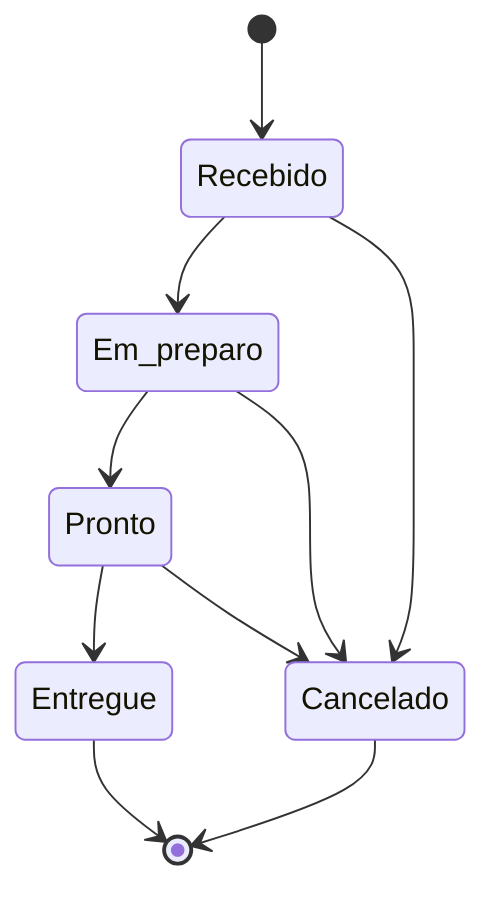
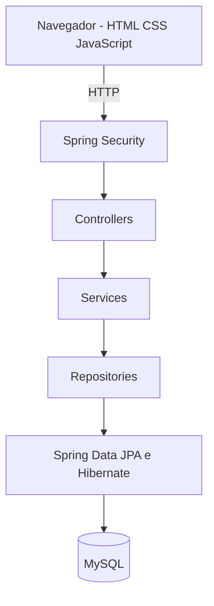
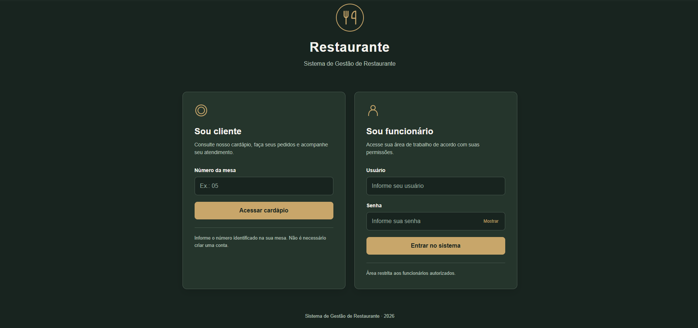
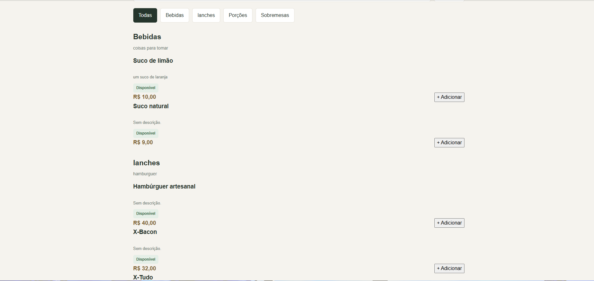
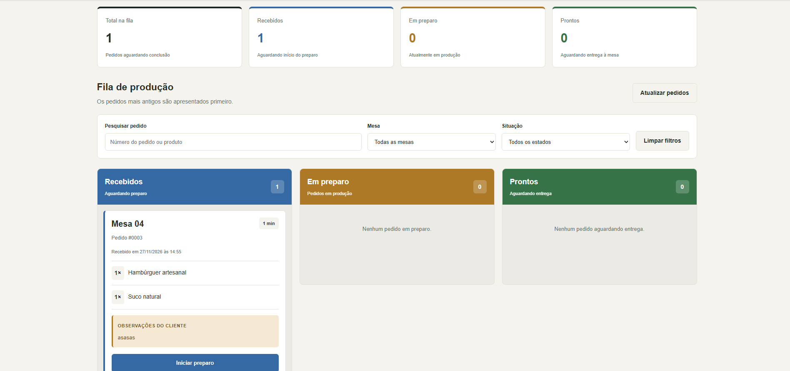
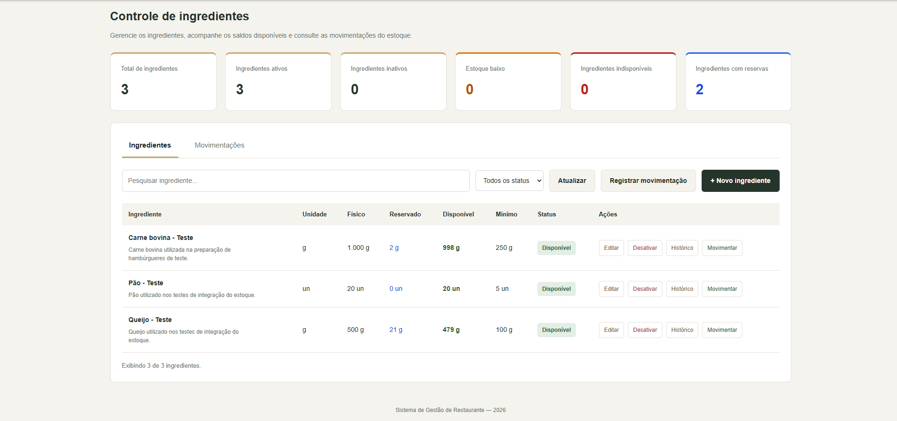
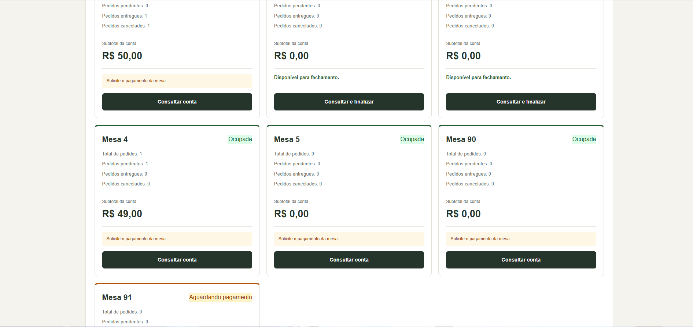

# Sistema de Gestão de Restaurante

Sistema web desenvolvido para auxiliar restaurantes e lanchonetes no gerenciamento integrado de suas principais atividades, incluindo atendimento, mesas, cardápio, pedidos, cozinha, estoque, vendas, pagamentos e usuários.


---

## Identificação do projeto

| Informação | Descrição |
|---|---|
| Projeto | Sistema de Gestão de Restaurante |
| Disciplina | IMERSÃO PROFISSIONAL: PROJETO DE SOFTWARE  |
| Professora | Sabine Cassol |
| Ano letivo | 2026 |
| Entrega final | 27/11/2026 |
| Branch da entrega final | `entrega-27-11-2026` |
| Plataforma | Aplicação web |
| Situação | Implementação final preparada e validada localmente |

## Equipe

| Integrante | GitHub |
|---|---|
| João Vitor Barros Presner | [JoaoVitorPresner](https://github.com/JoaoVitorPresner) |
| Guilhermy Martineli Brenny | [guilhermemgb](https://github.com/guilhermemgb) |
| Matheus Borges | [Matheusborgges](https://github.com/Matheusborgges) |
| Mateus Henrique Presner | [MateusPresner](https://github.com/MateusPresner) |

---

## Sumário

- [Problema](#problema)
- [Objetivo](#objetivo)
- [Entrega final](#entrega-final--27112026)
- [Principais funcionalidades](#principais-funcionalidades)
- [Perfis e permissões](#perfis-e-permissões)
- [Fluxo principal do sistema](#fluxo-principal-do-sistema)
- [Tecnologias utilizadas](#tecnologias-utilizadas)
- [Arquitetura da aplicação](#arquitetura-da-aplicação)
- [Banco de dados](#banco-de-dados)
- [Organização do projeto](#organização-do-projeto)
- [Instalação e execução](#instalação-e-execução)
- [Testes e qualidade](#testes-e-qualidade)
- [Evidências da entrega final](#evidências-da-entrega-final)
- [Segurança](#segurança)
- [Backup e recuperação](#backup-e-recuperação)
- [Rastreabilidade dos requisitos](#rastreabilidade-dos-requisitos)
- [Limitações e melhorias futuras](#limitações-e-melhorias-futuras)
- [Responsabilidades da equipe](#responsabilidades-da-equipe)
- [Histórico das entregas](#histórico-das-entregas)

---

## Problema

Restaurantes precisam administrar simultaneamente diferentes atividades, como atendimento de clientes, registro de pedidos, comunicação com a cozinha, controle de mesas, acompanhamento do estoque e fechamento das vendas.

Quando essas atividades são realizadas manualmente ou por meio de ferramentas separadas, podem ocorrer erros nos pedidos, falhas de comunicação entre atendimento e cozinha, atrasos no preparo, dificuldades no controle de estoque e problemas no acompanhamento das vendas.

O projeto busca centralizar essas informações e processos em um único sistema.

---

## Objetivo

Desenvolver um sistema web para gerenciar e otimizar as principais operações de um restaurante, incluindo pedidos, mesas, produtos, estoque, vendas, pagamentos e usuários.

A aplicação busca integrar o atendimento, a cozinha e o estoque, permitindo acompanhar as informações dos pedidos durante todo o fluxo operacional.

### Objetivos específicos

- Centralizar as informações do estabelecimento.
- Organizar o atendimento e a ocupação das mesas.
- Disponibilizar um cardápio digital.
- Facilitar o registro e acompanhamento dos pedidos.
- Integrar os pedidos à cozinha.
- Controlar a disponibilidade dos ingredientes.
- Automatizar reservas e baixas de estoque.
- Organizar o fechamento das contas.
- Controlar as permissões dos funcionários.
- Preservar informações relevantes das operações realizadas.

---

## Entrega final — 27/11/2026

A entrega final consolida a evolução do Sistema de Gestão de Restaurante durante o segundo bimestre.

A implementação inicial, concentrada no gerenciamento do cardápio, foi ampliada para contemplar os principais módulos administrativos e operacionais previstos no projeto.

### Documentação final

| Documento | Acesso |
|---|---|
| Documentação técnica | [Consultar documento](./2-Bimestre/Entrega-27-11/documentacao/Documentacao-Tecnica-Entrega-27-11.md) |
| Backlog e planejamento | [Consultar documento](./2-Bimestre/Entrega-27-11/documentacao/Backlog-e-Planejamento-27-11.md) |
| Testes e evidências | [Consultar documento](./2-Bimestre/Entrega-27-11/documentacao/Testes-e-Evidencias-27-11.md) |
| Código-fonte | [Consultar implementação](./2-Bimestre/Entrega-20-10/implementacao/) |
| Capturas de tela | [Consultar capturas](./2-Bimestre/Entrega-27-11/evidencias/capturas/) |
| Relatórios de testes | [Consultar relatórios](./2-Bimestre/Entrega-27-11/evidencias/relatorios/) |

### Visão geral da aplicação



### Resultados consolidados

| Indicador | Resultado |
|---|---:|
| Testes automatizados Java aprovados | 307 |
| Testes isolados JavaScript aprovados | 35 |
| Verificações manuais acumuladas aprovadas | 639 |
| Medições de desempenho aprovadas | 55 |
| Total de verificações consolidadas | 1.036 |
| Classes de testes Java | 17 |
| Interfaces web | 12 |
| Tabelas do banco de dados | 12 |
| Capturas de tela | 14 |
| Relatórios CSV | 3 |
| Documentos finais | 3 |

O total de 1.036 reúne verificações de naturezas diferentes, não representando necessariamente casos de teste independentes.

A aprovação dos testes não implica atendimento integral de todos os requisitos originais.

---

## Principais funcionalidades

### 1. Autenticação e controle de acesso

- Login de funcionários.
- Identificação do perfil autenticado.
- Controle de acesso no frontend e backend.
- Armazenamento de senhas com BCrypt.
- Bloqueio após cinco tentativas inválidas consecutivas.
- Expiração de sessão após 15 minutos de inatividade.
- Invalidação de sessões após alterações relevantes de segurança.
- Encerramento da sessão.

### 2. Administração de usuários

- Cadastro de funcionários.
- Consulta de usuários.
- Edição de informações.
- Definição de perfil.
- Redefinição de senha.
- Ativação e desativação.
- Desbloqueio administrativo.
- Proteções contra determinadas operações administrativas incompatíveis.

### 3. Produtos e categorias

- Cadastro de categorias.
- Cadastro de produtos.
- Consulta de registros.
- Edição de informações.
- Ativação e desativação lógica.
- Associação entre produtos e categorias.
- Configuração de produtos com controle de estoque.
- Gerenciamento da composição dos produtos.

A exclusão física dos registros não integra a política adotada.

### 4. Mesas e atendimento

- Cadastro e edição de mesas.
- Consulta da situação das mesas.
- Ocupação de mesas disponíveis.
- Identificação do atendimento ativo.
- Solicitação de pagamento.
- Ativação e desativação de mesas.
- Liberação após fechamento da conta.

### 5. Cardápio digital

- Acesso do cliente pela identificação da mesa.
- Consulta das categorias disponíveis.
- Consulta dos produtos ativos.
- Identificação da disponibilidade dos produtos.
- Seleção de produtos.
- Acesso ao carrinho.

### 6. Carrinho e pedidos do cliente

- Adição e remoção de produtos.
- Alteração de quantidades.
- Cálculo dos subtotais.
- Registro de observações.
- Confirmação do pedido.
- Verificação da disponibilidade dos ingredientes.
- Acompanhamento dos pedidos realizados.

### 7. Gestão de pedidos

- Consulta de pedidos.
- Identificação da mesa vinculada.
- Acompanhamento dos estados.
- Registro de entrega.
- Cancelamento autorizado.
- Exigência de justificativa de cancelamento.
- Registro de informações relevantes do cancelamento.

### 8. Cozinha

- Consulta da fila de pedidos.
- Visualização dos itens solicitados.
- Consulta de observações.
- Início do preparo.
- Marcação do pedido como Pronto.
- Acompanhamento do tempo decorrido.
- Interface adaptável a diferentes dimensões de tela.

### 9. Estoque

- Cadastro e edição de ingredientes.
- Controle de unidades de medida.
- Controle de estoque físico.
- Controle de estoque reservado.
- Cálculo de estoque disponível.
- Definição de estoque mínimo.
- Identificação de estoque baixo.
- Entradas e saídas manuais.
- Histórico de movimentações.
- Reserva automática de ingredientes.
- Liberação de reservas.
- Baixa automática de ingredientes.
- Registro de perdas durante o preparo.

### 10. Pagamentos e vendas

- Consulta das contas abertas.
- Cálculo do valor devido.
- Aplicação de descontos conforme permissões.
- Registro de múltiplas formas de pagamento.
- Validação dos valores registrados.
- Fechamento de contas.
- Liberação de mesas.
- Consulta do histórico de contas.
- Consulta de vendas por período.
- Estorno autorizado com justificativa.

As formas de pagamento disponíveis são:

- Dinheiro.
- Pix.
- Cartão de crédito.
- Cartão de débito.
- Vale-refeição.

O sistema registra os pagamentos internamente, sem integração direta com instituições financeiras.

---

## Perfis e permissões

| Funcionalidade | Administrador | Gerente | Atendente | Cozinheiro | Estoquista | Cliente |
|---|:---:|:---:|:---:|:---:|:---:|:---:|
| Administração de usuários | Sim | Não | Não | Não | Não | Não |
| Produtos e categorias | Sim | Sim | Não | Não | Não | Não |
| Gestão operacional de mesas | Sim | Sim | Sim | Não | Não | Não |
| Gestão operacional de pedidos | Sim | Sim | Sim | Não | Não | Não |
| Cozinha | Sim | Sim | Não | Sim | Não | Não |
| Estoque | Sim | Sim | Não | Não | Sim | Não |
| Pagamentos | Sim | Sim | Sim | Não | Não | Não |
| Cardápio e pedidos do cliente | Não | Não | Não | Não | Não | Sim |

A tabela apresenta as permissões gerais dos módulos.

Algumas operações possuem restrições adicionais.

### Restrições específicas

- Apenas o administrador pode gerenciar usuários internos.
- Descontos superiores a 10% são restritos ao administrador e ao gerente.
- Estornos são restritos ao administrador e ao gerente.
- O cliente acessa os dados vinculados ao atendimento ativo da mesa.
- Operações administrativas de cadastro, edição, ativação e desativação de mesas possuem permissões específicas.

---

## Fluxo principal do sistema



O diagrama representa o fluxo principal simplificado.

As operações de cancelamento, descontos, estornos e validações complementares são detalhadas na documentação técnica.

### Estados dos pedidos



### Integração com o estoque

| Operação | Efeito |
|---|---|
| Confirmação do pedido | Reserva dos ingredientes |
| Início do preparo | Manutenção da reserva |
| Pedido Pronto | Baixa do estoque físico e reservado |
| Cancelamento antes do preparo | Liberação da reserva |
| Cancelamento durante o preparo | Registro de perda |
| Cancelamento após ficar Pronto | Sem devolução dos ingredientes consumidos |

### Estados das mesas

| Estado | Descrição |
|---|---|
| LIVRE | Disponível para atendimento |
| OCUPADA | Atendimento em andamento |
| AGUARDANDO_PAGAMENTO | Atendimento em processo de fechamento |
| INATIVA | Indisponível para novos atendimentos |

---

## Tecnologias utilizadas

| Camada ou componente | Tecnologia |
|---|---|
| Linguagem backend | Java 17 |
| Framework backend | Spring Boot 3.3.5 |
| API | Spring Web |
| Segurança | Spring Security |
| Validação | Jakarta Bean Validation |
| Persistência | Spring Data JPA e Hibernate |
| Banco de dados | MySQL 8.0 |
| Banco de testes | H2 |
| Frontend | HTML5, CSS3 e JavaScript |
| Gerenciamento de dependências | Maven |
| Testes automatizados | JUnit, Spring Boot Test e MockMvc |
| Verificação JavaScript | Node.js |
| Versionamento | Git e GitHub |
| Protótipos | Figma |
| Automação de backup | PowerShell e mysqldump |
| Agendamento | Agendador de Tarefas do Windows |

A aplicação foi desenvolvida e validada em ambiente local.

Não foi realizada implantação pública em um serviço de hospedagem.

---

## Arquitetura da aplicação

A aplicação utiliza uma arquitetura web em camadas, com separação entre interface, processamento das requisições, regras de negócio e persistência.



### Responsabilidades das camadas

| Camada | Responsabilidade |
|---|---|
| Frontend | Apresentação e interação com o usuário |
| Security | Autenticação, autorização e validação de sessões |
| Controllers | Recebimento e processamento das requisições HTTP |
| Services | Regras de negócio e operações transacionais |
| Repositories | Consultas e persistência |
| Models | Representação das entidades |
| DTOs | Transferência e validação de informações |
| Exceptions | Tratamento padronizado de erros |
| Banco de dados | Armazenamento persistente |

O frontend utiliza requisições HTTP para comunicação com o backend.

As respostas das APIs são utilizadas para atualizar as informações apresentadas ao usuário.

A implementação mantém os recursos estáticos e o backend no mesmo projeto Spring Boot.

---

## Banco de dados

O banco de dados utilizado pela aplicação é o MySQL.

A configuração padrão utiliza o banco denominado `restaurante`.

### Principais tabelas

| Tabela | Finalidade |
|---|---|
| usuario | Funcionários, perfis e informações de autenticação |
| categoria | Categorias do cardápio |
| produto | Produtos comercializados |
| mesa | Mesas e atendimento ativo |
| pedido | Pedidos realizados |
| item_pedido | Produtos e quantidades dos pedidos |
| ingrediente | Ingredientes e saldos de estoque |
| composicao_produto | Ingredientes utilizados pelos produtos |
| reserva_estoque | Reservas vinculadas aos pedidos |
| movimentacao_estoque | Histórico de movimentações |
| conta | Contas finalizadas e estornadas |
| pagamento | Formas e valores de pagamento |

A persistência é realizada utilizando Spring Data JPA e Hibernate.

A configuração de desenvolvimento utiliza `ddl-auto=update` para criação e atualização da estrutura das entidades.

Para uma implantação em produção, recomenda-se adotar migrações versionadas do banco de dados.

---

## Organização do projeto

```text
Sistema-de-Gestao-de-Restaurante/
|
|-- 1°Entrega/
|   `-- Visão do projeto e requisitos
|
|-- 2°Entrega/
|   `-- Modelagem do software e banco de dados
|
|-- 3°Entrega/
|   `-- Planejamento, arquitetura, protótipos e MVP
|
|-- 2-Bimestre/
|   |
|   |-- Entrega-20-10/
|   |   |-- implementacao/
|   |   |   |-- scripts/
|   |   |   |-- src/
|   |   |   |   |-- main/
|   |   |   |   `-- test/
|   |   |   `-- pom.xml
|   |   |-- documentacao/
|   |   `-- evidencias/
|   |
|   |-- Entrega-06-11/
|   |   |-- documentacao/
|   |   `-- evidencias/
|   |
|   `-- Entrega-27-11/
|       |-- documentacao/
|       |   |-- Backlog-e-Planejamento-27-11.md
|       |   |-- Documentacao-Tecnica-Entrega-27-11.md
|       |   `-- Testes-e-Evidencias-27-11.md
|       |
|       `-- evidencias/
|           |-- capturas/
|           `-- relatorios/
|
|-- .gitignore
`-- README.md
```

O código-fonte evoluiu de maneira incremental e permanece em:

`2-Bimestre/Entrega-20-10/implementacao/`

O nome dessa pasta corresponde à primeira entrega de implementação.

A versão do código depende da branch ou do commit consultado.

As pastas das entregas posteriores armazenam suas respectivas documentações e evidências, evitando duplicação desnecessária do código-fonte.

---

## Instalação e execução

### 1. Pré-requisitos

- Git.
- Java 17.
- Maven.
- MySQL 8.0 instalado e em execução.
- Navegador web.
- Windows PowerShell para os comandos apresentados.

O Node.js é necessário apenas para as verificações complementares de JavaScript, não para executar a aplicação.

### 2. Clonar o repositório

```powershell
git clone -b entrega-27-11-2026 https://github.com/JoaoVitorPresner/Sistema-de-Gestao-de-Restaurante.git

cd Sistema-de-Gestao-de-Restaurante
```

A implementação final estará disponível para clonagem após a publicação das alterações nessa branch.

Caso o repositório já esteja clonado e as alterações finais tenham sido publicadas:

```powershell
git fetch origin

git switch entrega-27-11-2026

git pull origin entrega-27-11-2026
```

### 3. Verificar o ambiente

```powershell
git --version

java -version

mvn -version
```

O Maven deve utilizar uma instalação compatível do Java 17.

No Windows, caso existam diferentes versões do Java instaladas, pode ser necessário ajustar a variável JAVA_HOME.

Exemplo:

```powershell
$env:JAVA_HOME = "C:\caminho\para\jdk-17"

$env:Path = "$env:JAVA_HOME\bin;$env:Path"
```

Substitua o caminho de exemplo pelo diretório real da instalação.

### 4. Acessar a implementação

Na raiz do repositório:

```powershell
cd "2-Bimestre\Entrega-20-10\implementacao"
```

### 5. Verificar o MySQL

Caso a instalação utilize o serviço MySQL80:

```powershell
Get-Service MySQL80
```

O serviço deve estar em execução.

Caso esteja parado, pode ser iniciado pelo gerenciamento de serviços do Windows ou por um PowerShell com permissões administrativas.

### 6. Configurar a conexão com o banco

```powershell
$env:DB_URL = "jdbc:mysql://localhost:3306/restaurante?createDatabaseIfNotExist=true"

$env:DB_USER = "root"

$env:DB_PASSWORD = [System.Net.NetworkCredential]::new(
    "",
    (Read-Host "Digite a senha do MySQL" -AsSecureString)
).Password
```

O usuário do banco deve possuir as permissões necessárias para utilizar a aplicação.

O uso do usuário root é apresentado apenas como exemplo de configuração local de desenvolvimento.

Em uma implantação real, recomenda-se utilizar um usuário específico para a aplicação.

A senha é solicitada durante a configuração e não deve ser adicionada ao código-fonte.

### 7. Configurar os usuários iniciais

Na primeira execução de um banco novo, os funcionários iniciais podem ser criados a partir das seguintes variáveis de ambiente:

| Login inicial | Perfil | Variável |
|---|---|---|
| admin | Administrador | ADMIN_PASSWORD |
| gerente | Gerente | GERENTE_PASSWORD |
| atendente | Atendente | ATENDENTE_PASSWORD |
| cozinheiro | Cozinheiro | COZINHEIRO_PASSWORD |
| estoquista | Estoquista | ESTOQUISTA_PASSWORD |

Para configurar as senhas iniciais:

```powershell
$env:ADMIN_PASSWORD = [System.Net.NetworkCredential]::new(
    "",
    (Read-Host "Senha inicial do administrador" -AsSecureString)
).Password

$env:GERENTE_PASSWORD = [System.Net.NetworkCredential]::new(
    "",
    (Read-Host "Senha inicial do gerente" -AsSecureString)
).Password

$env:ATENDENTE_PASSWORD = [System.Net.NetworkCredential]::new(
    "",
    (Read-Host "Senha inicial do atendente" -AsSecureString)
).Password

$env:COZINHEIRO_PASSWORD = [System.Net.NetworkCredential]::new(
    "",
    (Read-Host "Senha inicial do cozinheiro" -AsSecureString)
).Password

$env:ESTOQUISTA_PASSWORD = [System.Net.NetworkCredential]::new(
    "",
    (Read-Host "Senha inicial do estoquista" -AsSecureString)
).Password
```

As senhas devem possuir pelo menos oito caracteres e respeitar o limite de 72 bytes utilizado pelo BCrypt.

Recomenda-se utilizar senhas fortes e diferentes para cada funcionário.

Os usuários existentes não têm suas senhas substituídas automaticamente pela inicialização.

Em um banco já configurado, não é necessário recriar os funcionários iniciais.

### 8. Compilar e executar os testes

```powershell
mvn clean package
```

O comando realiza a compilação, executa os testes automatizados e gera o arquivo JAR.

O resultado esperado é:

```text
Tests run: 307, Failures: 0, Errors: 0, Skipped: 0

BUILD SUCCESS
```

### 9. Iniciar a aplicação

```powershell
java -jar "target\restaurante-0.1.0.jar"
```

Após a inicialização, acessar:

[http://localhost:8080](http://localhost:8080)



### 10. Encerrar a aplicação

No terminal em que o servidor está sendo executado, pressionar:

`Ctrl + C`

As informações persistidas no MySQL permanecem armazenadas.

### 11. Executar novamente

Em uma nova sessão do PowerShell:

1. Acessar a pasta da implementação.
2. Configurar as variáveis de conexão com o MySQL.
3. Confirmar que o serviço MySQL está em execução.
4. Executar o arquivo JAR.

Não é necessário recompilar a aplicação sempre que ela for iniciada.

Uma nova compilação é necessária quando houver alterações no código ou quando o arquivo JAR não estiver disponível.

### 12. Observações sobre o ambiente

- As variáveis de ambiente configuradas no PowerShell pertencem à sessão atual.
- Os arquivos gerados na pasta target não precisam ser versionados.
- As dependências Maven precisam estar disponíveis localmente ou ser baixadas durante a compilação.
- A aplicação utiliza a porta 8080 por padrão.
- A configuração do MySQL pode variar entre computadores.
- Não devem ser publicadas senhas, arquivos de credenciais ou backups do banco.

---

## Testes e qualidade

### Testes automatizados Java

Para executar apenas a suíte de testes:

```powershell
mvn clean test
```

### Resultado final

| Indicador | Resultado |
|---|---:|
| Classes de testes | 17 |
| Testes executados | 307 |
| Testes aprovados | 307 |
| Falhas | 0 |
| Erros | 0 |
| Ignorados | 0 |

### Distribuição dos testes

| Área | Testes aprovados |
|---|---:|
| Produtos e categorias | 21 |
| Autenticação e sessões | 21 |
| Cardápio digital e acesso do cliente | 22 |
| Mesas | 10 |
| Pedidos e cancelamentos | 58 |
| Estoque e composição | 75 |
| Pagamentos e integração | 65 |
| Administração de usuários | 35 |
| **Total** | **307** |

### Verificações complementares

| Categoria | Aprovadas |
|---|---:|
| Verificações manuais acumuladas | 639 |
| Testes isolados JavaScript | 35 |
| Medições de desempenho | 55 |
| Verificações de sintaxe JavaScript | 14 arquivos |
| Referências locais entre arquivos | 78 |
| Identificadores HTML duplicados | Nenhum encontrado |

### Desempenho

Foram realizadas cinco medições para cada uma das 11 operações de consulta selecionadas.

| Indicador | Resultado |
|---|---:|
| Medições realizadas | 55 |
| Medições aprovadas | 55 |
| Menor tempo registrado | 17,44 ms |
| Tempo médio geral | 22,47 ms |
| Maior tempo registrado | 41,24 ms |
| Limite do RNF07 | 3.000 ms |

Os testes foram realizados localmente, utilizando requisições HTTP GET sequenciais e uma sessão administrativa autenticada.

Esses resultados não representam testes de carga concorrente ou desempenho em produção.

### Compatibilidade

| Navegador | Situação |
|---|---|
| Google Chrome | Avaliado |
| Microsoft Edge | Avaliado |
| Mozilla Firefox | Não avaliado |
| Safari | Não avaliado |

### Responsividade

Foram avaliadas as 12 interfaces na dimensão simulada de 360 x 800 pixels.

A interface da cozinha também foi avaliada nas dimensões simuladas de 1024 x 768 e 1920 x 1080 pixels.

### Compilação final

| Indicador | Resultado |
|---|---|
| Data | 27/11/2026 |
| Horário de conclusão | 14:42:21 |
| Tempo de compilação | 50,208 segundos |
| Resultado | BUILD SUCCESS |
| Arquivo gerado | restaurante-0.1.0.jar |
| Tamanho do arquivo | 52.496.817 bytes |

Os resultados detalhados estão disponíveis no documento:

[Testes e evidências da entrega final](./2-Bimestre/Entrega-27-11/documentacao/Testes-e-Evidencias-27-11.md).

---

## Evidências da entrega final

### Capturas de tela

| Identificador | Interface | Evidência |
|---|---|---|
| EV08 | Login | [Visualizar](./2-Bimestre/Entrega-27-11/evidencias/capturas/EV08-Login.png) |
| EV09 | Dashboard | [Visualizar](./2-Bimestre/Entrega-27-11/evidencias/capturas/EV09-Dashboard.png) |
| EV10 | Produtos | [Visualizar](./2-Bimestre/Entrega-27-11/evidencias/capturas/EV10-Produtos.png) |
| EV11 | Mesas | [Visualizar](./2-Bimestre/Entrega-27-11/evidencias/capturas/EV11-Mesas.png) |
| EV12 | Cardápio | [Visualizar](./2-Bimestre/Entrega-27-11/evidencias/capturas/EV12-Cardapio.png) |
| EV13 | Carrinho | [Visualizar](./2-Bimestre/Entrega-27-11/evidencias/capturas/EV13-Carrinho.png) |
| EV14 | Meus pedidos | [Visualizar](./2-Bimestre/Entrega-27-11/evidencias/capturas/EV14-Meus-Pedidos.png) |
| EV15 | Pedidos | [Visualizar](./2-Bimestre/Entrega-27-11/evidencias/capturas/EV15-Pedidos.png) |
| EV16 | Cozinha | [Visualizar](./2-Bimestre/Entrega-27-11/evidencias/capturas/EV16-Cozinha.png) |
| EV17 | Estoque | [Visualizar](./2-Bimestre/Entrega-27-11/evidencias/capturas/EV17-Estoque.png) |
| EV18 | Composição | [Visualizar](./2-Bimestre/Entrega-27-11/evidencias/capturas/EV18-Composicao.png) |
| EV19 | Pagamentos | [Visualizar](./2-Bimestre/Entrega-27-11/evidencias/capturas/EV19-Pagamentos.png) |
| EV20 | Usuários | [Visualizar](./2-Bimestre/Entrega-27-11/evidencias/capturas/EV20-Usuarios.png) |
| EV21 | Responsividade | [Visualizar](./2-Bimestre/Entrega-27-11/evidencias/capturas/EV21-Responsividade.png) |

### Relatórios

- [Resumo dos testes automatizados](./2-Bimestre/Entrega-27-11/evidencias/relatorios/Testes-Automatizados-Resumo.csv).
- [Relatório detalhado de desempenho](./2-Bimestre/Entrega-27-11/evidencias/relatorios/Desempenho-Detalhado.csv).
- [Resumo de desempenho](./2-Bimestre/Entrega-27-11/evidencias/relatorios/Desempenho-Resumo.csv).

### Interface do cliente



### Interface da cozinha



### Interface de estoque



### Interface de pagamentos



As demais capturas estão disponíveis no documento de testes e evidências.

---

## Segurança

A aplicação utiliza mecanismos de segurança relacionados à autenticação, autorização e gerenciamento de sessões.

### Mecanismos implementados

- Hash de senhas com BCrypt.
- Controle de acesso por perfil.
- Proteção CSRF.
- Cookies de sessão com HttpOnly.
- Configuração SameSite para o cookie de sessão.
- Expiração após 15 minutos de inatividade.
- Bloqueio após cinco tentativas inválidas consecutivas.
- Invalidação de sessões após alterações relevantes.
- Validação de entradas.
- Tratamento de erros.
- Restrições administrativas.
- Separação dos atendimentos por identificador de sessão.

### Considerações

A invalidação de sessões ocorre quando uma nova requisição protegida é realizada.

A identificação inicial do cliente utiliza o número da mesa, sem comprovação individual de identidade ou presença física.

A versão atual foi preparada para utilização acadêmica em ambiente local.

Uma implantação pública exige configurações adicionais, incluindo HTTPS, gerenciamento adequado de credenciais e avaliações complementares de segurança.

---

## Backup e recuperação

Foi desenvolvido um script PowerShell para geração de backups do banco MySQL.

[Consultar Backup-Restaurante.ps1](./2-Bimestre/Entrega-20-10/implementacao/scripts/Backup-Restaurante.ps1).

### Configuração adotada

| Item | Configuração |
|---|---|
| Frequência | Diária |
| Horário | 03:00 |
| Retenção | 7 dias |
| Tarefa | Restaurante-Backup-Diario |
| Ferramenta | mysqldump |
| Armazenamento | Diretório local externo ao repositório |

### Resultados registrados

- Geração manual de backup concluída.
- Execução da tarefa agendada por acionamento manual concluída.
- Restauração em banco temporário concluída.
- Existência das 12 tabelas confirmada.
- Contagens correspondentes entre o banco original e o restaurado.
- Total de 52 registros comparados por contagem.

A execução no horário programado e a retenção após sete dias ainda não foram observadas.

A configuração do agendamento e das credenciais deve ser realizada individualmente em cada computador.

As instruções detalhadas estão disponíveis na documentação técnica final.

Os arquivos de backup não são publicados no repositório.

---

## Rastreabilidade dos requisitos

### Requisitos funcionais

| ID | Funcionalidade | Situação |
|---|---|---|
| RF01 | Administração de usuários internos | Atendido |
| RF02 | Autenticação | Atendido |
| RF03 | Controle de acesso | Atendido |
| RF04 | Cadastro individual de clientes | Não implementado |
| RF05 | Gerenciamento do cardápio | Atendido com ressalva |
| RF06 | Gerenciamento de estoque | Atendido |
| RF07 | Composição de produtos | Atendido |
| RF08 | Pedidos vinculados às mesas | Atendido |
| RF09 | Cardápio e pedidos do cliente | Atendido |
| RF10 | Acompanhamento de pedidos | Atendido |
| RF11 | Interface da cozinha | Atendido |
| RF12 | Verificação de disponibilidade | Atendido |
| RF13 | Reserva e liberação de ingredientes | Atendido |
| RF14 | Baixa de ingredientes | Atendido |
| RF15 | Movimentações de estoque | Atendido |
| RF16 | Alerta de estoque baixo | Atendido |
| RF17 | Fechamento de contas | Atendido |
| RF18 | Múltiplas formas de pagamento | Atendido |
| RF19 | Descontos e estornos | Atendido |
| RF20 | Comprovantes e relatórios | Parcialmente atendido |
| RF21 | Auditoria | Parcialmente atendido |

### Consolidação

| Classificação | Quantidade |
|---|---:|
| Atendidos sem ressalva específica de escopo | 17 |
| Atendidos com ressalva | 1 |
| Parcialmente atendidos | 2 |
| Não atendidos | 1 |
| **Total** | **21** |

O RF05 utiliza desativação lógica em vez de exclusão física.

O RF04 não foi implementado como cadastro individual de clientes.

O RF20 possui consultas de contas e vendas por período, mas a emissão de comprovantes não foi demonstrada.

O RF21 possui registros relevantes de estoque, cancelamentos e estornos, mas não contempla uma auditoria integral de todas as alterações.

### Requisitos não funcionais

| ID | Requisito | Situação |
|---|---|---|
| RNF01 | Armazenamento seguro de senhas | Validado nos cenários avaliados |
| RNF02 | Expiração de sessão | Validado |
| RNF03 | Controle de acesso por perfil | Validado nos cenários avaliados |
| RNF04 | Restrição de informações do cliente | Validado com ressalva |
| RNF05 | Clareza das interfaces | Avaliado manualmente |
| RNF06 | Mensagens de erro e confirmação | Avaliado manualmente |
| RNF07 | Resposta em até três segundos | Validado nas operações medidas |
| RNF08 | Compatibilidade com navegadores | Parcialmente validado |
| RNF09 | Responsividade | Validado em dimensões simuladas |
| RNF10 | Backup periódico | Implementado e testado localmente |
| RNF11 | Interface da cozinha | Validado em dimensões simuladas |

A rastreabilidade completa dos requisitos funcionais, não funcionais e regras de negócio está disponível na documentação técnica.

---

## Limitações e melhorias futuras

A entrega final contempla os principais módulos do sistema, mas não representa a implementação integral de todos os requisitos originais.

### Limitações funcionais

- Ausência de cadastro individual de clientes.
- Utilização de desativação lógica em vez de exclusão física.
- Emissão de comprovantes não demonstrada.
- Relatórios de vendas limitados às consultas implementadas.
- Auditoria não integral.
- Ausência de integração direta com serviços financeiros.
- Ausência de integração fiscal.
- Identificação inicial do cliente pelo número da mesa.

### Limitações das validações

- Testes automatizados executados utilizando H2.
- Ausência de campanha abrangente de testes concorrentes no MySQL.
- Ausência de medição consolidada de cobertura de código.
- Desempenho medido em ambiente local.
- Firefox e Safari não avaliados.
- Responsividade avaliada em dimensões simuladas.
- Execução periódica e retenção de backups ainda não observadas.
- Ausência de auditoria profissional de segurança.

### Melhorias futuras

- Implementar cadastro individual de clientes.
- Aprimorar a identificação e autorização de acesso às mesas.
- Implementar emissão de comprovantes.
- Ampliar os relatórios administrativos.
- Implementar auditoria mais abrangente.
- Adotar migrações versionadas do banco de dados.
- Implementar mecanismos adicionais contra duplicação de requisições.
- Ampliar os testes de concorrência e desempenho.
- Validar outros navegadores e dispositivos físicos.
- Configurar backups externos e políticas de recuperação.
- Preparar a aplicação para implantação com HTTPS.

---

## Responsabilidades da equipe

| Integrante | Responsabilidade de referência |
|---|---|
| João Vitor Barros Presner | README, organização do GitHub e integração |
| Guilhermy Martineli Brenny | Documentação técnica |
| Matheus Borges | Backlog e planejamento |
| Mateus Henrique Presner | Testes e evidências |

A distribuição representa as responsabilidades de organização e acompanhamento definidas para a equipe.

O desenvolvimento, a revisão e a validação dos artefatos podem envolver a colaboração entre os integrantes.

---

## Histórico das entregas

As seções seguintes preservam os registros históricos das entregas anteriores.

As funcionalidades pendentes e os resultados apresentados nessas seções correspondem às respectivas datas de entrega, não necessariamente à situação da versão final.

### Resumo da evolução

| Etapa | Conteúdo |
|---|---|
| Primeira entrega do primeiro bimestre | Visão e requisitos |
| Segunda entrega do primeiro bimestre | Modelagem do software e banco de dados |
| Terceira entrega do primeiro bimestre | Planejamento, arquitetura, protótipos e MVP |
| 20/10/2026 | Implementação inicial do RF05 |
| 06/11/2026 | Edição e desativação lógica de produtos |
| 27/11/2026 | Integração dos principais módulos e documentação final |

### Documentação da entrega de 06/11

- [Documentação técnica](./2-Bimestre/Entrega-06-11/documentacao/Documentacao-Tecnica-Entrega-06-11.md).
- [Backlog e planejamento](./2-Bimestre/Entrega-06-11/documentacao/Backlog-e-Planejamento-06-11.md).
- [Testes e evidências](./2-Bimestre/Entrega-06-11/documentacao/Testes-e-Evidencias-06-11.md).
- [Capturas de tela](./2-Bimestre/Entrega-06-11/evidencias/).

---

# 1ª Entrega — Visão e Requisitos

A primeira entrega apresenta a definição inicial do projeto, incluindo problema, objetivos, público-alvo, escopo, requisitos e regras de negócio.

### Documentação

1. [📄 Identificação do Projeto](./1%C2%B0Entrega/1-Identifica%C3%A7%C3%A3o.md)
2. [📄 Contexto e Problema](./1%C2%B0Entrega/2-Contexto%20e%20Problema.md)
3. [📄 Objetivos](./1%C2%B0Entrega/3-Objetivos.md)
4. [📄 Público-Alvo e Perfis de Usuário](./1%C2%B0Entrega/4-P%C3%BAblico%20Alvo%20e%20Perfis%20de%20Usu%C3%A1rio.md)
5. [📄 Escopo](./1%C2%B0Entrega/5-Escopo.md)
6. [📄 Requisitos Funcionais](./1%C2%B0Entrega/6-Requisitos%20Funcionais.md)
7. [📄 Requisitos Não Funcionais](./1%C2%B0Entrega/7-Requisitos%20n%C3%A3o%20funcionais.md)
8. [📄 Regras de Negócio](./1%C2%B0Entrega/8-Regras%20de%20Neg%C3%B3cio.md)

### Documento completo

[📑 Visualizar PDF da 1ª Entrega](./1%C2%B0Entrega/Sistema%20de%20Gestao%20de%20Restaurante.pdf)

---

# 2ª Entrega — Modelagem do Software e Banco de Dados

A segunda entrega transforma os requisitos levantados anteriormente em modelos comportamentais e estruturais, além de definir a estrutura lógica do banco de dados.

### Documentação

1. [📄 Revisão da Entrega 1](./2%C2%B0Entrega/1-Revisar%20a%20Entrega%201.md)
2. [📄 Diagrama de Casos de Uso](./2%C2%B0Entrega/2-Construir%20o%20diagrama%20de%20casos%20de%20uso.md)
3. [📄 Especificação dos Casos de Uso](./2%C2%B0Entrega/3-Especificar%20pelo%20menos%20cinco%20casos%20de%20uso%20ou%20hist%C3%B3rias%20de%20usu%C3%A1rio.md)
4. [📄 Diagramas de Atividades](./2%C2%B0Entrega/4-Criar%20pelo%20menos%20dois%20diagramas%20de%20atividades%20ou%20fluxos.md)
5. [📄 Modelo Conceitual do Banco de Dados](./2%C2%B0Entrega/5-Construir%20o%20modelo%20conceitual%20do%20banco%20de%20dados.md)
6. [📄 Modelo Lógico do Banco de Dados](./2%C2%B0Entrega/6-Transformar%20o%20modelo%20conceitual%20em%20modelo%20l%C3%B3gico.md)
7. [📄 Dicionário de Dados](./2%C2%B0Entrega/7-Criar%20o%20dicion%C3%A1rio%20de%20dados.md)
8. [📄 Matriz de Rastreabilidade](./2%C2%B0Entrega/8-Montar%20a%20matriz%20de%20rastreabilidade.md)
9. [📄 Revisão Cruzada dos Modelos](./2%C2%B0Entrega/9-Fazer%20a%20revis%C3%A3o%20cruzada%20dos%20modelos.md)

### Documento completo

[📑 Visualizar PDF da 2ª Entrega](./2%C2%B0Entrega/Entrega2doSistemadeGestaodeRestaurante.pdf)

---

# 3ª Entrega — Planejamento, Arquitetura, Protótipos e MVP

A terceira entrega organiza a preparação para a implementação do sistema, incluindo planejamento do trabalho, definição das tecnologias, arquitetura, navegação, protótipos, MVP e rastreabilidade.

### Conteúdo

- organização e atualização do backlog;
- definição da arquitetura;
- definição das tecnologias;
- levantamento das telas;
- mapa de navegação;
- protótipos das principais telas;
- definição do MVP;
- definição do fluxo principal;
- rastreabilidade entre requisitos, funcionalidades, entidades, telas e MVP.

### Protótipos previstos

Os protótipos desenvolvidos representam as principais interfaces do fluxo do MVP:

- Tela de Login;
- Tela Inicial;
- Tela de Mesas;
- Tela de Novo Pedido;
- Tela da Cozinha;
- Tela de Acompanhamento;
- Tela de Pagamento;
- Tela de Estoque.

### Documentação

1. [📄 Atualizar a Gestão do Trabalho](./3%C2%B0Entrega/1-Atualizar%20a%20gest%C3%A3o%20do%20trabalho.md)
2. [📄 Definir Arquitetura e Tecnologias Previstas](./3%C2%B0Entrega/2-Definir%20arquitetura%20e%20tecnologias%20previstas.md)
3. [📄 Elaborar o Mapa de Navegação e os Protótipos](./3%C2%B0Entrega/3-Elaborar%20o%20mapa%20de%20navega%C3%A7%C3%A3o%20e%20os%20prot%C3%B3tipos.md)
4. [📄 Definir o Produto Mínimo Viável (MVP)](./3%C2%B0Entrega/4-Definir%20o%20Produto%20M%C3%ADnimo%20Vi%C3%A1vel%20%28MVP%29.md)
5. [📄 Verificar a Rastreabilidade](./3%C2%B0Entrega/5-Verificar%20a%20rastreabilidade.md)

### Documento completo

[📑 Visualizar PDF da 3ª Entrega](./3%C2%B0Entrega/6-3%C2%B0entrega%20Sistema%20de%20Gest%C3%A3o%20de%20Restaurante.pdf)

---
---

# 2º Bimestre — Primeira Entrega (20/10/2026)

## Implementação inicial

Nesta etapa, a equipe iniciou a implementação do Sistema de Gestão de Restaurante, priorizando o **RF05 — Gerenciamento do Cardápio**.

A entrega apresenta uma aplicação web executável, acompanhada de documentação técnica, planejamento, testes e evidências.

### Funcionalidades implementadas

- Cadastro de categorias do cardápio.
- Cadastro de produtos associados a categorias.
- Consulta de categorias e produtos cadastrados.
- Persistência dos dados no MySQL.
- Validação de campos obrigatórios e valores de preço na interface.

### Funcionalidades pendentes

As operações de edição e exclusão de produtos ainda não foram implementadas. Essas limitações estão documentadas nos casos de teste CT06 e CT07.

A implementação de 20/10 representa apenas uma etapa inicial do desenvolvimento, não a conclusão do MVP.

## Tecnologias utilizadas

| Componente | Tecnologia |
|---|---|
| Linguagem | Java 17 |
| Backend | Spring Boot 3.3.5 |
| Gerenciamento de dependências | Maven |
| Banco de dados | MySQL |
| Banco de testes | H2 em memória |
| Frontend | HTML, CSS e JavaScript |

## Como executar a implementação

### Pré-requisitos

- Java 17.
- Maven.
- MySQL instalado e em execução.
- Banco de dados e conexão configurados para a aplicação.

### Compilar

Na raiz do repositório, acessar a pasta da implementação:

```powershell
cd "2-Bimestre/Entrega-20-10/implementacao"
```

Executar:

```powershell
mvn clean package -DskipTests
```

### Iniciar o servidor

```powershell
java -jar target\restaurante-0.1.0.jar
```

Após a inicialização, acessar:

http://localhost:8080

Para encerrar o servidor, pressionar `Ctrl + C` no terminal.

### Executar os testes automatizados

Na pasta da implementação:

```powershell
mvn clean test
```

A execução registrada apresentou dois testes automatizados aprovados, sem falhas ou erros.

## Testes e evidências

Foram registrados oito casos de teste:

| Resultado | Quantidade |
|---|---:|
| Aprovados | 6 |
| Bloqueados | 2 |
| Total | 8 |

Os casos CT01 a CT05 e CT08 foram aprovados nos escopos avaliados.

Os casos CT06 e CT07 permaneceram bloqueados porque as operações de edição e exclusão ainda não estão disponíveis.

As verificações do CT08 foram realizadas na interface web, sem teste direto da API.

## Documentação da entrega

- [Documentação técnica](./2-Bimestre/Entrega-20-10/documentacao/Documentacao-Tecnica-Entrega-20-10.md)
- [Backlog e planejamento](./2-Bimestre/Entrega-20-10/documentacao/Backlog-e-Planejamento-20-10.md)
- [Testes e evidências](./2-Bimestre/Entrega-20-10/documentacao/Testes-e-Evidencias-20-10.md)
- [Código-fonte](./2-Bimestre/Entrega-20-10/implementacao/)
- [Capturas de tela dos testes](./2-Bimestre/Entrega-20-10/evidencias/)

## Identificação da entrega

- **Data:** 20/10/2026.
- **Branch:** `entrega-20-10-2026`.
- **Commit de referência dos testes:** `2f96830`.
- **Situação:** implementação inicial executável, com testes e pendências documentadas.

---

# 2º Bimestre — Segunda Entrega (06/11/2026)

## Evolução da implementação

Nesta etapa, a equipe deu continuidade ao desenvolvimento do **Sistema de Gestão de Restaurante**, ampliando as funcionalidades do **RF05 — Gerenciamento do Cardápio**.

A implementação foi desenvolvida a partir da versão apresentada em 20/10/2026, mantendo a arquitetura Java com Spring Boot, a persistência em MySQL e a interface web desenvolvida com HTML, CSS e JavaScript.

### Funcionalidades implementadas

Além das operações disponíveis na entrega anterior, foram acrescentadas:

- **Edição de produtos:** permite modificar informações de produtos cadastrados, como nome, descrição, preço e categoria.
- **Desativação lógica de produtos:** permite desativar produtos sem remover seus registros do banco de dados.
- **Identificação de produtos inativos:** a interface identifica os produtos desativados e impede novas operações de edição e desativação nesses itens.
- **Integração entre frontend e backend:** a interface utiliza requisições HTTP para atualizar e desativar produtos.
- **Persistência das alterações:** as modificações são armazenadas no MySQL e permanecem disponíveis após a atualização da página.

### Endpoints da API REST

| Método | Endpoint | Finalidade |
|---|---|---|
| GET | `/api/categorias` | Consultar categorias |
| POST | `/api/categorias` | Cadastrar categoria |
| GET | `/api/produtos` | Consultar produtos |
| POST | `/api/produtos` | Cadastrar produto |
| GET | `/api/produtos/{id}` | Consultar produto por ID |
| PUT | `/api/produtos/{id}` | Atualizar produto |
| DELETE | `/api/produtos/{id}` | Desativar produto logicamente |

A operação `DELETE` não remove fisicamente o registro do banco de dados. Ela altera o atributo `ativo` do produto para `false`.

### Tecnologias utilizadas

- Java 17;
- Spring Boot 3.3.5;
- Maven;
- MySQL;
- H2 em memória para testes automatizados;
- HTML, CSS e JavaScript;
- Git e GitHub.

### Compilação e execução

A partir da raiz do repositório, acessar:

```powershell
cd "2-Bimestre/Entrega-20-10/implementacao"
```

Executar a compilação e os testes automatizados:

```powershell
mvn clean package
```

Para iniciar a aplicação, configurar a senha do MySQL no ambiente, quando necessária:

```powershell
$env:SPRING_DATASOURCE_PASSWORD = Read-Host "Digite a senha do MySQL"
```

Em seguida, executar:

```powershell
java -jar target\restaurante-0.1.0.jar
```

Acessar a aplicação pelo navegador:

`http://localhost:8080`

As configurações de conexão também podem ser fornecidas pelas variáveis `DB_URL`, `DB_USER` e `DB_PASSWORD`, conforme o arquivo `application.properties`.

Não devem ser publicadas senhas ou outras credenciais no repositório.

### Testes realizados

Durante a evolução do RF05, foram realizadas as seguintes verificações:

- Compilação da aplicação utilizando Maven, concluída com sucesso.
- Execução de dois testes automatizados, sem falhas ou erros.
- Cadastro e consulta de produtos pela interface web.
- Edição do preço de um produto existente.
- Verificação da persistência do novo preço após atualizar a página.
- Cadastro de um produto para teste de desativação.
- Desativação lógica do produto pela interface.
- Verificação da identificação do produto como inativo após atualizar a página.

Essas verificações confirmam o funcionamento dos fluxos avaliados, mas não representam a conclusão de todos os requisitos do sistema.

### Limitações atuais

A implementação desta entrega continua concentrada no RF05. Outros módulos previstos no projeto, como autenticação, gerenciamento de mesas, pedidos, cozinha, estoque e pagamentos, permanecem fora do escopo implementado nesta versão.

A desativação lógica de produtos também não deve ser confundida com exclusão física dos registros.

### Organização dos arquivos

O código-fonte atualizado permanece na pasta:

`2-Bimestre/Entrega-20-10/implementacao/`

A documentação e as evidências específicas desta entrega serão organizadas em:

- `2-Bimestre/Entrega-06-11/documentacao/`
- `2-Bimestre/Entrega-06-11/evidencias/`

### Identificação da entrega

- **Data:** 06/11/2026.
- **Branch:** `entrega-06-11-2026`.
- **Commit de referência da evolução do RF05:** `c952fef`.
- **Situação:** evolução funcional do RF05 implementada, compilada, testada nos fluxos descritos e enviada ao GitHub.

---

## Fluxo de evolução do projeto

```text
1ª Entrega
Visão e Requisitos
      ↓
2ª Entrega
Modelagem do Software e Banco de Dados
      ↓
3ª Entrega
Planejamento, Arquitetura, Protótipos e MVP
      ↓
Implementação do Sistema
```

Cada etapa utiliza os artefatos produzidos anteriormente, mantendo a rastreabilidade entre **requisitos, casos de uso, processos, dados, interfaces e MVP**.

---

## Repositório

Este repositório reúne a documentação, os diagramas, os modelos de banco de dados, os protótipos e o código-fonte desenvolvido durante a evolução do projeto Sistema de Gestão de Restaurante.
